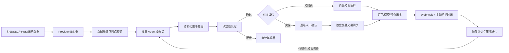

# NEXUS 个人 AI 投资平台设计规格

- 日期：2026-08-22
- 状态：已完成分节设计确认，等待书面规格复核
- 目标用户：单一私人用户
- 首期市场：美股
- 投资风格：中长期持有为主，兼顾波段交易

## 1. 目标与边界

NEXUS 是一个私人、单用户的 AI 辅助投资平台。它将行情、财报、宏观数据和现有持仓整理为可追溯的研究证据，由多个投资 Agent 形成结构化策略意图，再由不可被 Agent 修改的确定性风控决定是否允许进入模拟或实盘执行流程。

平台首先用于研究和模拟交易，不以全自动实盘为首期目标。实盘即使未来启用，也必须逐笔人工确认。系统提供决策辅助、回测和执行基础设施，不承诺收益，也不把模型生成内容视为投资事实。

### 1.1 首期范围

- 美股行情、SEC 财报和宏观数据采集与质量检查。
- 盘中指示性行情和波动提醒；它只用于监控，不直接触发首期交易决策。
- 流动性良好的美国大盘股、超大盘股和主流非杠杆 ETF 的版本化白名单。
- 多 Agent 研究、证据审计、组合建议和每日简报。
- 以 10,000 美元为初始资金的自动模拟盘。
- 时点正确的回测、基准比较、绩效归因和策略进化实验室。
- 复星国际 `00656.HK` 现有约 9 万价值持仓的只读展示；具体币种和市值以券商返回为准。
- 风控、订单、成交、Agent 调用和策略版本的完整审计。

### 1.2 明确不在首期范围

- Agent 直接调用券商下单接口。
- 无人值守的实盘交易或策略自动晋级实盘。
- 高频、日内或毫秒级交易。
- 期权、期货、外汇、加密资产、融资融券和卖空。
- 社交交易、多人协作、公开组合或付费投顾功能。
- 让向量检索、LLM 输出或当前网页价格成为权威会计与交易事实。

## 2. 已确认的产品原则

1. **研究可进化，交易边界不可进化。** Agent 可以生成和优化因子、规则、提示词及角色协作，但不能修改硬风控、密钥权限、人工批准要求、审计规则或实盘启用状态。
2. **没有完整证据就观望。** 数据过期、Agent 超时、Schema 不合格或证据矛盾未解决时，不产生新订单。
3. **先模拟、后只读、最后才可能实盘。** 每个阶段都有独立验收门槛，后续阶段不能因为前一阶段成功而自动启用。
4. **所有结论可追溯。** 研究结论必须关联数据版本、证据引用、模型和提示词版本、策略版本及最终订单结果。
5. **交易以确定性系统为准。** Agent 只提交策略意图；订单数量、现金约束、仓位上限和是否可交易均由普通程序规则计算。

## 3. 总体架构

采用“私人 Web 控制台 + Python 投资引擎 + 独立实盘网关”的混合架构。首期保持模块化单体，不拆成大量微服务；权限和故障域需要隔离的实盘网关除外。

### 3.1 Web 控制台

- 使用当前项目的 Next/vinext Web 应用承载私人界面。
- 负责身份验证、查询展示、人工批准和配置操作，不保存或接触明文密钥。
- 通过认证后的服务 API 调用 Python 投资引擎。
- 所有危险操作均需要服务端重新校验，不能依赖前端按钮状态。

### 3.2 Python 投资引擎

建议使用 FastAPI 暴露内部接口，并按单一职责划分模块：

- `providers`：行情、SEC、宏观和账户数据适配器。
- `quality`：数据新鲜度、完整性、异常值和时点契约校验。
- `research`：因子计算、财报解析、证据索引和个股研究包。
- `agents`：Agent 角色、工具、Schema、编排和评测。
- `strategy`：将 Agent 研究转为标准策略意图。
- `risk`：确定性仓位、现金、行业和回撤规则。
- `backtest`：时点回测、基准、成本模型和结果归档。
- `paper`：模拟订单、成交、现金和持仓账本。
- `reconciliation`：订单事件消重、主动查询和状态修复。
- `evolution`：实验、挑战者、影子组合和冠军晋级。
- `audit`：统一事件、调用、批准与变更记录。

定时任务使用数据库 lease 保证同一作业只被一个实例执行，状态变更使用 transaction + outbox，避免“数据库已写入但事件未发送”的不一致。

### 3.3 独立实盘网关

实盘网关使用单独的进程、服务账户、密钥域和网络出口。研究 Agent 进程不能访问它的凭据，也不能调用它的交易函数。网关只接受：

- 已通过确定性风控的规范化订单；
- 有效且未过期的人工批准；
- 匹配的策略、账户和幂等标识；
- 系统处于非熔断且对账一致状态。

复星接口若要求 IP 白名单、客户端公钥或 ECDH/AES-GCM 协议，网关部署在固定出口 IP 的隔离环境中实现这些要求。

## 4. 数据与时点契约

### 4.1 数据源

- **行情：** 通过 Provider 接口接入免费或低成本数据。首期可使用 Alpaca Basic/IEX 的流式或轮询数据提供盘中指示性行情和波动提醒；界面必须明确它不是全市场 consolidated quote，不能伪装成完整市场实时价格。收盘策略仍等待日线数据完整并通过质检，不被盘中提醒直接触发。
- **财报：** SEC EDGAR/XBRL 为美股公司文件的权威原始来源，保存原文、解析结果、提交时间和引用位置。
- **宏观：** FRED/ALFRED；回测优先使用可获得时点对应的 vintage，避免用后续修订值解释过去。
- **公司行动：** 拆股、分红、合并和退市事件进入独立事件表，并标明价格调整方式。
- **复星：** 轮换密钥后再接入。首个接入阶段仅同步账户、持仓、行情和订单状态，不允许交易。

### 4.2 统一 Provider 接口

借鉴 OpenBB 的 Provider 适配模式，业务模块只依赖统一领域对象，不依赖某一家数据商的响应结构。每个 Provider 必须实现能力声明、限流、重试、新鲜度阈值、原始响应归档和健康状态。

### 4.3 Point-in-time 字段

所有可用于研究或回测的数据至少包含：

| 字段 | 含义 |
| --- | --- |
| `source` | 数据提供方和接口版本 |
| `symbol` | 当时有效的证券标识 |
| `observed_at` | 数值对应的市场或报告时点 |
| `available_at` | 该数据最早可被策略合法使用的时间 |
| `received_at` | 系统实际收到数据的时间 |
| `revision_id` | 修订或 vintage 标识 |
| `adjustment` | 原始、前复权、后复权或其他调整口径 |
| `quality_flags` | 过期、缺失、异常、部分市场等质量标记 |

策略只能读取 `available_at <= decision_time` 的记录。数据质量模块在 Agent 运行前生成完整性清单；关键字段不合格时，该标的直接进入“观望”。

## 5. 投资 Agent 委员会

Agent 委员会采用角色化、对抗式研究，但委员会不是交易执行器。

### 5.1 角色

- **编排 Agent：** 确定研究任务和依赖，汇总各角色结果，不新增未经引用的事实。
- **基本面 Agent：** 分析收入、利润、现金流、资产负债表、估值和管理层披露。
- **价格与市场状态 Agent：** 分析趋势、波动、相对强弱、成交结构和市场 regime。
- **宏观与行业 Agent：** 分析利率、周期、行业暴露及跨资产背景。
- **多头 Agent：** 构建最强正面论证、催化剂和条件性收益路径。
- **空头 Agent：** 主动寻找反例、估值风险、财务质量问题和论点失效条件。
- **证据审计 Agent：** 检查时点、引用、矛盾、提示注入和无来源断言。
- **组合 Agent：** 在已有持仓、相关性和风险预算下提出目标暴露，不计算最终订单数量。

### 5.2 工具与输出限制

- 使用 OpenAI Responses API 的自定义函数工具读取结构化数据和证据。
- Agent 工具集只注册只读研究工具，不注册任何券商交易函数。
- 每类输出使用严格 JSON Schema；解析失败、缺字段或越权动作一律视为“观望”。
- 设置最大工具调用次数、总 token、费用、超时和重试上限。
- 模型、提示词哈希、工具版本、输入数据版本和完整响应均进入审计。
- 提取和分类任务优先使用经评测合格的低成本模型；委员会综合使用经评测合格的强推理模型。具体型号由配置和评测结果决定，避免把易变化的型号写死在业务逻辑中。

### 5.3 标准策略意图

委员会输出不能是自然语言订单，而是包含以下字段的策略意图：

- `decision_id`、`symbol`、`as_of`、`horizon`；
- `stance`：`buy_candidate`、`reduce_candidate`、`hold` 或 `watch`；
- 投资论点、反方论点、关键不确定性和失效条件；
- 带来源与时点的证据引用；
- 建议目标暴露区间，而不是股数；
- 进入条件、退出条件和最晚失效时间；
- 数据质量状态、证据审计结果和委员会分歧；
- 所使用的策略、模型、提示词和数据版本。

## 6. 确定性风险控制

风控服务不调用 LLM，规则必须有普通程序实现和独立测试。平衡型初始规则为：

- 单只股票市值不超过组合净值的 15%。
- 单一行业总市值不超过组合净值的 30%。
- 成交后现金比例不得低于组合净值的 10%。
- 组合从历史高点回撤达到 8% 后，暂停所有新开仓和加仓；减仓和风险退出仍可提交。
- 订单必须属于当前版本白名单并处于可交易时段。
- 订单数量由目标暴露、可用现金、当前持仓和上述上限共同计算。
- 风控服务不可用、持仓未对账或关键行情过期时，拒绝所有新订单。
- 每个决策只能产生一个有效订单链；重试必须复用相同幂等键。

风控结果只有 `approved`、`reduced`、`rejected` 三种，并记录每条命中规则、输入快照和最终允许数量。Agent 不能覆盖结果。

## 7. 模拟交易与实盘交易

### 7.1 模拟盘

- 初始现金为 10,000 美元。
- 收盘后生成信号，最早在下一交易日使用模拟成交，避免同一根 K 线的前视偏差。
- 成交模型包含买卖价差、滑点、费用、不可成交和部分成交。
- 订单、成交、现金、仓位和公司行动使用与未来实盘一致的领域模型。
- 通过风控的模拟订单可自动执行，不需要人工批准。

### 7.2 订单状态机

统一状态至少包括：`proposed`、`risk_rejected`、`risk_approved`、`awaiting_approval`、`submitted`、`partially_filled`、`filled`、`cancelled`、`rejected`、`reconciling`。

所有 Provider Webhook 先验证签名、时间窗和重放 nonce，再使用 Provider 事件 ID 与内部订单 ID 幂等消重。Webhook 只是加速状态更新；主动轮询才是最终补偿机制。内部账本与券商状态不一致时进入 `reconciling`，在恢复一致前禁止新的实盘订单。

### 7.3 实盘批准

实盘功能默认锁定。未来启用后，每笔订单都展示证券、方向、数量、价格类型、最坏风险、策略版本、Agent 论点、风控结果和批准有效期。用户必须在登录状态下逐笔批准，服务端再次验证全部状态后才能交给独立网关。

实盘永不因模拟盘表现、Agent 建议或软件升级而自动打开。

## 8. 回测、绩效比较与策略进化

### 8.1 回测协议

- 使用滚动训练、验证和完全样本外测试；验证集用于选择，测试集只用于最终报告。
- 收盘信号使用下一交易日成交模型。
- 处理价差、滑点、费用、公司行动、退市和证券池历史版本。
- 对参数、成本和成交假设做敏感性分析。
- 固定原始数据快照、代码版本、策略版本和随机种子，保证结果可复现。

### 8.2 比较基准

每个策略至少与以下对象比较：

- SPY 买入并持有；
- 同版本白名单的等权组合；
- 当前生产冠军策略。

指标包含成本后收益、超额收益、年化波动、Sharpe、Sortino、最大回撤、Calmar、尾部风险、Deflated Sharpe、换手率、交易成本占比和成本敏感性。任何晋级结论同时展示绝对表现与相对基准表现。

### 8.3 自进化流程

研发 Agent 可以自动提出候选因子、规则、提示词或角色协作方式，但只能进入以下受控漏斗：

1. 创建不可变实验记录和明确假设。
2. 通过数据泄漏、Schema、复杂度和规则合规检查。
3. 完成 walk-forward 回测及成本敏感性分析。
4. 与 SPY、等权白名单和当前冠军比较。
5. 合格挑战者进入独立影子模拟组合。
6. 达到观察窗口和稳定性要求后，只能自动晋级为新的**模拟盘冠军**。这些阈值属于不可被 Agent 修改的版本化晋级 policy；阶段 2 的实施计划必须在启用前固化最低样本量、观察交易日、成本后相对表现、回撤非劣性和成本敏感性数值。
7. 晋级保留上一版本和一键回滚；失败实验也永久归档，防止重复试错。

实盘策略不接受自动晋级。实盘使用任何新冠军都需要单独人工评审和明确启用。

## 9. 存储设计

### 9.1 PostgreSQL：业务事实源

保存用户配置、Provider 状态、策略、实验、决策、批准、订单、成交、现金、持仓和审计事件。订单与成交使用追加式账本；更正通过补偿事件完成，不覆盖历史。

### 9.2 对象存储：原始证据与产物

保存原始 Provider 响应、SEC 文档、解析快照、回测报告、模型响应和提示词快照。对象元数据包含来源、时间、内容哈希、Schema 版本和保留策略。

### 9.3 Parquet + DuckDB：分析层

保存时点特征、价格序列和回测快照。研究任务可使用 DuckDB 高效扫描 Parquet；生产交易只读取已发布并通过质量校验的数据版本。

### 9.4 向量索引：辅助检索

只用于定位财报或公告段落并返回原文引用。金额、比率、仓位、订单和风控字段必须来自结构化事实源。单用户首期不引入 Redis；调度 lease、outbox 和缓存优先由 PostgreSQL 实现。

## 10. 产品页面与每日运行

### 10.1 页面

- **投资总览：** 模拟盘净值、成本后超额收益、回撤、现金、集中度、盘中指示性波动提醒和数据可信度。
- **每日 Agent 简报：** 市场状态、主要风险、候选、被否决交易及原因。
- **个股研究室：** 时点财务、SEC 原文引用、价格因子、多空辩论和失效条件。
- **策略进化实验室：** 冠军/挑战者、样本外绩效、失败实验、晋级理由和回滚。
- **美股模拟盘：** 订单、成交、持仓、现金、滑点和决策版本。
- **风险与审计：** 风控命中、数据质检、Agent 调用成本、决策回放和异常。
- **实盘批准：** 默认锁定；启用后逐笔批准并显示完整风险信息。
- **数据与集成：** 只显示配置状态、权限、延迟、最后成功时间和轮换状态，永不回显密钥。

### 10.2 每日时序

1. 美股收盘后等待数据完整窗口。
2. 采集行情、SEC 更新、宏观数据和组合状态。
3. 执行质量检查并冻结本次决策的数据版本。
4. 并行运行研究角色，再执行证据审计和组合综合。
5. 生成结构化策略意图并运行确定性风控。
6. 合格模拟订单排队，在下一交易日按成交模型执行。
7. 更新订单、持仓、绩效、归因和审计记录。
8. 研发任务在独立资源池运行，不阻塞每日生产流程。

## 11. 故障处理与可观测性

| 故障 | 默认行为 |
| --- | --- |
| 行情、财报或持仓过期 | 不产生新订单，界面显示来源和最后成功时间 |
| Agent 超时、超预算或输出不合格 | 该标的观望，不使用部分报告触发交易 |
| 风控服务不可用 | 拒绝全部新订单；继续监控已有持仓 |
| Webhook 丢失、重复或乱序 | 幂等消重并主动轮询补偿 |
| 订单与券商状态不一致 | 进入对账状态，冻结新实盘订单 |
| 数据库或对象存储不可用 | 停止新决策和执行，保留告警与恢复记录 |
| 模型或 Provider 限流 | 有界退避重试；超过时限后观望，不切换到未经评测的来源 |

可观测指标包括任务延迟、数据新鲜度、Provider 错误率、Agent 成功率和费用、Schema 失败、风控拒绝原因、订单状态延迟、对账差异、组合风险和策略漂移。关键事件产生告警并关联审计 ID。

## 12. 安全与隐私

- 单用户私有认证；所有 API 再做服务端授权。
- OpenAI、数据源和券商密钥只存在于服务端 secret manager 或运行时环境变量中，不进入浏览器、提示词、数据库明文、日志或错误消息。
- 研究密钥和实盘券商密钥属于不同 secret domain；实盘密钥只对独立网关可见。
- 发到当前对话的复星 API Key 已视为泄露。必须在复星后台吊销并轮换；轮换完成前不得连接、验证或保存该 Key。
- Webhook 验证签名、时间窗、nonce 和幂等 ID；如接口支持，增加来源 IP allowlist。
- SEC 文档和新闻属于不可信输入；Agent 评测覆盖提示注入，文档内容不得改变系统指令或工具权限。
- 审计账本追加写入，并通过连续哈希或等价不可篡改机制检测修改。
- 备份覆盖 PostgreSQL 和对象存储；恢复演练是进入模拟盘和实盘阶段的门禁。
- 提交代码、日志和回测产物前运行秘密扫描；任何发现的真实凭据都必须立即轮换。

## 13. 测试策略

### 13.1 规则与契约测试

- 风控、仓位计算、现金、交易日和订单状态机的单元测试。
- 属性测试验证任何输入下都不能突破单股、行业、现金和重复订单不变量。
- Provider 使用脱敏 golden fixtures 做契约测试，不依赖真实密钥或实时接口。
- Point-in-time 泄漏测试确保策略看不到 `available_at` 晚于决策时间的数据。

### 13.2 执行与恢复测试

- Webhook 重复、乱序、延迟、签名错误和重放攻击测试。
- 订单提交超时、部分成交、拒单、撤单和主动查询恢复测试。
- 数据陈旧、Agent 超时、风控宕机、数据库中断和对账差异的故障演练。
- 端到端模拟盘流程测试；默认不运行真实下单的自动化端到端测试。

### 13.3 回测与 Agent 测试

- 固定数据和随机种子的确定性回测快照。
- 费用、滑点、证券池和公司行动的独立校验。
- Agent 评测覆盖证据引用、Schema、应当弃权、矛盾事实、提示注入和越权下单请求。
- 新模型、提示词、工具或策略必须通过离线评测和影子模拟，不能直接替换冠军。

## 14. 分阶段交付与验收

### 阶段 0：研究只读

实现数据契约、质量检查、个股研究、Agent 简报、回测和审计。验收条件是固定样例可复现、无时点泄漏、Agent 输出有引用且不合格时正确观望。

### 阶段 1：自动模拟盘

实现确定性风控、10,000 美元模拟账本、下一交易日成交、绩效比较和故障演练。验收条件是风控不变量、重复订单不变量、账本平衡和主动对账全部通过。

### 阶段 2：策略进化实验室

实现实验记录、walk-forward、冠军/挑战者、影子组合、自动模拟晋级和回滚。验收条件是失败实验可追溯、晋级可解释且实盘策略不受影响。

### 阶段 3：复星只读接入

前提是旧 Key 已吊销并轮换。实现独立网关、账户/持仓/行情/订单状态同步和对账，不实现交易。验收条件是权限最小化、静态出口配置、签名协议、断线恢复和审计通过。

### 阶段 4：人工批准实盘

需要用户未来再次明确授权，并另行编写实盘安全与运维规格。完成沙盒或测试账户验证、恢复演练、批准过期、kill switch 和小额限额后，才允许逐笔人工批准交易。永不启用全自动实盘。

本主规格描述所有阶段的稳定接口和安全边界。第一个实施计划只覆盖阶段 0 和阶段 1；阶段 2、3、4 在各自进入前分别形成更细的实施计划，其中阶段 4 还必须重新进行安全设计确认。

## 15. 借鉴的行业框架

本项目借鉴成熟项目的模式，不直接把多个大型框架拼接成生产系统：

- [OpenBB](https://github.com/OpenBB-finance/OpenBB)：Provider 适配和统一金融数据接口。
- [Microsoft Qlib](https://github.com/microsoft/qlib)：研究数据集、实验、回测和模型管理思路。
- [TradingAgents](https://github.com/TauricResearch/TradingAgents)：角色化、多空对抗的研究委员会。
- [vn.py](https://github.com/vnpy/vnpy) 与 [LEAN](https://github.com/QuantConnect/Lean)：事件驱动订单、成交、持仓和券商网关边界。
- [RD-Agent](https://github.com/microsoft/RD-Agent)：研究假设、实验记录和研发 Agent 漏斗。
- [FinRL](https://github.com/AI4Finance-Foundation/FinRL) 与 [FinGPT](https://github.com/AI4Finance-Foundation/FinGPT)：作为研究参考，不在首期引入强化学习或自行训练金融大模型。

最终原则是：借鉴接口和验证思想，保持首期系统小、可测、可审计，并让未来替换数据源、模型或券商时不破坏策略与风险边界。

## 16. 成功标准

阶段 0 和阶段 1 完成后，平台应做到：

- 每个交易日基于经质检的美股数据生成可引用、可回放的研究简报。
- 任何新模拟订单都能追溯到数据、Agent、策略和风控版本。
- 任何异常数据、Agent 失败或风控故障都不会产生新订单。
- 回测使用合法时点数据，并能与 SPY、等权白名单和冠军策略比较成本后表现。
- 10,000 美元模拟盘自动运行，订单、成交、现金和持仓账本一致。
- 策略实验能在不改变硬风控和实盘权限的前提下产生挑战者。
- 真实券商凭据不出现在浏览器、模型输入、代码、数据库明文或日志中。
