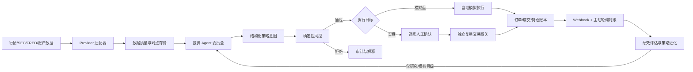

# NEXUS 个人 AI 投资平台设计规格

- 日期：2026-08-22
- 版本：v2（严格架构复审版）
- 状态：已完成架构复审修订，等待最终书面确认
- 目标用户：单一私人用户
- 首期市场：美股
- 投资风格：中长期持有为主，兼顾波段交易

## 0. 架构复审结论与修正

首版方向正确，但还不能直接生成实施计划：它描述了“要有什么”，没有完整规定“代码如何分层、数据由谁拥有、接口如何认证、状态如何转换、页面在异常时显示什么”。本版关闭以下会导致返工或安全事故的问题。

| 严重度 | 首版问题 | 本版决定 |
| --- | --- | --- |
| P0 | 规格指定 PostgreSQL，但仓库骨架是 D1/Drizzle，存在双事实源风险 | Python 引擎唯一拥有 PostgreSQL；Web 不使用 D1。现有 D1/Drizzle 文件在阶段 0 删除 |
| P0 | Web 到 Python 引擎缺少身份与重放保护协议 | 浏览器只访问同源 BFF；BFF 使用 HMAC、时间戳、nonce 和正文哈希调用引擎 |
| P0 | 当前原型把港股持仓、模拟盘和 HKD 净值混为一个组合 | 美股模拟组合与复星只读持仓完全分账、分币种展示；没有可靠 FX 时禁止合并净值 |
| P0 | “Agent 自进化”可能退化为生成任意代码并直接运行 | 只允许生成受限策略 DSL、因子参数或提示词候选；禁止执行 Agent 生成的任意 Python/SQL/Shell |
| P0 | 订单的成交价格、状态转换和幂等语义不完整 | 固化下一交易日 09:30–09:35 ET VWAP 模型、状态机、唯一键和失败行为 |
| P0 | 没有代码级 API、实体和仓库边界 | 新增 REST/OpenAPI 契约、核心表、共享 Schema、目录结构与模块依赖规则 |
| P1 | 对整个股票池运行完整 Agent 委员会，成本和延迟不可控 | 改为确定性筛选 → 轻量研究 → Top-K 完整辩论的分层漏斗，并设置每日硬预算 |
| P1 | “AI 置信度”和“组合健康分”没有校准定义 | 页面不展示伪精确分数；改为证据完整度、委员会分歧和明确风险限额余量 |
| P1 | ETF 行业穿透、证券代码变更和退市处理不明确 | 增加稳定 `instrument_id`、代码有效期和版本化 ETF 行业权重；数据过期即阻止新订单 |
| P1 | 页面只有名称，没有路由、状态、动作和权限 | 新增页面路由表、全局状态栏、空/错/旧/锁定状态和组件边界 |
| P1 | Sites Web 与 Python/对象存储的生产拓扑不明确 | Web 部署到 Sites；引擎使用 OCI 容器；本地使用 Docker Compose；R2 仅由引擎通过 S3 API 访问 |

本版仍是主架构规格，但可直接用于生成阶段 0–1 的实施计划。阶段 2–4 只保留稳定接口与门禁，不在首轮代码计划中展开。

## 1. 目标与边界

NEXUS 是一个私人、单用户的 AI 辅助投资平台。它将行情、财报、宏观数据和现有持仓整理为可追溯的研究证据，由多个投资 Agent 形成结构化策略意图，再由不可被 Agent 修改的确定性风控决定是否允许进入模拟或实盘执行流程。

平台首先用于研究和模拟交易，不以全自动实盘为首期目标。实盘即使未来启用，也必须逐笔人工确认。系统提供决策辅助、回测和执行基础设施，不承诺收益，也不把模型生成内容视为投资事实。

### 1.1 首轮实施范围（阶段 0–1）

- 美股行情、SEC 财报和宏观数据采集与质量检查。
- 盘中指示性行情和波动提醒；它只用于监控，不直接触发首期交易决策。
- 流动性良好的美国大盘股、超大盘股和主流非杠杆 ETF 的版本化白名单。
- 多 Agent 研究、证据审计、组合建议和每日简报。
- 以 10,000 美元为初始资金的自动模拟盘。
- 时点正确的回测、基准比较和绩效归因；策略页在阶段 2 前只展示 baseline 和阶段锁。
- 风控、订单、成交、Agent 调用和策略版本的完整审计。

### 1.2 后续门禁范围

- 阶段 2：策略进化实验室、挑战者影子组合和自动模拟冠军晋级。
- 阶段 3：复星国际 `00656.HK` 现有约 9 万价值持仓的只读展示；具体币种和市值以券商返回为准。
- 阶段 4：逐笔人工批准的实盘订单；进入前重新确认安全与运维规格。

### 1.3 明确不在产品范围

- Agent 直接调用券商下单接口。
- 无人值守的实盘交易或策略自动晋级实盘。
- 高频、日内或毫秒级交易。
- 期权、期货、外汇、加密资产、融资融券和卖空。
- 社交交易、多人协作、公开组合或付费投顾功能。
- 让向量检索、LLM 输出或当前网页价格成为权威会计与交易事实。

## 2. 已确认的产品原则

1. **研究可进化，交易边界不可进化。** Agent 可以生成和优化因子、规则、提示词及角色协作，但不能修改硬风控、密钥权限、人工批准要求、审计规则或实盘启用状态。
2. **没有完整证据就观望。** 数据过期、Agent 超时、Schema 不合格或证据矛盾未解决时，不产生新订单。
3. **先模拟、后只读、最后才可能实盘。** 每个阶段都有独立验收门槛，后续阶段不能因为前一阶段成功而自动启用。
4. **所有结论可追溯。** 研究结论必须关联数据版本、证据引用、模型和提示词版本、策略版本及最终订单结果。
5. **交易以确定性系统为准。** Agent 只提交策略意图；订单数量、现金约束、仓位上限和是否可交易均由普通程序规则计算。

## 3. 总体架构

采用“私人 Web 控制台 + Python 投资引擎 + 独立实盘网关”的混合架构。首期保持模块化单体，不拆成大量微服务；权限和故障域需要隔离的实盘网关除外。



### 3.1 Web 控制台

- 使用当前 Next/vinext + React + TypeScript 项目，部署到 OpenAI Sites。
- 页面和浏览器只访问同源的 Next Route Handler/BFF，禁止从浏览器直接访问 Python 引擎。
- 每个受保护页面和 BFF 路由调用现有 `requireChatGPTUser()`，并将 `userId` 与服务器环境变量 `NEXUS_ALLOWED_USER_ID` 做常量时间比较。生产环境缺少 allowlist 时启动失败。
- 身份头只在 Sites 服务端可信；BFF 不接受浏览器自行提交的 `oai-authenticated-*` 头。
- BFF 到 Python 引擎的请求使用服务端 HMAC 签名，签名覆盖 method、path、timestamp、nonce 和 body SHA-256。引擎拒绝超过 60 秒、nonce 已使用或签名错误的请求。
- 负责查询展示、人工批准和配置操作，不保存或接触明文 Provider 密钥。
- 所有写操作校验 `Origin`、登录身份、权限、幂等键和最新资源版本；不能依赖前端按钮状态。
- Server Component 默认负责读取；只有图表、筛选器、确认对话框和实时刷新使用 Client Component。

### 3.2 Python 投资引擎

使用 Python 3.12、FastAPI、Pydantic 2、SQLAlchemy 2、Alembic 和 PostgreSQL。依赖由 `uv.lock` 固定；引擎镜像运行两个进程角色：无状态 `api` 和领取数据库任务的 `worker`。它们共享代码与数据库，不使用 Redis、Celery 或第二套消息系统。

Provider HTTP 使用 `httpx`，分析数据使用 Polars + PyArrow + DuckDB，交易日历使用 `exchange-calendars`，模型调用使用 OpenAI 官方 Python SDK。阶段 0–1 自建小型事件驱动回测器并复用生产策略/风控/成交领域函数，不直接嵌入 Qlib、LEAN、vn.py 或 TradingAgents 运行时。

模块按单一职责划分：

- `providers`：行情、SEC、宏观和账户数据适配器。
- `quality`：数据新鲜度、完整性、异常值和时点契约校验。
- `research`：因子计算、财报解析、证据索引和个股研究包。
- `agents`：Agent 角色、工具、Schema、编排和评测。
- `strategy`：将 Agent 研究转为标准策略意图。
- `risk`：确定性仓位、现金、行业和回撤规则。
- `backtest`：时点回测、基准、成本模型和结果归档。
- `paper`：模拟订单、成交、现金和持仓账本。
- `reconciliation`：订单事件消重、主动查询和状态修复。
- `evolution`：实验、挑战者、影子组合和冠军晋级。
- `audit`：统一事件、调用、批准与变更记录。

定时任务使用数据库 lease 保证同一作业只被一个实例执行，状态变更使用 transaction + outbox，避免“数据库已写入但事件未发送”的不一致。

模块依赖方向固定为 `providers -> quality/research -> agents/strategy -> risk -> paper`。`risk` 不得依赖 `agents` 的内部实现，`paper` 不得调用 LLM，`providers` 不得写订单表。跨模块只传 Pydantic 领域对象或数据库 ID。

### 3.3 独立实盘网关

实盘网关使用单独的进程、服务账户、密钥域和网络出口。研究 Agent 进程不能访问它的凭据，也不能调用它的交易函数。网关只接受：

- 已通过确定性风控的规范化订单；
- 有效且未过期的人工批准；
- 匹配的策略、账户和幂等标识；
- 系统处于非熔断且对账一致状态。

阶段 3 开始前必须把届时有效的复星官方 OpenAPI/SDK 版本、权限清单、签名/加密算法、Webhook 语义、限流和错误码冻结为 Provider contract，并取得官方 test vector 或沙盒响应。IP 白名单、客户端公钥、ECDH/AES-GCM 等要求只按该冻结版本实现，不根据当前网页描述自行猜测密码学细节。网关部署在固定出口 IP 的隔离环境中；没有可验证沙盒或测试向量时只能做账户只读轮询，不能启用交易。

### 3.4 运行与部署拓扑

**本地开发：**

- `npm run dev` 启动 Web。
- `docker compose up` 启动 PostgreSQL、MinIO、Python API 和 Python worker。
- Web 通过 loopback BFF 调用引擎；`NEXUS_AUTH_MODE=dev` 仅允许在非生产且绑定 loopback 时注入固定开发用户。
- Provider 默认为 fixture 模式，没有 OpenAI 或行情 Key 也能完成测试和页面开发。

**首期生产：**

- Web：OpenAI Sites 私有站点；`.openai/hosting.json` 的 D1/R2 binding 保持 `null`，避免 Web 成为第二数据拥有者。
- 引擎：单个 OCI 镜像部署在具备持久网络与定时任务能力的 Linux 容器环境；`api` 与 `worker` 使用同一镜像不同命令。
- 数据：托管 PostgreSQL；对象存储使用 S3 兼容接口。生产可使用 R2，但只允许 Python 引擎凭据访问。
- 网络：引擎 HTTPS 入口只接受 HMAC 服务请求和健康检查；管理文档、数据库和对象存储不暴露公网。
- 阶段 3 前将复星网关拆到独立容器、独立服务账户和固定出口 IP；阶段 0–2 不部署实盘凭据。

### 3.5 代码目录与所有权

实施后仓库保持单仓库、双运行时：

```text
app/                         # Next 页面、布局、BFF Route Handlers
  (protected)/               # 需要登录与 allowlist 的页面组
  api/v1/                    # 浏览器同源 BFF；不含业务规则
  components/                # 页面组件与状态组件
  lib/generated/             # 从引擎 OpenAPI 生成的 TS 客户端
worker/                      # Sites/vinext 平台入口，仅基础设施适配
engine/
  pyproject.toml
  uv.lock
  src/nexus/
    api/                     # FastAPI 路由、认证、错误映射
    domain/                  # 无框架领域模型与不变量
    providers/ quality/ research/ agents/
    strategy/ risk/ backtest/ paper/ jobs/ audit/
    persistence/             # SQLAlchemy repository 与 Alembic
  tests/                     # unit/contract/integration
contracts/
  agent/                     # Agent JSON Schema 与版本
  strategy/                  # 受限策略 DSL Schema
infra/
  compose.yaml               # 本地 PostgreSQL、MinIO、API、worker
  env.example                # 变量名和说明；绝不包含值
tests/                       # Web 单元、可访问性与端到端测试
docs/                        # 规格、ADR、运行手册
```

Python 引擎是业务逻辑和 PostgreSQL 的唯一拥有者。当前 `db/`、`drizzle/`、`drizzle.config.ts`、D1 示例与旧 starter skeleton 测试属于脚手架，阶段 0 基础提交中删除；不得迁移为另一套生产数据库。

## 4. 数据与时点契约

### 4.1 数据源

- **行情：** 通过 Provider 接口接入免费或低成本数据。首期使用 Alpaca Basic/IEX 流提供盘中指示性行情；Basic 的 IEX 只覆盖单一交易所且 WebSocket 最多 30 个 symbol，界面必须明确它不是 consolidated quote。收盘策略、回测和模拟成交使用 `feed=sip` 且查询 `end <= now - 15 minutes` 的历史 bar，等待全市场延迟数据合法可用后再运行，不被 IEX 提醒直接触发。依据：[Alpaca 数据计划](https://docs.alpaca.markets/us/docs/about-market-data-api)、[实时股票流](https://docs.alpaca.markets/us/docs/real-time-stock-pricing-data)、[Market Data FAQ](https://docs.alpaca.markets/us/docs/market-data-faq)。
- **财报：** SEC EDGAR submissions/companyfacts/XBRL 为美股公司文件的权威原始来源，保存原文、解析结果、提交时间和引用位置。批量初始化优先使用 SEC nightly bulk archives；增量请求全局限速 5 req/s、携带可联系的 User-Agent，低于 SEC 当前 10 req/s 的公平访问上限。依据：[SEC EDGAR APIs](https://www.sec.gov/search-filings/edgar-application-programming-interfaces)、[SEC Developer Resources](https://www.sec.gov/about/developer-resources)。
- **宏观：** `macro_series_v1` 固定为 `DFF, DGS2, DGS10, CPIAUCSL, UNRATE, INDPRO, VIXCLS`。FRED/ALFRED 回测使用对应 vintage 和 real-time period；只有 release date、没有可靠发布时间的记录保守地从下一个美股交易日开始可用。依据：[FRED 与 ALFRED](https://fred.stlouisfed.org/docs/api/fred/fred_vs_alfred.html)、[Real-Time Periods](https://fred.stlouisfed.org/docs/api/fred/realtime_period.html)。
- **公司行动：** 使用 Alpaca 当前 [`/v1/corporate-actions`](https://docs.alpaca.markets/us/reference/corporateactions-1) 数据接口，保存 `data_quality`、process/ex/record/payable date 和 Provider 事件 ID；拆股、分红、合并、改名、重组和 worthless removal 进入独立事件表。只使用 `complete` 记录驱动账本，`all` 记录仅作预警。
- **复星：** 轮换密钥后再接入。首个接入阶段仅同步账户、持仓、行情和订单状态，不允许交易。
- **离线 fixture：** 每个 Provider 提供一组脱敏、固定日期、覆盖正常/缺失/修订/限流响应的 fixture。开发、CI 和演示默认使用 fixture，不能静默访问真实账户。

### 4.2 统一 Provider 接口

借鉴 OpenBB 的 Provider 适配模式，业务模块只依赖统一领域对象，不依赖某一家数据商的响应结构。每个 Provider 必须实现：

- `capabilities()`：市场、资产类别、粒度、实时性、复权和许可说明；
- `fetch(request, cursor)`：有界分页和可恢复 cursor；
- `normalize(raw)`：转换为版本化领域 Schema；
- `freshness_policy()`：按数据类型返回允许延迟；
- `health()`：最后成功、限流窗口、错误分类和降级状态；
- `license_policy()`：允许的保存期限、衍生使用和展示范围；首期只用于私人单用户界面，不提供原始数据导出或再分发；
- 原始响应归档、指数退避、`Retry-After`、请求 ID 和调用审计。

Provider 的网络错误只能由适配器重试；上层业务不得自行无限重试。所有重试有最大次数和绝对 deadline。

### 4.3 Point-in-time 字段

所有可用于研究或回测的数据至少包含：

| 字段 | 含义 |
| --- | --- |
| `source` | 数据提供方和接口版本 |
| `symbol` | 当时有效的证券标识 |
| `observed_at` | 数值对应的市场或报告时点 |
| `available_at` | 该数据最早可被策略合法使用的时间 |
| `received_at` | 系统实际收到数据的时间 |
| `revision_id` | 修订或 vintage 标识 |
| `adjustment` | 原始、前复权、后复权或其他调整口径 |
| `quality_flags` | 过期、缺失、异常、部分市场等质量标记 |

策略只能读取 `available_at <= decision_time` 的记录。数据质量模块在 Agent 运行前生成完整性清单；关键字段不合格时，该标的直接进入“观望”。

### 4.4 证券主数据与股票池

- 内部始终使用不可变 `instrument_id`，ticker 只是一段带 `valid_from/valid_to` 的别名。
- 首期股票池是显式、版本化快照，最多 120 个美国普通股和 20 个非杠杆主流 ETF；不在运行时自动读取“当前指数成分”回填历史。
- 首期排除 OTC、优先股、权证、杠杆/反向 ETF、ADR、非美国公司和价格低于 5 美元的证券。
- 每个快照保存生效日、纳入/移除原因、数据来源和内容哈希。回测使用当日有效快照，不能使用今天的白名单回测过去。
- 初始 ETF 观察集合固定为 `SPY, QQQ, IWM, DIA, VTI, TLT, GLD`；它们仍受单品种 15% 上限。权益 ETF 必须通过受控 CSV 导入发行人披露的行业权重，字段固定为 `instrument_id, sector_code, weight, as_of, source_url, content_hash`，权重合计容差为 99.5%–100.5%。阶段 0–1 不写脆弱的网页抓取器。
- 股票行业使用内部版本化 `NEXUS_SECTOR_V1`，固定 11 个标签：`communication_services, consumer_discretionary, consumer_staples, energy, financials, health_care, industrials, information_technology, materials, real_estate, utilities`。映射 CSV 固定字段为 `instrument_id, sector_code, valid_from, valid_to, source_url, override_reason, content_hash`，不依赖需要额外授权的分类数据。权益 ETF 行业权重超过 30 个自然日未更新时可展示但禁止新增订单。`TLT` 和 `GLD` 分别进入 `US_TREASURY`、`GOLD` 非权益风险桶，不参与 11 行业上限，但仍受单品种和现金上限。
- 拆股、ticker 变更、并购和退市通过 `instrument_id` 关联历史，禁止按 ticker 直接拼接时间序列。

### 4.5 数据质量门禁

每个策略版本声明 `required_inputs`、字段容忍缺失率和 `max_age`。质量报告只返回：

- `PASS`：所有交易所需输入满足时点、新鲜度、完整性和一致性要求；
- `PARTIAL`：允许展示研究，但禁止产生新仓位；
- `FAIL`：研究页显示失败原因，Agent 不运行。

日线交易数据必须覆盖最近一个已结束交易日，且 session calendar、OHLCV、复权和公司行动检查一致。财报数据以 SEC `filedAt/acceptedAt` 推导 `available_at`，不能用报告期结束日作为可用日。所有冻结快照拥有唯一 `data_snapshot_id` 和内容哈希，后续决策只引用该 ID。

### 4.6 SEC 财务事实规范化

阶段 0 只规范化以下 canonical facts：`revenue, gross_profit, operating_income, net_income, operating_cash_flow, capital_expenditure, total_assets, total_liabilities, stockholders_equity, diluted_shares, diluted_eps`。每条事实保存原始 taxonomy/tag、unit、period start/end、fiscal year/period、form、filed/accepted time、accession number 和 frame。

选择规则固定为：同一 canonical fact/period 只选择在 `decision_time` 前已 accepted 的最新 filing；后续 amendment/restatement 创建新 revision，不覆盖旧值；duration fact 不与 instant fact混用，季度、TTM 和年度值分别计算。无法在多个 tag 中唯一映射、unit 不一致或 period 重叠时返回缺失和质量原因，不由 LLM 猜值。XBRL 计算只使用 Decimal，并保留从 canonical fact 回到原始 filing 的证据链。

## 5. 投资 Agent 委员会

Agent 委员会采用角色化、对抗式研究，但委员会不是交易执行器。

### 5.1 角色

- **编排 Agent：** 确定研究任务和依赖，汇总各角色结果，不新增未经引用的事实。
- **基本面 Agent：** 分析收入、利润、现金流、资产负债表、估值和管理层披露。
- **价格与市场状态 Agent：** 分析趋势、波动、相对强弱、成交结构和市场 regime。
- **宏观与行业 Agent：** 分析利率、周期、行业暴露及跨资产背景。
- **多头 Agent：** 构建最强正面论证、催化剂和条件性收益路径。
- **空头 Agent：** 主动寻找反例、估值风险、财务质量问题和论点失效条件。
- **证据审计 Agent：** 检查时点、引用、矛盾、提示注入和无来源断言。
- **组合 Agent：** 在已有持仓、相关性和风险预算下提出目标暴露，不计算最终订单数量。

### 5.2 分层运行流程与成本上限

完整委员会不能对全部股票逐一运行。每日流程固定为：

1. **确定性筛选：** 普通程序对整个版本化股票池计算数据质量和 `baseline_v1` 明确定义的流动性、200 日趋势、126 日收益及排名，不调用 LLM。阶段 0–1 不增加未写入策略版本的隐含打分。
2. **轻量研究：** 对排序前 12 名、全部现有模拟持仓和出现重大新 SEC 文件的标的生成标准证据包；同一标的去重后最多 20 个。
3. **完整辩论：** 只对轻量研究前 5 名，以及存在明确减仓风险的持仓，运行基本面、市场状态、多头、空头、证据审计和组合综合。
4. **预算降级：** 持仓风险分析优先于新候选。达到 `AGENT_DAILY_BUDGET_USD` 后不再创建调用，剩余标的标记 `budget_exhausted/watch`，不能用缺失分析下单。

初始每日硬预算为 3 美元，可由用户在服务端配置中修改；修改进入审计。每次 Response 设置绝对超时、最大工具调用数和 token 上限。失败重试最多一次，且必须复用相同输入快照；重试仍失败则观望。

`model_configs` 保存模型 ID、输入/输出 token 单价、计价生效日和 `pricing_version`。入队前按最大 token 预留预算，完成后按 API usage 结算；价格配置过期或缺失时停止新 Agent 调用，不把估算成本伪装成账单金额。

编排使用 OpenAI 官方 SDK 与 Responses API 直接实现显式状态机，不在阶段 0–1 引入 LangChain、LangGraph 或另一套持久化运行时。状态固定为 `prepared -> running -> validated -> audited -> synthesized -> completed`，任何步骤可进入 `failed` 或 `abstained`，终态不可原地覆盖。

### 5.3 工具与输出限制

- 使用 OpenAI [Responses API 自定义函数工具](https://developers.openai.com/api/reference/cli/resources/responses/methods/create)读取结构化数据和证据，并使用[严格 JSON Schema 输出](https://developers.openai.com/api/reference/cli/resources/beta/subresources/responses)。
- Agent 工具集只注册只读研究工具，不注册任何券商交易函数。
- 每类输出使用严格 JSON Schema；解析失败、缺字段或越权动作一律视为“观望”。
- 设置最大工具调用次数、总 token、费用、超时和重试上限。
- 模型、提示词哈希、工具版本、输入数据版本和完整响应均进入审计。
- 提取和分类任务优先使用经评测合格的低成本模型；委员会综合使用经评测合格的强推理模型。具体型号由配置和评测结果决定，避免把易变化的型号写死在业务逻辑中。
- 具体模型由 `OPENAI_EXTRACTION_MODEL` 和 `OPENAI_REASONING_MODEL` 提供；非 fixture 模式缺少配置时启动失败，不允许静默换模型。
- SEC 文档正文作为引用数据传入，与系统指令隔离；任何出现在文档中的“指令”仅可作为文本证据，不能影响工具或权限。

只读工具固定为：`get_security_snapshot`、`get_financial_facts`、`search_filing_evidence`、`get_price_features`、`get_macro_snapshot`、`get_portfolio_exposure`。每个工具只接受明确 ID、日期范围和字段列表，不接受自由 SQL、URL 或文件路径。

### 5.4 标准策略意图

委员会输出不能是自然语言订单，而是包含以下字段的策略意图：

- `schema_version`、`decision_id`、`instrument_id`、显示 ticker、`decision_time`、`data_snapshot_id`、`horizon`；
- `stance`：`buy_candidate`、`reduce_candidate`、`hold` 或 `watch`；
- 最多 5 条投资论点、最多 5 条反方论点、关键不确定性和可机器判断的失效条件；
- 每条论点至少一个 `evidence_ref`，引用对象包含 source、object ID、available_at、原文位置和内容哈希；
- `target_weight_min/max`，取值 0–0.15，不包含股数；
- 结构化进入条件、退出条件和 `valid_until`；
- `quality_status`、证据审计结果、角色投票与委员会分歧；
- 所使用的策略、模型、提示词和数据版本。

前端不得把模型自报的 probability 当作真实概率。首期不显示“置信度 78%”一类未校准数字，只展示：证据完整度 `complete/partial`、委员会投票、分歧原因、数据新鲜度和最终风控状态。

### 5.5 Agent 生成策略的安全表示

研发 Agent 只能输出符合 `contracts/strategy/strategy-dsl.schema.json` 的声明式候选：

- 允许字段：股票池过滤、白名单特征、比较/布尔表达式、排序、调仓频率、持有期、退出规则、参数范围和目标权重方法；
- 特征只能引用引擎注册表中的纯函数及版本，例如 `sma_20`、`revenue_growth_ttm`、`realized_vol_20d`；
- 禁止字段：任意 Python、SQL、Shell、URL、包名、文件路径、网络调用或动态 import；
- DSL 先做 JSON Schema、AST 深度、运算数量、参数范围和 look-ahead 检查，再编译为内部表达式树；
- 编译器不使用 `eval/exec`，运行时只能读取冻结的数据快照。

提示词候选与策略 DSL 分开版本化：策略 DSL 可做确定性历史回测；提示词/模型版本只能做固定评测集和前向影子模拟，不能把今天的模型回放历史后声称为无偏回测。

## 6. 确定性风险控制

风控服务不调用 LLM，规则必须有普通程序实现和独立测试。平衡型初始规则为：

- 首期所有可交易证券（股票和 ETF）单品种市值不超过组合净值的 15%，不为宽基 ETF 设置隐含例外。
- 单一行业穿透市值不超过组合净值的 30%。股票按 `NEXUS_SECTOR_V1` 100% 计入；权益 ETF 按最后合格的版本化行业权重拆分计入。
- 按订单最坏成本计算，成交后现金比例不得低于组合净值的 10%。买单最坏成本使用参考价上浮 100 bps 加费用；实际成交后释放多余预留。
- 组合从历史收盘净值高点回撤达到 8% 后，暂停所有新开仓和加仓；减仓和风险退出仍可提交。只有回撤恢复到 6% 以下且用户在风险页确认后才能解锁，避免阈值附近反复开关。
- 订单必须属于当前版本白名单并处于可交易时段。
- 首期只生成整股订单。订单数量为目标暴露、可用现金、当前持仓、行业穿透和上述最坏成本约束共同允许的向下取整值；新增/加仓不足 100 美元或 1 股时拒绝为 `below_minimum_order`，减仓或清仓不受 100 美元门槛限制。
- 风控服务不可用、持仓未对账或关键行情过期时，拒绝所有新订单。
- 每个决策只能产生一个有效订单链；重试必须复用相同幂等键。
- 待生效公司行动、停牌、无法确定交易日历或 ETF 穿透数据过期时，禁止对应证券的新订单。

每次评估输入必须包含 `risk_policy_version`、冻结组合快照、参考价格、全部待成交订单和数据质量报告。风控结果只有 `approved`、`reduced`、`rejected` 三种，并记录每条命中规则、评估前后暴露、最坏现金和最终允许数量。批量候选按确定性排序逐笔模拟进入组合，排序键为策略优先级、预期目标权重、`instrument_id`，保证同一输入得到相同结果。Agent 不能覆盖结果。

首期参考价格固定为同一 `data_snapshot_id` 中最近完整交易日的合格日线 close；界面和审计标注 feed。风控不读取盘中 `latest_quotes`，以免重跑同一决策得到不同订单。次日实际模拟成交差额由现金预留和执行模型处理。

## 7. 模拟交易与实盘交易

### 7.1 模拟盘

- 初始现金为 10,000 美元。
- 收盘后生成信号，模拟订单类型固定为下一交易日开盘执行的 `market` 意图，不允许使用生成信号当日的价格成交。
- worker 在下一交易日 09:55 ET 以后读取 `feed=sip` 的 09:30–09:35 ET 合格 1 分钟数据，确保已越过 Basic 最近 15 分钟限制。基准价为该窗口 VWAP。模拟成交价为 VWAP 加方向性半买卖价差和 10 bps 基础滑点；没有可用报价时使用 25 bps 保守滑点。参数属于版本化 `execution_model`。
- 单笔最多成交该 5 分钟窗口成交量的 1%；超过部分保留为 `partially_filled`，后续每个 5 分钟窗口使用该窗口自己的 VWAP、价差和滑点继续模拟，16:00 ET 未成交部分取消。
- 如果 10:15 ET 前仍无合格 SIP 分钟数据，订单取消并记录 `missing_fill_data`，不得回退到 IEX 或前一日收盘价。
- 费用按版本化费用表计算，默认佣金为 0，但税费和监管费字段始终存在。金额使用十进制定点数，不使用二进制浮点。
- 订单、成交、现金、仓位和公司行动使用与未来实盘一致的领域模型。
- 通过风控的模拟订单可自动执行，不需要人工批准。

### 7.2 订单状态机

统一状态包括：`proposed`、`risk_rejected`、`risk_approved`、`awaiting_approval`、`submitted`、`partially_filled`、`filled`、`cancelled`、`rejected`、`reconciling`。允许转换固定为：

```text
proposed -> risk_rejected | risk_approved
risk_approved -> submitted                    # 模拟盘
risk_approved -> awaiting_approval             # 实盘
awaiting_approval -> submitted | cancelled | risk_rejected
submitted -> partially_filled | filled | cancelled | rejected | reconciling
partially_filled -> partially_filled | filled | cancelled | reconciling
reconciling -> submitted | partially_filled | filled | cancelled | rejected
```

终态 `risk_rejected/filled/cancelled/rejected` 不可原地修改。任何更正追加新的 `order_event` 或补偿交易。每个订单包含唯一 `client_order_id`；数据库约束为 `(account_id, client_order_id) UNIQUE`。Provider 事件约束为 `(provider, provider_event_id) UNIQUE`。

所有 Provider Webhook 先验证签名、时间窗和重放 nonce，再使用 Provider 事件 ID 与内部订单 ID 幂等消重。Webhook 只是加速状态更新；主动轮询才是最终补偿机制。内部账本与券商状态不一致时进入 `reconciling`，在恢复一致前禁止新的实盘订单。

持仓不是可直接编辑的表单字段，而是成交、现金账本和公司行动投影的结果。每日保存 `position_snapshot` 便于查询，但对账时以不可变事件和券商事实为准重建。

### 7.3 实盘批准

实盘功能默认锁定。未来启用后，每笔订单都展示证券、方向、数量、价格类型、最坏风险、策略版本、Agent 论点、风控结果和批准有效期。用户必须在登录状态下逐笔批准，服务端再次验证全部状态后才能交给独立网关。

实盘永不因模拟盘表现、Agent 建议或软件升级而自动打开。

## 8. 回测、绩效比较与策略进化

### 8.1 回测协议

- 默认要求至少 7 年历史数据。每个 walk-forward 窗口使用 3 年训练、1 年验证和随后 6 个月完全样本外测试，每季度向前滚动；不足 8 个样本外窗口的结果可展示但不得晋级。
- 验证集用于选择参数，样本外测试只用于最终报告；任何看过测试结果后的修改都创建新的实验族，并计入多重尝试校正。
- 收盘信号使用下一交易日成交模型。
- 处理价差、滑点、费用、公司行动、退市和证券池历史版本。
- 对参数、成本和成交假设做敏感性分析。
- 固定原始数据快照、代码版本、策略版本和随机种子，保证结果可复现。
- LLM 不在逐 bar 回测循环中运行。策略 DSL 编译为确定性表达式；提示词和模型变化通过固定 eval cases 与前向影子模拟评估。

### 8.2 比较基准

每个策略至少与以下对象比较：

- SPY 买入并持有；
- 同版本白名单的等权组合；
- 当前生产冠军策略。

系统首次运行时将人工定义、无 LLM 的 `baseline_v1` 作为冠军，避免在没有比较对象时自动晋级复杂策略。所有基准使用相同起止日期和成本口径；阶段 0–1 现金收益固定为 0%，与模拟账户一致。SPY 和等权白名单是风险不受限的参照，不伪装为满足本平台仓位规则的可执行组合。

指标包含成本后收益、超额收益、年化波动、Sharpe、Sortino、最大回撤、Calmar、历史 95% Expected Shortfall、Deflated Sharpe、换手率、交易成本占比和成本敏感性。任何晋级结论同时展示绝对表现与相对基准表现。

组合每日净值使用合格 SIP 收盘价和 Decimal 账本计算；阶段 0–1 没有外部申赎，因此时间加权收益等于净值收益。年化按 252 个交易日、无风险利率按 0% 计算。绩效归因至少拆为已实现盈亏、未实现盈亏、费用/滑点、现金和按 instrument/sector 的贡献，并与订单及策略版本关联。

### 8.3 自进化流程

研发 Agent 可以自动提出候选因子、规则、提示词或角色协作方式，但只能进入以下受控漏斗：

1. 创建不可变实验记录和明确假设；记录实验族以及累计尝试次数。
2. 通过数据泄漏、Schema、复杂度和规则合规检查。
3. 完成 walk-forward 回测及成本敏感性分析。
4. 与 SPY、等权白名单和当前冠军比较。
5. 合格挑战者进入独立影子模拟组合。
6. 挑战者必须同时满足：至少 8 个样本外窗口；Deflated Sharpe 置信度不低于 95%；成本后 Sharpe 至少高于冠军 0.15 或年化收益高 1 个百分点；最大回撤不比冠军差超过 2 个百分点；交易成本放大 2 倍后仍保持正超额收益。
7. 合格挑战者进入至少 63 个交易日、至少 20 个完成订单的影子模拟；期间无风控违规，成本后超额收益非负，最大回撤不比冠军差超过 2 个百分点。
8. 通过后只能自动晋级为新的**模拟盘冠军**。所有阈值属于不可被 Agent 修改的版本化 `promotion_policy_v1`。
9. 晋级保留上一版本和一键回滚；失败实验也永久归档，防止重复试错。

实盘策略不接受自动晋级。实盘使用任何新冠军都需要单独人工评审和明确启用。

### 8.4 首个可执行策略 `baseline_v1`

为了让阶段 0–1 能直接实现和验证，首个模拟冠军不是空名称，而是以下确定性周频策略：

- 每个 ISO 周由交易所日历给出的最后一个 session 收盘后评估（半日市仍算 session），下一交易日执行；中途只处理数据失效、退市/公司行动和硬风控退出。
- 候选限于 `PASS` 的美国普通股和初始 ETF 集合；最近 20 日平均日成交额至少 5,000 万美元、收盘价至少 5 美元、收盘价高于 200 日均线、126 日总收益为正。权益 ETF 还必须有合格行业穿透版本。
- 按 126 日总收益从高到低排序，跳过最近 5 个交易日以降低短期反转影响。
- 选择前 6 个；单个目标权重 12.5%，ETF 最多 2 个，股票同一 `NEXUS_SECTOR_V1` 行业最多 2 个，最终仍由行业穿透风控限制 30%，至少保留 25% 现金。若不足 6 个合格标的，空缺保持现金。
- 持仓在周评估时跌破 200 日均线，或连续两次周评估跌出排名前 20，则生成 `reduce_candidate` 到 0%；硬风控退出不等待第二次周评估。
- 已持仓与排序前 12 个进入 Agent 研究。确定性入选且委员会为 `buy_candidate`、证据审计通过时才可提交 12.5% 目标；其他 stance 保持现金。已持仓出现经审计的 `reduce_candidate` 时可将目标降到意图给出的 0%–当前权重；确定性退出和硬风控退出不受 Agent 阻止。Agent 不能新增筛选之外的标的或提高 12.5% 目标。
- 历史回测只报告上述确定性策略，不把 Agent overlay 计入历史结果；Agent overlay 的增量效果从真实开始日期起在并行纸面组合中前向比较。

`baseline_v1` 是工程基线和风险管道验证载体，不代表收益承诺。任何参数修改都创建 `baseline_v2+` 或挑战者版本，禁止修改已发布版本。

## 9. 存储设计

### 9.1 PostgreSQL：业务事实源

Python 引擎通过 SQLAlchemy/Alembic 唯一读写 PostgreSQL。首期核心表与最小约束为：

| 领域 | 表 | 关键约束 |
| --- | --- | --- |
| 主数据 | `instruments`, `instrument_aliases`, `universe_snapshots`, `universe_members`, `sector_exposures`, `watchlists`, `watchlist_members` | ticker 带有效期；snapshot version 唯一；watchlist member 唯一 |
| 数据 | `data_snapshots`, `provider_runs`, `quality_reports`, `latest_quotes`, `filings`, `financial_facts`, `corporate_actions` | source + provider object ID + revision 唯一 |
| Agent | `agent_runs`, `agent_outputs`, `evidence_refs`, `prompt_versions`, `model_configs` | 输出只追加；Schema/version 必填 |
| 策略 | `strategy_versions`, `strategy_decisions`, `risk_policies`, `risk_evaluations` | 发布版本不可修改；decision id 唯一 |
| 组合 | `accounts`, `portfolios`, `orders`, `order_events`, `fills`, `cash_ledger`, `position_snapshots` | client order 与 provider event 幂等唯一 |
| 研究 | `experiment_families`, `experiments`, `backtest_runs`, `backtest_metrics`, `promotion_events` | 记录尝试数、数据/代码/策略哈希 |
| 运行 | `jobs`, `job_leases`, `outbox_events`, `webhook_events`, `integration_status`, `audit_events`, `used_nonces` | job 幂等键、nonce 和外部事件唯一 |

订单、成交、现金和审计使用追加式记录；更正通过补偿事件完成，不覆盖历史。查询用的当前状态可以物化，但必须能从事件重建。

### 9.2 对象存储：原始证据与产物

保存原始 Provider 响应、SEC 文档、解析快照、回测报告、大型模型响应和提示词快照。对象 key 使用 `domain/yyyy/mm/dd/object_id/content_hash`，数据库只保存 URI、内容哈希、字节数、MIME、来源和 Schema 版本。上传流程先写临时对象并校验哈希，再在同一业务事务提交元数据；孤儿临时对象由清理任务回收。

### 9.3 Parquet + DuckDB：分析层

保存时点特征、价格序列和回测快照。研究任务可使用 DuckDB 高效扫描 Parquet；生产交易只读取已发布并通过质量校验的数据版本。

### 9.4 向量索引：辅助检索

只用于定位财报或公告段落并返回原文引用。金额、比率、仓位、订单和风控字段必须来自结构化事实源。单用户首期不引入 Redis；调度 lease、outbox 和缓存优先由 PostgreSQL 实现。

阶段 0–1 不安装 `pgvector`，使用 PostgreSQL 全文检索和明确 filing section/tag 过滤，避免引入尚未证明有价值的嵌入链路。阶段 2 只有在引用检索 eval 明确优于全文检索后才可新增向量索引；它仍不得改变结构化财务数据或订单资格。

### 9.5 类型、时间与并发约定

- ID 使用 UUIDv7；外部 ID 单独存储，不能作为内部主键。
- 所有时间戳以带时区 UTC 存储；交易日和调度使用 `America/New_York` 与交易所日历计算，前端按用户时区显示并同时保留 ET 标签。
- 金额、数量、价格和比率使用 `NUMERIC`/Python `Decimal`；JSON 和 TypeScript API 中用十进制字符串传输，禁止 IEEE-754 浮点承担账本计算。
- 每个可修改资源包含 `version`；写 API 使用 `If-Match` 或 body version 做乐观锁，过期写返回 `409 VERSION_CONFLICT`。
- 订单、批准、任务和 Provider 写入均要求 `Idempotency-Key`；相同 key + 相同 body 返回原结果，相同 key + 不同 body 返回 `409 IDEMPOTENCY_CONFLICT`。
- 数据库隔离级别默认 `READ COMMITTED`；订单生成、现金预留和冠军晋级使用显式行锁或 advisory lock 保证串行不变量。

## 10. 产品页面与每日运行

### 10.1 页面

| 路由 | 页面目的 | 首期核心内容 | 主要动作 |
| --- | --- | --- | --- |
| `/overview` | 今天先看什么 | 美股模拟盘 USD 净值/回撤/现金、风险限额余量、数据状态、最新简报、盘中提醒 | 打开简报、研究或订单；不在首页直接下单 |
| `/market` | 监控股票池 | 白名单、指示性价格、变化、数据来源、延迟、筛选结果 | 加入/移出观察列表；进入个股研究 |
| `/briefs/[sessionDate]` | 每日 Agent 简报 | 市场状态、候选、持仓风险、被否决项、证据完整度、委员会分歧 | 展开证据、打开决策回放 |
| `/research/[instrumentId]` | 个股证据页 | 财务趋势、SEC 引用、价格特征、多空论点、失效条件、全部 as-of | 运行/重跑研究、比较历史版本；无交易按钮 |
| `/paper` | 美股模拟交易 | USD 现金、持仓、订单、成交、滑点、绩效与决策版本 | 取消允许取消的订单、查看订单时间线 |
| `/strategies` | 策略与实验 | baseline/champion/challenger、walk-forward、基准、失败实验和回滚 | 阶段 2 前只读显示“未启用” |
| `/risk-audit` | 风险和审计 | 硬限制、熔断、质量报告、Agent 成本、任务错误、事件检索 | 确认回撤解锁、导出审计、重试安全任务 |
| `/holdings/fosun` | 复星只读持仓 | 原币种市值、成本、数量、同步状态；与模拟盘分账 | 阶段 3 前显示锁定和密钥轮换要求 |
| `/live-approvals` | 实盘逐笔批准 | 完整订单、最坏风险、批准有效期、二次确认 | 阶段 4 前路由存在但返回锁定说明，不渲染可提交表单 |
| `/integrations` | 数据与配置状态 | Provider 权限、延迟、最后成功、限流、fixture/live 模式、轮换状态 | 测试非交易连接、禁用 Provider；永不回显密钥 |

根路由 `/` 服务端重定向到 `/overview`。不存在的 instrument、sessionDate 或 run ID 返回明确 404 页面；无权限统一返回 403，不伪装为 404。

### 10.2 全局页面状态与视觉规则

每个页面顶部固定显示互不混淆的状态轴：

- 数据模式：`FIXTURE`、`ALPACA_IEX+DELAYED_SIP`、`BROKER_READ_ONLY`；
- 执行模式：`RESEARCH_ONLY`、`PAPER`、`LIVE_LOCKED`、`LIVE_MANUAL_APPROVAL`；
- 数据截止时间、交易所 session、数据来源和质量 `PASS/PARTIAL/FAIL`；
- 当前策略、风险 policy、执行模型版本；
- 全局熔断、对账锁和任务异常。

所有数据组件必须实现 `loading`、`empty`、`ready`、`partial`、`stale`、`error`、`forbidden` 七种状态。`stale` 保留最后已知值但加醒目标识、截止时间和失败原因；不得把旧数据显示成实时。关键页面支持键盘操作、可见焦点、语义表格、颜色以外的涨跌/风险编码，以及 `prefers-reduced-motion`。

禁止使用没有定义的“AI 72/100”“健康度 64/100”或单一信任分。风险以明确的 `当前值 / 上限 / 余量` 展示；Agent 以证据完整度、角色投票和分歧展示。货币在每个金额旁明确标注，USD 模拟盘和 HKD/其他币种复星持仓不合并；只有未来接入带时点的 FX 数据并标明换算口径后，才能增加独立的汇总视图。

### 10.3 前端组件边界

- `AppShell`：导航和用户区，不读取投资数据。
- `GlobalSystemStatus`：环境、session、数据质量和熔断。
- `PortfolioSummary`：只接收一个 portfolio/currency，禁止内部做 FX 或订单计算。
- `RiskLimitTable`：渲染后端返回的规则评估，不在前端重算风控。
- `DecisionCard`：策略意图、证据、分歧和风控状态。
- `EvidenceDrawer`：展示原文、位置、source、available_at 和哈希。
- `OrderTimeline`：按追加事件显示订单状态，不自行推断缺失事件。
- `DataState`：统一 `loading/empty/ready/partial/stale/error/forbidden` 七种 UI。
- `PriceChart`：Client Component 动态加载 `lightweight-charts`，输入只包含 typed OHLCV；同时提供同数据的可访问表格。组合绩效和风险余量使用简单 SVG，不再引入第二套图表库。

URL 承担可分享的筛选、日期和选中标的状态。桌面为侧栏，窄屏改为顶部/抽屉导航；核心表格在窄屏使用字段优先级和横向滚动，不能丢失金额币种或状态。

### 10.4 每日时序

1. 16:30 ET，交易所日历确认正常收盘后创建 `daily_pipeline` job；半日市使用相对收盘时间 +30 分钟。
2. 采集并归档行情、SEC 更新、宏观数据和模拟组合状态；失败在 18:00 ET 前有界重试。
3. 执行质量检查并冻结 `data_snapshot_id`。18:00 ET 仍未 `PASS` 时当日结束为 `skipped_data_quality`，不产生订单。
4. 确定性筛选全股票池，执行分层 Agent 漏斗、证据审计和组合综合。
5. 生成结构化策略意图；`baseline_v1` 只在该 ISO 周最后一个交易所 session 创建新开仓/调仓候选，其他交易日只允许硬退出或经审计的持仓减仓。候选按固定排序运行确定性风控并创建模拟订单。
6. 下一交易日 09:55 ET 起读取已越过 15 分钟限制的 SIP 数据，按 09:30–09:35 VWAP 模型生成模拟成交。
7. 更新账本、仓位快照、绩效、归因、审计和当天简报。
8. 策略研发使用独立 job queue 优先级，不得抢占每日持仓风险分析。

所有 job 状态固定为 `queued/running/succeeded/failed/skipped/dead_letter`。幂等键为 `job_type:session_date:data_snapshot_id:strategy_version`。worker 使用 `SELECT ... FOR UPDATE SKIP LOCKED` 领取任务和 lease heartbeat；进程退出后 lease 到期可重领，同一 job 的副作用仍受业务幂等约束保护。

### 10.5 当前原型的处理结论

当前 `app/page.tsx` 和 `app/globals.css` 只作为视觉方向参考，不是可继续堆功能的生产页面。它存在硬编码 HKD 数值、港股市场状态、复星集中持仓、未校准 AI 分数和假按钮，与本规格的美股首期及分账原则冲突。阶段 0 必须：

- 将单页拆为上述路由和组件边界，所有业务值来自 typed BFF 响应；
- 删除硬编码持仓、盈亏、价格、置信度、VaR 和市场状态；
- 保留深绿/米白视觉语言，但建立 token、状态色、可访问性和响应式规则；
- 删除旧 starter skeleton 目录、`react-loading-skeleton` 依赖及仍断言 starter 文案的测试；
- 不在 UI 中提供会绕过后端状态机的“快速下单”入口。

## 11. 故障处理与可观测性

| 故障 | 默认行为 |
| --- | --- |
| 行情、财报或持仓过期 | 不产生新订单，界面显示来源和最后成功时间 |
| Agent 超时、超预算或输出不合格 | 该标的观望，不使用部分报告触发交易 |
| 风控服务不可用 | 拒绝全部新订单；继续监控已有持仓 |
| Webhook 丢失、重复或乱序 | 幂等消重并主动轮询补偿 |
| 订单与券商状态不一致 | 进入对账状态，冻结新实盘订单 |
| 数据库或对象存储不可用 | 停止新决策和执行，保留告警与恢复记录 |
| 模型或 Provider 限流 | 有界退避重试；超过时限后观望，不切换到未经评测的来源 |

可观测指标包括任务延迟、数据新鲜度、Provider 错误率、Agent 成功率和费用、Schema 失败、风控拒绝原因、订单状态延迟、对账差异、组合风险和策略漂移。关键事件产生告警并关联审计 ID。

## 12. 安全与隐私

- 单用户私有认证；所有页面、BFF 和引擎 API 分层授权。生产环境不支持匿名或“首次访问自动成为管理员”。
- OpenAI、数据源和券商密钥只存在于服务端 secret manager 或运行时环境变量中，不进入浏览器、提示词、数据库明文、日志或错误消息。
- 研究密钥和实盘券商密钥属于不同 secret domain；实盘密钥只对独立网关可见。
- 发到当前对话的复星 API Key 已视为泄露。必须在复星后台吊销并轮换；轮换完成前不得连接、验证或保存该 Key。
- 当前工作区中的 PEM 文件仅按本地敏感文件处理，不能据此假定它们已经在复星后台登记、有效或安全。实施阶段不读取、提交或复制其内容；阶段 3 重新执行来源确认和密钥轮换。
- Webhook 验证签名、时间窗、nonce 和幂等 ID；如接口支持，增加来源 IP allowlist。
- SEC 文档和新闻属于不可信输入；Agent 评测覆盖提示注入，文档内容不得改变系统指令或工具权限。
- 发送给模型的组合信息使用内部匿名 portfolio ID，不包含券商账号、API 身份、姓名、邮箱或精确总资产；只提供研究所需的归一化权重与风险暴露。
- Python 引擎只允许出站访问已配置的 OpenAI、SEC、FRED、行情 Provider 和对象存储域名；禁止 Agent 工具接受任意 URL。
- Web 设置严格 CSP、`frame-ancestors`、HSTS、`nosniff`、Referrer-Policy 和 SameSite cookie 策略；所有写操作拒绝跨站 Origin。
- BFF HMAC 支持 `current/next` 双密钥轮换；nonce 至少保留 5 分钟，签名失败写安全审计但不记录签名或正文秘密。
- `audit_events` 使用单调 `event_seq`、`previous_hash` 和 `event_hash = SHA256(previous_hash + RFC8785_JCS(event))` 追加写入；写入时使用 advisory lock 保证链顺序。每日链头写入只追加的对象存储清单，校验任务发现断链立即告警并锁定交易。
- 备份覆盖 PostgreSQL 和对象存储。阶段 0–1 目标 RPO 24 小时、RTO 4 小时；每季度做一次恢复演练并保留结果。阶段 3 前另行提高实盘 RPO/RTO。
- 提交代码、日志和回测产物前运行秘密扫描；任何发现的真实凭据都必须立即轮换。
- Python 依赖和 npm 依赖使用 lockfile、自动漏洞扫描和许可证清单；高危漏洞没有书面豁免时阻止部署。

## 13. 测试策略

### 13.1 规则与契约测试

- Python 使用 `pytest`；风控、仓位、现金、Decimal 舍入、交易日和订单状态机全部使用纯函数单元测试。
- 使用 Hypothesis 属性测试验证任何输入下都不能突破单品种、行业穿透、现金、回撤锁和重复订单不变量。
- Provider 使用脱敏 golden fixtures 做契约测试，不依赖真实密钥或实时接口。
- Point-in-time 泄漏测试确保策略看不到 `available_at` 晚于决策时间的数据。
- Alembic migration 在空数据库升级到 head，并从上一个发布版本升级；两条路径都要通过。
- FastAPI OpenAPI 生成 TypeScript 客户端后必须保持 git clean；契约变化未重新生成客户端则 CI 失败。

### 13.2 执行与恢复测试

- Webhook 重复、乱序、延迟、签名错误和重放攻击测试。
- 订单提交超时、部分成交、拒单、撤单和主动查询恢复测试。
- 数据陈旧、Agent 超时、风控宕机、数据库中断和对账差异的故障演练。
- 端到端模拟盘流程测试；默认不运行真实下单的自动化端到端测试。
- 并发提交相同 Idempotency-Key、worker lease 过期重领和 outbox 重发测试，证明只产生一次业务副作用。

### 13.3 回测与 Agent 测试

- 固定数据和随机种子的确定性回测快照。
- 费用、滑点、证券池和公司行动的独立校验。
- Agent 评测覆盖证据引用、Schema、应当弃权、矛盾事实、提示注入和越权下单请求。
- 新模型、提示词、工具或策略必须通过离线评测和影子模拟，不能直接替换冠军。

### 13.4 Web 与端到端门禁

- Web 单元测试使用 Vitest + Testing Library；每个核心组件覆盖七种数据状态。
- Playwright 覆盖登录后路由、模拟盘分账、证据跳转、订单时间线、熔断和锁定页；测试只连 fixture 引擎。
- `axe-core` 阻止关键页面的严重/高等级可访问性问题；桌面和 390px 窄屏都保存视觉快照。
- 旧 `rendered-html.test.mjs` 的 starter skeleton 断言删除，替换为真实 NEXUS 页面 smoke test。

### 13.5 持续集成必须通过

```text
npm run lint
npm run typecheck
npm run test:unit
npm run test:e2e
npm run build
uv run ruff check engine
uv run mypy engine/src
uv run pytest engine/tests
docker compose -f infra/compose.yaml config
```

默认 CI 禁止外网访问真实 Provider；只有手工触发的 integration workflow 可以使用受限测试密钥，并且永不调用真实交易端点。

## 14. 分阶段交付与验收

### 阶段 0：研究只读

实现数据契约、质量检查、个股研究、Agent 简报、回测和审计。验收条件是固定样例可复现、无时点泄漏、Agent 输出有引用且不合格时正确观望。

### 阶段 1：自动模拟盘

实现确定性风控、10,000 美元模拟账本、下一交易日成交、绩效比较和故障演练。验收条件是风控不变量、重复订单不变量、账本平衡和主动对账全部通过。

### 阶段 2：策略进化实验室

实现实验记录、walk-forward、冠军/挑战者、影子组合、自动模拟晋级和回滚。验收条件是失败实验可追溯、晋级可解释且实盘策略不受影响。

### 阶段 3：复星只读接入

前提是旧 Key 已吊销并轮换。实现独立网关、账户/持仓/行情/订单状态同步和对账，不实现交易。验收条件是权限最小化、静态出口配置、签名协议、断线恢复和审计通过。

### 阶段 4：人工批准实盘

需要用户未来再次明确授权，并另行编写实盘安全与运维规格。完成沙盒或测试账户验证、恢复演练、批准过期、kill switch 和小额限额后，才允许逐笔人工批准交易。永不启用全自动实盘。

本主规格描述所有阶段的稳定接口和安全边界。第一个实施计划只覆盖阶段 0 和阶段 1；阶段 2、3、4 在各自进入前分别形成更细的实施计划，其中阶段 4 还必须重新进行安全设计确认。

## 15. 借鉴的行业框架

本项目借鉴成熟项目的模式，不直接把多个大型框架拼接成生产系统：

- [OpenBB](https://github.com/OpenBB-finance/OpenBB)：Provider 适配和统一金融数据接口。
- [Microsoft Qlib](https://github.com/microsoft/qlib)：研究数据集、实验、回测和模型管理思路。
- [TradingAgents](https://github.com/TauricResearch/TradingAgents)：角色化、多空对抗的研究委员会。
- [vn.py](https://github.com/vnpy/vnpy) 与 [LEAN](https://github.com/QuantConnect/Lean)：事件驱动订单、成交、持仓和券商网关边界。
- [RD-Agent](https://github.com/microsoft/RD-Agent)：研究假设、实验记录和研发 Agent 漏斗。
- [FinRL](https://github.com/AI4Finance-Foundation/FinRL) 与 [FinGPT](https://github.com/AI4Finance-Foundation/FinGPT)：作为研究参考，不在首期引入强化学习或自行训练金融大模型。

最终原则是：借鉴接口和验证思想，保持首期系统小、可测、可审计，并让未来替换数据源、模型或券商时不破坏策略与风险边界。

## 16. 成功标准

阶段 0 和阶段 1 完成后，平台应做到：

- 每个交易日基于经质检的美股数据生成可引用、可回放的研究简报。
- 任何新模拟订单都能追溯到数据、Agent、策略和风控版本。
- 任何异常数据、Agent 失败或风控故障都不会产生新订单。
- 回测使用合法时点数据，并能与 SPY、等权白名单和冠军策略比较成本后表现。
- 10,000 美元模拟盘自动运行，订单、成交、现金和持仓账本一致。
- `baseline_v1` 能在冻结数据上确定性复现；策略 DSL 拒绝任意代码和未注册特征。阶段 0–1 不自动生成或晋级挑战者。
- 真实券商凭据不出现在浏览器、模型输入、代码、数据库明文或日志中。

## 17. HTTP API 与共享契约

### 17.1 浏览器同源 BFF API

阶段 0–1 只实现以下 `/api/v1` 路由。BFF 做身份、Origin、输入大小、超时和响应脱敏，不包含财务计算、Agent 编排、风控或订单状态转换。

| Method | 路由 | 用途 |
| --- | --- | --- |
| GET | `/api/v1/overview?session_date=` | 单币种模拟组合摘要、风险余量、简报和系统状态 |
| GET | `/api/v1/market?cursor=&limit=&watchlist=` | 股票池、筛选分数和指示性行情；limit 最大 100 |
| PUT | `/api/v1/watchlist/{instrument_id}` | 幂等加入观察列表 |
| DELETE | `/api/v1/watchlist/{instrument_id}` | 幂等移出观察列表 |
| GET | `/api/v1/briefs/{session_date}` | 当日简报与决策列表 |
| POST | `/api/v1/research-runs` | 对一个 instrument/data snapshot 创建异步研究；要求 Idempotency-Key |
| GET | `/api/v1/research-runs/{run_id}` | 查询研究状态和结果引用 |
| GET | `/api/v1/instruments/{instrument_id}/research?as_of=` | 个股研究、财务事实和证据 |
| GET | `/api/v1/paper/portfolio` | USD 模拟账户、现金、持仓和绩效 |
| GET | `/api/v1/paper/orders?cursor=&status=` | 订单与成交时间线 |
| POST | `/api/v1/paper/orders/{order_id}/cancel` | 取消仍可取消的模拟订单；要求 version 与 Idempotency-Key |
| GET | `/api/v1/strategies` | baseline/champion/challenger 与实验摘要 |
| GET | `/api/v1/risk-audit?cursor=&kind=` | 风控、质量、任务和审计事件 |
| GET | `/api/v1/risk-audit/export?from=&to=` | 导出指定日期范围的脱敏 gzip NDJSON；每行保留 event hash |
| POST | `/api/v1/risk/drawdown-lock/acknowledge` | 达到恢复条件后人工确认解锁；要求最新 lock version |
| POST | `/api/v1/jobs/{job_id}/retry` | 仅重试标记为安全可重试的 failed/dead-letter job |
| GET | `/api/v1/integrations` | Provider 模式、健康、权限与最后成功时间 |
| POST | `/api/v1/integrations/{provider}/test` | 只读连通性测试；不能触发交易或回显凭据 |
| POST | `/api/v1/integrations/{provider}/mode` | 在 `disabled/fixture/live` 间切换；live 要求服务端凭据已存在且 capability 通过 |

研究创建返回 `202 Accepted` 和 `Location`；其他创建/动作返回最终资源。分页使用不透明 cursor，排序稳定包含 `(created_at, id)`。日期使用 ISO 8601，交易 session 使用 `YYYY-MM-DD`，Decimal 使用字符串。

### 17.2 引擎内部 API

BFF 用生成客户端调用 `/internal/v1/...`。资源名和响应 Schema 与 BFF 保持一致，但内部请求额外要求：

- `X-Nexus-Timestamp`、`X-Nexus-Nonce`、`X-Nexus-Body-SHA256`、`X-Nexus-Signature`；
- `X-Request-Id` 和经 allowlist 验证后的 `X-Nexus-Actor-Id`；
- 写请求的 `Idempotency-Key`、资源 version；
- 默认读取超时 10 秒、写入 30 秒、研究创建 10 秒内只负责入队。

OpenAPI 文件由 FastAPI 生成并提交到 `contracts/openapi.json`；TypeScript 客户端生成到 `app/lib/generated/`。手写前端不得复制 Pydantic 字段定义。

容器提供 `/health/live`（只证明进程事件循环存活，不返回配置）和受 HMAC 保护的 `/health/ready`（检查数据库、对象存储、migration head 和 worker heartbeat）。Provider 故障不会让 API liveness 失败，但会进入 integration/quality 状态并阻止相关业务。

### 17.3 统一响应与错误

成功响应：

```json
{
  "data": {},
  "meta": {
    "request_id": "uuidv7",
    "schema_version": "1",
    "as_of": "2026-08-21T20:30:00Z"
  }
}
```

错误响应：

```json
{
  "error": {
    "code": "DATA_STALE",
    "message": "当前数据不足以生成新订单",
    "request_id": "uuidv7",
    "details": {}
  }
}
```

稳定错误码至少包括 `UNAUTHENTICATED`、`FORBIDDEN`、`VALIDATION_ERROR`、`NOT_FOUND`、`VERSION_CONFLICT`、`IDEMPOTENCY_CONFLICT`、`DATA_PARTIAL`、`DATA_STALE`、`RISK_REJECTED`、`DRAWDOWN_LOCKED`、`RECONCILIATION_REQUIRED`、`BUDGET_EXHAUSTED`、`PROVIDER_UNAVAILABLE` 和 `INTERNAL_ERROR`。错误 `message` 可本地化，前端逻辑只依赖 `code`。

### 17.4 指示性行情刷新

行情 worker 只为现有持仓、待成交订单、当天研究候选和观察列表维护流式订阅，按此优先级去重，Alpaca Basic 模式硬上限 30 个 instrument。Provider capability 返回更高限额前不得提升。最新报价在内存合并并最多每 5 秒写一次 `latest_quotes`；浏览器页面可见时每 15 秒轮询 BFF，隐藏时降为 60 秒。正常交易时段超过 45 秒没有新 quote/bar 即标记 `stale`。该链路不参与交易决策，断线时显示最后时间和 feed=`iex`，不触发自动下单。

## 18. 配置与版本化政策

所有非秘密运行配置进入版本化配置表或只读环境变量。初始配置如下：

| 配置 | 初始值/来源 | 修改规则 |
| --- | --- | --- |
| `NEXUS_ALLOWED_USER_ID` | Sites 用户 ID | secret manager；生产必填 |
| `NEXUS_AUTH_MODE` | `sites`；本地可为 `dev` | production 只允许 `sites` |
| `NEXUS_ENGINE_BASE_URL` | 引擎 HTTPS 地址 | Web 服务端环境 |
| `NEXUS_ENGINE_HMAC_SECRET` | 随机服务密钥 | secret manager，支持双密钥轮换 |
| `DATABASE_URL` | PostgreSQL DSN | 引擎 secret manager |
| `OBJECT_STORE_ENDPOINT/REGION/BUCKET` | S3/MinIO 位置 | 引擎运行环境 |
| `OBJECT_STORE_ACCESS_KEY_ID/SECRET_ACCESS_KEY` | S3/MinIO 凭据 | 引擎 secret manager |
| `OPENAI_API_KEY` | OpenAI 项目 Key | 仅 Agent worker 可见 |
| `OPENAI_EXTRACTION_MODEL` | 经 eval 通过的模型 ID | 配置变更创建新 model config |
| `OPENAI_REASONING_MODEL` | 经 eval 通过的模型 ID | 配置变更创建新 model config |
| `AGENT_DAILY_BUDGET_USD` | `3.00` | 用户修改并审计；worker 硬停止 |
| `ALPACA_API_KEY_ID/ALPACA_API_SECRET_KEY` | 行情凭据 | Provider secret domain |
| `ALPACA_DATA_FEED` | `iex` | capability 校验；Basic 不允许伪装成 `sip` |
| `FRED_API_KEY` | FRED 凭据 | Provider secret domain |
| `SEC_USER_AGENT` | 可联系的应用标识 | 必填，不包含秘密 |
| `NEXUS_ENV` | `development/test/production` | production 禁用 dev auth 和 fixture 写混用 |

`risk_policy_v1`、`execution_model_v1`、`promotion_policy_v1`、股票池快照、提示词和 Agent Schema 都是数据库中的不可变发布版本。修改不是 update，而是创建新版本、验证、发布并记录操作者。订单永远引用当时版本。

开发仓库只提交 `infra/env.example` 的变量名和说明。`.env*`、PEM、API Key、Provider 原始账户响应和本地对象存储数据全部保持忽略。

## 19. 阶段 0–1 的实施切片

实施计划必须按可运行的纵向切片组织，每个切片完成数据库、API、页面和测试，不能先一次性搭完所有基础设施再补业务：

1. **仓库基线：** 清理 starter/D1，建立 Python 引擎、Compose、CI、认证 BFF、统一错误和 fixture health page。
2. **主数据与行情：** instrument/universe、交易日历、Alpaca fixture/adapter、质量报告、`/market` 与全局状态。
3. **SEC/FRED 证据：** filing/facts、point-in-time snapshot、证据引用和个股研究只读页。
4. **Agent 研究：** 只读工具、Schema、预算、轻量/完整漏斗、每日简报和 Agent eval。
5. **确定性回测：** 策略 DSL、baseline、walk-forward、成本模型和基准页面。
6. **风险与模拟账本：** risk policy、订单状态机、现金/成交/仓位投影和 `/paper`。
7. **每日自动化：** job/lease/outbox、收盘 pipeline、次日成交、故障恢复和审计。
8. **加固与发布：** E2E、可访问性、备份恢复、成本上限、运行手册和 Sites/引擎部署。

每个切片在合并前必须有迁移、fixture、API 契约、前端状态和自动化测试；禁止以“后续补测试/安全/异常状态”结束切片。

## 20. 实施计划就绪门禁

本规格只有在以下陈述全部为真时才允许进入 `writing-plans`：

- 数据库唯一拥有者、Web/BFF/引擎认证和部署目标已经固定；
- 阶段 0–1 的路由、API、实体、状态机、时间、Decimal、幂等和错误语义没有未决分支；
- Agent 的只读工具、预算、Schema、提示注入边界和策略 DSL 安全约束可直接转成测试；
- 回测与提示词评测已经分离，不会把非确定性 LLM 历史回放包装成无偏回测；
- 美股模拟盘和复星只读持仓分账，页面不展示无定义 AI/风险分数；
- 当前 D1/starter 原型的保留与删除范围明确；
- 阶段 2–4 不会被阶段 0–1 的任何配置或自动化意外启用；
- 规格中不存在占位符、真实密钥、未定义“实时”或需要实施人员自行选择的核心技术分支。

满足这些条件后，实施计划可以直接引用本规格的章节、目录、路由、表和测试门禁拆成编码任务；仍需在写代码前由用户最终确认本 v2 规格。
