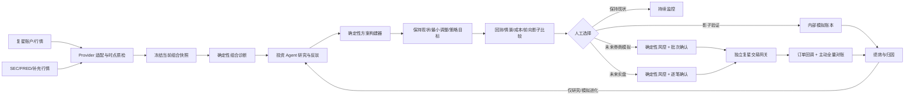

# NEXUS 个人 AI 投资组合诊断与优化平台设计规格

- 日期：2026-08-22
- 版本：v4（实施前门禁收敛版）
- 状态：已完成实施前复审，可生成阶段 0–1 编码计划；真实复星只读启用仍受外部门禁约束
- 目标用户：单一私人用户
- 首期市场：美股
- 投资风格：中长期持有为主，兼顾波段交易

## 0. 架构复审结论与修正

首版方向正确，但不能直接生成实施计划：它描述了“要有什么”，没有完整规定“代码如何分层、数据由谁拥有、接口如何认证、状态如何转换、页面在异常时显示什么”。v3 完成产品与主架构重构；v4 再关闭实施前审查发现的 ID、状态机、只读订阅、快照一致性、存储实体和仓库基线问题。

| 严重度 | 首版问题 | 本版决定 |
| --- | --- | --- |
| P0 | 规格指定 PostgreSQL，但仓库骨架是 D1/Drizzle，存在双事实源风险 | Python 引擎唯一拥有 PostgreSQL；Web 不使用 D1。现有 D1/Drizzle 文件在阶段 0 删除 |
| P0 | Web 到 Python 引擎缺少身份与重放保护协议 | 浏览器只访问同源 BFF；BFF 使用 HMAC、时间戳、nonce 和正文哈希调用引擎 |
| P0 | 当前原型把港股持仓、模拟盘和 HKD 净值混为一个组合 | 美股模拟组合与复星只读持仓完全分账、分币种展示；没有可靠 FX 时禁止合并净值 |
| P0 | “Agent 自进化”可能退化为生成任意代码并直接运行 | 只允许生成受限策略 DSL、因子参数或提示词候选；禁止执行 Agent 生成的任意 Python/SQL/Shell |
| P0 | 订单的成交价格、状态转换和幂等语义不完整 | 固化下一交易日 09:30–09:35 ET VWAP 模型、状态机、唯一键和失败行为 |
| P0 | 没有代码级 API、实体和仓库边界 | 新增 REST/OpenAPI 契约、核心表、共享 Schema、目录结构与模块依赖规则 |
| P1 | 对整个股票池运行完整 Agent 委员会，成本和延迟不可控 | 改为确定性筛选 → 轻量研究 → Top-K 完整辩论的分层漏斗，并设置每日硬预算 |
| P1 | “AI 置信度”和“组合健康分”没有校准定义 | 页面不展示伪精确分数；改为证据完整度、委员会分歧和明确风险限额余量 |
| P1 | ETF 行业穿透、证券代码变更和退市处理不明确 | 增加稳定 `instrument_id`、代码有效期和版本化 ETF 行业权重；数据过期即阻止新订单 |
| P1 | 页面只有名称，没有路由、状态、动作和权限 | 新增页面路由表、全局状态栏、空/错/旧/锁定状态和组件边界 |
| P1 | Sites Web 与 Python/对象存储的生产拓扑不明确 | Web 部署到 Sites；引擎使用 OCI 容器；本地使用 Docker Compose；R2 仅由引擎通过 S3 API 访问 |
| P0 | 产品主线仍偏向“AI 选股并产生订单”，没有首先回答“当前组合是否需要优化” | 核心闭环改为真实组合快照 → 确定性诊断 → Agent 研究 → 多方案优化 → 历史/前向比较 → 人工选择；订单只是可选的末端动作 |
| P0 | 行情默认以 Alpaca 为首选，与用户已有复星账户和 OpenAPI 条件不一致 | 按数据域设权威来源：复星优先承担券商账户、持仓、订单、资金和具备权限的行情；SEC/FRED 继续分别承担财报与宏观；Alpaca 作为行情补缺和独立交叉验证 |
| P0 | “优化”若只有一个 AI 分数或目标权重，容易制造伪精确结论 | 输出三个受版本化约束的可解释方案，并逐项比较集中度、回撤、波动、流动性、换手和成本；没有足够证据时只诊断、不建议交易 |
| P0 | 阶段 1 `READ_ONLY` 与创建 Webhook 订阅相冲突，且公开事件只覆盖订单 | 阶段 1 不创建、更新或删除复星订阅，也不注册券商回调入口；账户、现金、持仓、订单和流水全部主动轮询。Webhook 延后到阶段 3 冻结写契约后实现 |
| P0 | 真实组合“现金双读”不能检测持仓或未结订单在同步窗口内变化 | 改为现金、持仓和未结订单全部双读并比较规范化哈希；资金流水使用重叠窗口增量拉取并以 Provider 流水 ID 消重 |
| P0 | 提案组 ID、页面参数和状态机语义不一致 | 页面与 API 统一使用 `proposal_group_id`；组状态固定为 `draft/compared/shadowing/validated/rejected/expired`，验证与未来执行批准彻底分离 |
| P0 | 缺少 `portfolio_snapshots`、提案组、价格产物、宏观观测和幂等记录等父实体 | 补齐业务事实表及唯一约束；子记录不能脱离冻结父快照或提案组存在 |
| P1 | 当前 Web 脚手架全部未跟踪，直接创建 worktree 会丢失它 | 实施计划第一个任务只在当前工作区完成无秘密基线提交；之后才进入隔离 worktree 执行编码任务 |

本版仍是主架构规格，但可直接用于生成阶段 0–1 的实施计划。阶段 2–4 只保留稳定接口与门禁，不在首轮代码计划中展开。

## 1. 目标与边界

NEXUS 是一个私人、单用户的 **AI 辅助投资组合诊断与优化平台**。它首先同步或导入用户当前组合，回答“现在是否存在值得处理的问题、问题有多严重、有哪些可执行但风险不同的优化方案”。行情、财报、宏观和账户数据被整理为可追溯证据；Agent 负责提出和反驳优化假设，普通程序负责计算暴露、构建约束内方案、回测比较和风控，用户负责最终选择。

平台首先用于真实组合的只读诊断、研究、情景分析和影子模拟，不以“每天必须交易”或全自动实盘为目标。实盘即使未来启用，也必须逐笔人工确认。系统提供决策辅助、回测和执行基础设施，不承诺收益，不把模型生成内容视为投资事实，也不把“优化”解释为保证提高收益。

### 1.1 首轮实施范围（阶段 0–1）

- 复星 OpenAPI 脱敏 fixture、Provider 契约和只读同步能力；旧 Key 轮换、固定出口和权限验收完成后，接入真实账户、现金、持仓、订单和具备权限的行情。
- 美股行情、SEC 财报和宏观数据采集与质量检查；复星行情合格时优先，Alpaca 用于补缺与交叉验证。
- 盘中指示性行情和波动提醒；它只用于监控，不直接触发首期交易决策。
- 流动性良好的美国大盘股、超大盘股和主流非杠杆 ETF 的版本化白名单。
- 当前组合的集中度、行业、币种、流动性、趋势、回撤、相关性和证据完整度诊断。
- 多 Agent 研究、证据审计、优化假设，以及同组 `hold_current/minimum_change/strategy_target` 三候选方案的对比简报。
- 以 10,000 美元为初始资金的美股策略模拟盘，以及以指数 100 起始的“保持现状 vs 优化方案”前向影子组合。
- 时点正确的回测、基准比较和绩效归因；策略页在阶段 2 前只展示 baseline 和阶段锁。
- 风控、订单、成交、Agent 调用和策略版本的完整审计。

### 1.2 后续门禁范围

- 阶段 2：策略进化实验室、挑战者影子组合和自动模拟冠军晋级。
- 阶段 3：将通过人工选择的优化方案发送到复星模拟证券账户，验证券商侧订单和对账；内部模拟账本仍保留为独立基准。
- 阶段 4：逐笔人工批准的复星实盘订单；进入前重新确认安全与运维规格。

### 1.3 明确不在产品范围

- Agent 直接调用券商下单接口。
- 无人值守的实盘交易或策略自动晋级实盘。
- 高频、日内或毫秒级交易。
- 期权、期货、外汇、加密资产、融资融券和卖空。
- 社交交易、多人协作、公开组合或付费投顾功能。
- 让向量检索、LLM 输出或当前网页价格成为权威会计与交易事实。

### 1.4 与传统量化交易平台的定位差异

NEXUS 内部仍有量化核心：时点数据、因子、回测、组合约束、订单状态机和绩效归因都由确定性代码完成。差异在产品目标：传统量化平台通常从策略信号出发追求自动化执行，本平台从用户真实组合和“是否有必要调整”出发，Agent 用于阅读非结构化披露、提出反方证据和解释权衡，交易只是人工可选的末端。它是“量化基础设施 + Agent 研究委员会 + 个人组合工作台”，不是用 LLM 替代量化规则。

## 2. 已确认的产品原则

1. **研究可进化，交易边界不可进化。** Agent 可以生成和优化因子、规则、提示词及角色协作，但不能修改硬风控、密钥权限、人工批准要求、审计规则或实盘启用状态。
2. **没有完整证据就观望。** 数据过期、Agent 超时、Schema 不合格或证据矛盾未解决时，不产生新订单。
3. **先离线 fixture 与只读，再内部模拟和券商模拟，最后才可能实盘。** 每个阶段都有独立验收门槛，后续阶段不能因为前一阶段成功而自动启用。
4. **所有结论可追溯。** 研究结论必须关联数据版本、证据引用、模型和提示词版本、策略版本及最终订单结果。
5. **交易以确定性系统为准。** Agent 只提交策略意图；订单数量、现金约束、仓位上限和是否可交易均由普通程序规则计算。
6. **先证明需要优化，再讨论怎么交易。** 没有明确问题、可量化改善或足够证据时，合法结论是“保持现状”。
7. **来源优先级按数据域定义。** 复星是券商事实源，不替代 SEC 财报或 FRED/ALFRED 宏观；任何来源切换或冲突都必须显式展示，禁止静默拼接。

## 3. 总体架构

采用“私人 Web 控制台 + Python 投资引擎 + 独立复星网关”的混合架构。首期保持模块化单体，不拆成大量微服务；只有必须隔离券商凭据和能力的复星网关是独立故障域。



### 3.1 Web 控制台

- 使用当前 Next/vinext + React + TypeScript 项目，部署到 OpenAI Sites。
- 页面和浏览器只访问同源的 Next Route Handler/BFF，禁止从浏览器直接访问 Python 引擎。
- 每个受保护页面和 BFF 路由调用现有 `requireChatGPTUser()`，并将 `userId` 与服务器环境变量 `NEXUS_ALLOWED_USER_ID` 做常量时间比较。生产环境缺少 allowlist 时启动失败。
- 身份头只在 Sites 服务端可信；BFF 不接受浏览器自行提交的 `oai-authenticated-*` 头。
- BFF 到 Python 引擎的请求使用服务端 HMAC 签名，签名覆盖 method、path、timestamp、nonce 和 body SHA-256。引擎拒绝超过 60 秒、nonce 已使用或签名错误的请求。
- 负责查询展示、人工批准和配置操作，不保存或接触明文 Provider 密钥。
- 所有写操作校验 `Origin`、登录身份、权限、幂等键和最新资源版本；不能依赖前端按钮状态。
- Server Component 默认负责读取；只有图表、筛选器、确认对话框和实时刷新使用 Client Component。

### 3.2 Python 投资引擎

使用 Python 3.12、FastAPI、Pydantic 2、SQLAlchemy 2、Alembic 和 PostgreSQL。仓库根目录是 uv workspace，根 `uv.lock` 同时固定 `nexus-engine` 与 `nexus-fosun-gateway`，但两个成员构建成不同镜像、进程身份和依赖集合；引擎镜像运行两个进程角色：无状态 `api` 和领取数据库任务的 `worker`。它们共享引擎代码与数据库，不使用 Redis、Celery 或第二套消息系统。

引擎通用 Provider HTTP 使用 `httpx`；隔离复星网关若通过准入则在防腐层内使用锁定官方 SDK 及其 HTTP 栈，不能让 SDK 类型泄漏到引擎。分析数据使用 Polars + PyArrow + DuckDB，交易日历使用 `exchange-calendars`，模型调用使用 OpenAI 官方 Python SDK。阶段 0–1 自建小型事件驱动回测器并复用生产策略/风控/成交领域函数，不直接嵌入 Qlib、LEAN、vn.py 或 TradingAgents 运行时。

模块按单一职责划分：

- `providers`：行情、SEC、宏观和账户数据适配器。
- `quality`：数据新鲜度、完整性、异常值和时点契约校验。
- `research`：因子计算、财报解析、证据索引和个股研究包。
- `agents`：Agent 角色、工具、Schema、编排和评测。
- `diagnostics`：从冻结组合快照计算明确、有单位的组合问题与改善空间。
- `strategy`：将 Agent 研究转为标准策略意图。
- `optimizer`：在版本化咨询/硬约束内构建可解释候选方案，不调用 LLM。
- `risk`：确定性仓位、现金、行业和回撤规则。
- `backtest`：时点回测、基准、成本模型和结果归档。
- `paper`：模拟订单、成交、现金和持仓账本。
- `reconciliation`：订单事件消重、主动查询和状态修复。
- `evolution`：实验、挑战者、影子组合和冠军晋级。
- `audit`：统一事件、调用、批准与变更记录。

定时任务使用数据库 lease 保证同一作业只被一个实例执行，状态变更使用 transaction + outbox，避免“数据库已写入但事件未发送”的不一致。

模块依赖方向固定为 `providers -> quality/research -> diagnostics -> agents/strategy -> optimizer -> risk -> paper`。`diagnostics` 和 `optimizer` 不得调用 LLM，`risk` 不得依赖 `agents` 的内部实现，`paper` 不得调用 LLM，`providers` 不得写订单表。跨模块只传 Pydantic 领域对象或数据库 ID。

### 3.3 独立复星网关

复星网关从阶段 1 开始就是单独的进程、服务账户、密钥域和固定网络出口；不是等到实盘才拆分。研究 Agent 和通用 Provider worker 都不能访问复星凭据。网关对引擎只暴露规范化内部 RPC，不透传 SDK 对象、账户号或任意 endpoint。

运行时 capability 分三级且只能通过部署策略单向开启：`READ_ONLY`（阶段 1）、`SIMULATION_WRITE`（阶段 3）、`LIVE_WRITE`（阶段 4）。如果复星只提供同一把同时覆盖实盘与模拟盘的 Key，凭据仍只挂载到网关；引擎无法因拿到 Key 而绕过能力策略。阶段 1 的路由 allowlist 只包含 Session、Accounts、CashSummary、Holdings、OrderList、CashFlows 和 Market 只读接口。

网关的写入口只接受：

- 已通过确定性风控的规范化订单；
- 有效且未过期的人工批准；
- 匹配的策略、账户和幂等标识；
- 系统处于非熔断且对账一致状态。

阶段 3 的复星模拟盘写入也要求用户明确选择模拟账户并确认整份提案，不能把内部自动模拟订单静默复制到复星；阶段 4 实盘继续逐笔确认。`account_type=real|simulation`、`sub_account_id` 和部署 capability 必须三者一致，任何不一致都 fail closed。

阶段 1 真实只读同步前必须把届时有效的复星官方 OpenAPI、Python SDK、权限清单、签名/加密算法、行情授权、限流和错误码冻结为 Provider contract，并取得官方 test vector 或脱敏沙盒响应。优先评估官方 [`openapi-python-sdk`](https://github.com/fosunwealth/openapi-python-sdk) 的发布 tag，最终以 commit SHA 锁定并包在本项目 adapter 后；SDK 仓库当前未声明标准许可证时，在获得复星书面使用许可前只能用于本地验证，不能直接打入生产镜像。IP 白名单、客户端公钥、ECDH/AES-GCM 等要求只按冻结版本实现，不根据网页或 Skill 自行重写密码学。阶段 3 写入模拟证券账户前再冻结交易和回调契约；没有可验证沙盒、测试向量或最小权限隔离时，不启用券商写操作。

复星的 [`fw-trading`](https://github.com/fosunwealth/fw-trading) 与 [FW-trading Skill](https://clawhub.ai/fosunwealth/skills/fw-tradings) 仅作为交互流程和边界测试参考，吸收实盘/模拟盘显式分流、币种不混用、变更确认、脚本白名单、结构化错误和 `next_action` 思路。2026-08-22 审阅到的 GitHub 仓库与 ClawHub `v2.0.3` 不是同一目录/版本形态，不能把网页说明、仓库脚本和安装包视为天然一致；若未来 vendoring，必须分别保存来源 URL、版本、内容哈希和安全审查结果。平台不执行其 CLI、不依赖其 `fosun.env`，不通过对话收集凭据，也不把 Skill 的自然语言规则当成服务端授权。官方 OpenAPI 契约、冻结 SDK 行为和本项目测试发生冲突时，以 OpenAPI + 实测契约为准并记录差异。

### 3.4 运行与部署拓扑

**本地开发：**

- `npm run dev` 启动 Web。
- `docker compose up` 启动 PostgreSQL、MinIO、Python API 和 Python worker。
- Web 通过 loopback BFF 调用引擎；`NEXUS_AUTH_MODE=dev` 仅允许在非生产且绑定 loopback 时注入固定开发用户。
- Provider 默认为 fixture 模式，没有 OpenAI 或行情 Key 也能完成测试和页面开发。

**首期生产：**

- Web：OpenAI Sites 私有站点；`.openai/hosting.json` 的 D1/R2 binding 保持 `null`，避免 Web 成为第二数据拥有者。
- 引擎：单个 OCI 镜像部署在具备持久网络与定时任务能力的 Linux 容器环境；`api` 与 `worker` 使用同一镜像不同命令。
- 数据：托管 PostgreSQL；对象存储使用 S3 兼容接口。生产可使用 R2，但只允许 Python 引擎凭据访问。
- 网络：引擎 HTTPS 入口只接受 HMAC 服务请求和健康检查；管理文档、数据库和对象存储不暴露公网。
- 阶段 1 的复星网关使用独立容器、只读路由 allowlist 和固定出口 IP；阶段 3 通过独立部署配置开启模拟账户写路由，阶段 4 才可能开启实盘写路由。阶段 0 不部署真实券商凭据，阶段 0–3 都不部署 `LIVE_WRITE` capability。

### 3.5 代码目录与所有权

实施后仓库保持单仓库、多个隔离进程角色：

```text
app/                         # Next 页面、布局、BFF Route Handlers
  (protected)/               # 需要登录与 allowlist 的页面组
  api/v1/                    # 浏览器同源 BFF；不含业务规则
  components/                # 页面组件与状态组件
  lib/generated/             # 从引擎 OpenAPI 生成的 TS 客户端
worker/                      # Sites/vinext 平台入口，仅基础设施适配
pyproject.toml               # uv workspace 与共享开发工具，不包含服务运行依赖
uv.lock                      # 两个 Python 成员的唯一锁文件
engine/
  pyproject.toml             # nexus-engine 包与运行依赖
  src/nexus/
    api/                     # FastAPI 路由、认证、错误映射
    domain/                  # 无框架领域模型与不变量
    providers/ quality/ research/ agents/
    diagnostics/ strategy/ optimizer/ risk/ backtest/ paper/
    reconciliation/ evolution/ jobs/ audit/
    persistence/             # SQLAlchemy repository 与 Alembic
  tests/                     # unit/contract/integration
integrations/
  fosun_gateway/             # 唯一持有复星凭据；阶段化 route allowlist
    pyproject.toml           # nexus-fosun-gateway 独立包与最小依赖
    adapter/                 # 对锁定 SDK 的防腐层，不泄漏 SDK 类型
    policy/                  # READ_ONLY/SIMULATION_WRITE/LIVE_WRITE 强制门禁
    tests/                   # 脱敏 fixture、契约、安全与回放测试
contracts/
  agent/                     # Agent JSON Schema 与版本
  strategy/                  # 受限策略 DSL Schema
infra/
  compose.yaml               # 本地 PostgreSQL、MinIO、API、worker
  env.example                # 变量名和说明；绝不包含值
tests/                       # Web 单元、可访问性与端到端测试
docs/                        # 规格、ADR、运行手册
```

Python 引擎是业务逻辑和 PostgreSQL 的唯一拥有者。当前 `db/`、`drizzle/`、`drizzle.config.ts`、D1 示例与旧 starter skeleton 测试属于脚手架，阶段 0 基础提交中删除；不得迁移为另一套生产数据库。

## 4. 数据与时点契约

### 4.1 数据源

- **复星券商域：** 公开契约确认支持港股/美股/A 股通行情查询与 WebSocket 推送、日/分钟等 K 线、账户资金、持仓、订单、资金流水、模拟证券账户及订单状态回调。账户、现金、持仓、订单和实际成交以复星为唯一权威源；其他 Provider 只能用于研究交叉验证，不能覆盖券商事实。依据：[复星 OpenAPI 介绍](https://openapi-docs.fosunxcz.com/)、[Market 契约](https://openapi-docs.fosunxcz.com/specs/public/market/market/openapi.yaml)、[Trade 契约](https://openapi-docs.fosunxcz.com/specs/public/trade/openapi.yaml)、[Push 契约](https://openapi-docs.fosunxcz.com/specs/public/market/push/openapi.yaml)。
- **复星接入限制：** 公开 K 线契约包含周期、起止时间、条数和复权类型，但没有承诺可查询历史深度、分页上限、SLA、精确限流和 point-in-time 证券池；真实接入前必须用轮换后的凭据完成只读 capability probe。订阅接口文字提到订单、持仓和资金事件，但当前公开 `EventType` 只枚举 `orderUpdate`，而创建/更新/删除订阅本身是外部写操作；因此阶段 1 不管理订阅、不暴露券商 Webhook，资金、持仓、订单和流水全部使用主动轮询。Webhook 从阶段 3 冻结模拟交易写契约后才作为订单更新加速通道，主动轮询始终是最终补偿机制。
- **复星限流策略：** 旧版 Skill 文档给出 5 QPS/60 次每分钟，但公开 OpenAPI 契约未形成同等承诺，不能把 Skill 数字当 SLA，也不能用压测“探测”生产限额。网关初始使用 concurrency=1、2 QPS、30 次/分钟的 token bucket，正确遵守 `429/Retry-After`；取得账户级书面限额后只允许下调或通过审计配置发布新值。
- **补充行情：** 当复星行情权限未开通、历史深度不足或健康检查失败时，Alpaca 作为美股补充来源。Basic/IEX 只覆盖单一交易所且 WebSocket 最多 30 个 symbol，界面明确它不是 consolidated quote。需要全市场历史 bar 的回测和内部模拟成交可使用 `feed=sip` 且 `end <= now - 15 minutes`，等待延迟数据合法可用后运行。依据：[Alpaca 数据计划](https://docs.alpaca.markets/us/docs/about-market-data-api)、[实时股票流](https://docs.alpaca.markets/us/docs/real-time-stock-pricing-data)、[Market Data FAQ](https://docs.alpaca.markets/us/docs/market-data-faq)。
- **财报：** SEC EDGAR submissions/companyfacts/XBRL 为美股公司文件的权威原始来源，保存原文、解析结果、提交时间和引用位置。批量初始化优先使用 SEC nightly bulk archives；增量请求全局限速 5 req/s、携带可联系的 User-Agent，低于 SEC 当前 10 req/s 的公平访问上限。依据：[SEC EDGAR APIs](https://www.sec.gov/search-filings/edgar-application-programming-interfaces)、[SEC Developer Resources](https://www.sec.gov/about/developer-resources)。
- **宏观与 FX 参照：** `macro_series_v1` 固定为 `DFF, DGS2, DGS10, CPIAUCSL, UNRATE, INDPRO, VIXCLS, DEXHKUS`。FRED/ALFRED 回测使用对应 vintage 和 real-time period；只有 release date、没有可靠发布时间的记录保守地从下一个美股交易日开始可用。`DEXHKUS` 是每日“每 1 USD 对应 HKD”参照，只用于风险展示和复星汇率合理性检查，不用于下单购买力、实时换汇或覆盖券商账本。依据：[FRED 与 ALFRED](https://fred.stlouisfed.org/docs/api/fred/fred_vs_alfred.html)、[Real-Time Periods](https://fred.stlouisfed.org/docs/api/fred/realtime_period.html)、[DEXHKUS](https://fred.stlouisfed.org/series/DEXHKUS)。
- **公司行动：** 研究和内部模拟账本使用 Alpaca 当前 [`/v1/corporate-actions`](https://docs.alpaca.markets/us/reference/corporateactions-1)，保存 `data_quality`、process/ex/record/payable date 和 Provider 事件 ID；只使用 `complete` 记录驱动内部账本。真实账户已经入账的分红、拆并股和证券变更仍以复星现金流水、持仓和订单对账结果为准，来源不一致时产生人工复核事件。
- **离线 fixture：** 每个 Provider 提供一组脱敏、固定日期、覆盖正常/缺失/修订/限流响应的 fixture。开发、CI 和演示默认使用 fixture，不能静默访问真实账户。

数据源选择不是简单的“复星失败就拿另一家数据顶上”，而是版本化 `source_policy_v1`：

| 数据域 | 权威/首选 | 次选 | 失败行为 |
| --- | --- | --- | --- |
| 账户、现金、持仓、订单、实际成交、资金流水 | 复星 | 无 | 标记 `BROKER_STALE`，停止真实组合优化刷新和全部券商写操作 |
| 盘中行情 | 复星已授权行情 | Alpaca IEX | 显示明确来源和覆盖范围；只用于监控，不直接触发交易 |
| 日/分钟历史行情 | 复星通过 capability probe 后优先 | 仅美股可用 Alpaca delayed SIP | 记录单一 selected source；港股无合格次选时标记缺失，不逐字段混合 bar |
| 美股财报与披露 | SEC EDGAR | 无自动替代 | 缺失即降低证据状态或观望 |
| 宏观 vintage | FRED/ALFRED | 无自动替代 | 缺失时相关宏观结论观望 |
| 美股公司行动研究事件 | Alpaca | 发行人披露人工证据 | 冲突时阻止对应标的新订单 |
| 真实账户公司行动入账 | 复星现金/持仓事实 | 无 | 对账差异转人工复核 |

`source_policy_v1` 选择整条时间序列或完整快照，不对同一 bar、持仓或财务事实做字段级拼接。双行情源同时可用时保存独立记录并交叉检查；同一日线收盘价偏差超过 `max(instrument_tick_size, 20 bps)`、复权口径不一致或交易日缺失时标记 `SOURCE_CONFLICT`，该证券只能研究不能产生新订单；tick size 未知时该交叉检查本身为 `PARTIAL`。盘中报价偏差超过 50 bps 产生监控告警，但不据此自动交易。报价和历史序列必须从 Provider 到持久化、API 和 UI 传递闭合的 `delivery_mode=real_time|delayed|fixture|unknown`，不得根据 feed 名称推测实时性。

### 4.2 统一 Provider 接口

借鉴 OpenBB 的 Provider 适配模式，业务模块只依赖统一领域对象，不依赖某一家数据商的响应结构。每个 Provider 必须实现：

- `capabilities()`：市场、资产类别、粒度、实时性、复权和许可说明；
- `probe_capabilities()`：使用非交易请求验证真实权限、历史深度、最大页、时区、复权和错误语义；限流只读取官方/账户配置和真实 `429`，不主动压测；结果带 `checked_at`、契约哈希和到期时间；
- `fetch(request, cursor)`：有界分页和可恢复 cursor；
- `normalize(raw)`：转换为版本化领域 Schema；
- `freshness_policy()`：按数据类型返回允许延迟；
- `health()`：最后成功、限流窗口、错误分类和降级状态；
- `license_policy()`：允许的保存期限、衍生使用和展示范围；首期只用于私人单用户界面，不提供原始数据导出或再分发；
- 原始响应归档、指数退避、`Retry-After`、请求 ID 和调用审计。

Provider 的网络错误只能由适配器重试；上层业务不得自行无限重试。所有重试有最大次数和绝对 deadline。

首个复星 capability probe 只允许在旧 Key 已吊销、轮换 Key 已进入服务端 secret manager、IP 白名单与客户端公钥重新确认后运行；probe 固定只调用 Session、Accounts、CashSummary、Holdings、OrderList、CashFlows、quote 和最小 K 线查询，不调用 SimAccountCreate/Reset、OrderCreate/Modify/Cancel 或任何财富产品写接口。probe 原始响应脱敏后仅进入对象存储，不写日志。

实时权限、账户类型和读路由 capability 默认有效 24 小时；历史深度/复权 probe 默认有效 7 天；OpenAPI/SDK 契约哈希、网关版本、权限错误或用户禁用任一变化立即失效。过期 capability 仍可展示最后结果，但返回 `CAPABILITY_EXPIRED` 并阻止新提案或券商操作。

### 4.3 Point-in-time 字段

所有可用于研究或回测的数据至少包含：

| 字段 | 含义 |
| --- | --- |
| `source` | 数据提供方和接口版本 |
| `symbol` | 当时有效的证券标识 |
| `observed_at` | 数值对应的市场或报告时点 |
| `available_at` | 该数据最早可被策略合法使用的时间 |
| `received_at` | 系统实际收到数据的时间 |
| `revision_id` | 修订或 vintage 标识 |
| `adjustment` | 原始、前复权、后复权或其他调整口径 |
| `quality_flags` | 过期、缺失、异常、部分市场等质量标记 |

策略只能读取 `available_at <= decision_time` 的记录。数据质量模块在 Agent 运行前生成完整性清单；关键字段不合格时，该标的直接进入“观望”。

### 4.4 证券主数据与股票池

- 内部始终使用不可变 `instrument_id`，ticker 只是一段带 `valid_from/valid_to` 的别名。
- 首期股票池是显式、版本化快照，最多 120 个美国普通股和 20 个非杠杆主流 ETF；不在运行时自动读取“当前指数成分”回填历史。
- 阶段 0–1 的首个工程股票池 `us_liquid_v1` 固定为 `AAPL, ABBV, ABT, AMD, AMGN, AMT, AMZN, APD, AVGO, BAC, CAT, COST, CRM, CSCO, CVX, GE, GOOGL, GS, HD, IBM, JNJ, JPM, KO, LLY, MA, MCD, META, MSFT, NEE, NFLX, NVDA, ORCL, PG, QCOM, RTX, SHW, TSLA, TXN, UNH, V, WMT, XOM` 与 `SPY, QQQ, IWM, DIA, VTI, TLT, GLD`。这是可审计的工程初值，不宣称等于任何指数成分；新增、移除或行业变更只能发布新快照，不能改写 `us_liquid_v1`。
- 首期排除 OTC、优先股、权证、杠杆/反向 ETF、ADR、非美国公司和价格低于 5 美元的证券。
- 每个快照保存生效日、纳入/移除原因、数据来源和内容哈希。回测使用当日有效快照，不能使用今天的白名单回测过去。
- 初始 ETF 观察集合固定为 `SPY, QQQ, IWM, DIA, VTI, TLT, GLD`；它们仍受单品种 15% 上限。权益 ETF 必须通过受控 CSV 导入发行人披露的行业权重，字段固定为 `instrument_id, sector_code, weight, as_of, source_url, content_hash`，权重合计容差为 99.5%–100.5%。fixture 可使用明确标记为 synthetic 的固定暴露；非 fixture 模式没有 30 日内人工复核的发行人 CSV 时，权益 ETF 可以展示但不能成为新增仓位。ETF 的“完整研究证据”由合格价格、流动性、基金元数据和行业暴露组成，不强制要求 SEC companyfacts。阶段 0–1 不写脆弱的网页抓取器。
- 股票行业使用内部版本化 `NEXUS_SECTOR_V1`，固定 11 个标签：`communication_services, consumer_discretionary, consumer_staples, energy, financials, health_care, industrials, information_technology, materials, real_estate, utilities`。映射 CSV 固定字段为 `instrument_id, sector_code, valid_from, valid_to, source_url, override_reason, content_hash`，不依赖需要额外授权的分类数据。权益 ETF 行业权重超过 30 个自然日未更新时可展示但禁止新增订单。`TLT` 和 `GLD` 分别进入 `US_TREASURY`、`GOLD` 非权益风险桶，不参与 11 行业上限，但仍受单品种和现金上限。
- 拆股、ticker 变更、并购和退市通过 `instrument_id` 关联历史，禁止按 ticker 直接拼接时间序列。

### 4.5 数据质量门禁

每个策略版本声明 `required_inputs`、字段容忍缺失率和 `max_age`。质量报告只返回：

- `PASS`：所有交易所需输入满足时点、新鲜度、完整性和一致性要求；
- `PARTIAL`：允许展示研究，但禁止产生新仓位；
- `FAIL`：研究页显示失败原因，Agent 不运行。

日线交易数据必须覆盖最近一个已结束交易日，且 session calendar、OHLCV、复权和公司行动检查一致。财报数据以 SEC `filedAt/acceptedAt` 推导 `available_at`，不能用报告期结束日作为可用日。所有冻结快照拥有唯一 `data_snapshot_id` 和内容哈希，后续决策只引用该 ID。

### 4.6 SEC 财务事实规范化

阶段 0 只规范化以下 canonical facts：`revenue, gross_profit, operating_income, net_income, operating_cash_flow, capital_expenditure, total_assets, total_liabilities, stockholders_equity, diluted_shares, diluted_eps`。每条事实保存原始 taxonomy/tag、unit、period start/end、fiscal year/period、form、filed/accepted time、accession number 和 frame。

选择规则固定为：同一 canonical fact/period 只选择在 `decision_time` 前已 accepted 的最新 filing；后续 amendment/restatement 创建新 revision，不覆盖旧值；duration fact 不与 instant fact混用，季度、TTM 和年度值分别计算。无法在多个 tag 中唯一映射、unit 不一致或 period 重叠时返回缺失和质量原因，不由 LLM 猜值。XBRL 计算只使用 Decimal，并保留从 canonical fact 回到原始 filing 的证据链。

### 4.7 真实组合快照

组合诊断只能针对冻结的 `portfolio_snapshot_id` 运行。复星没有单个“原子组合快照”接口，也不能在阶段 1 依赖 Webhook，因此同步尝试固定为 `CashSummary A -> Holdings A 全分页 -> OrderList A 未终结订单 -> Holdings B 全分页 -> OrderList B 未终结订单 -> CashSummary B`：

- 全部请求使用同一内部 `sync_run_id`，总窗口不超过 60 秒；A/B 的任一币种账面余额差异超过 `max(1 原币种单位, 组合净值 5 bps)`、规范化持仓哈希不同，或规范化未结订单哈希不同时整轮作废并重试一次。持仓哈希覆盖 instrument、总量、可用量、冻结量、两种成本和币种；订单哈希覆盖订单 ID、方向、总量、累计成交量、价格、状态和更新时间，排序后再做 SHA-256；
- 第二次仍不一致则保存原始事实但快照为 `RECONCILIATION_REQUIRED`，只能展示，不能生成优化提案；
- CashFlows 不进入上述原子窗口；成功冻结快照后按“上次成功 cursor 前回看 3 个自然日”的重叠窗口拉取，以 `(provider, provider_cash_flow_id)` 唯一键消重并关联 `sync_run_id`。没有稳定 Provider 流水 ID 时，以冻结契约规定的规范化字段哈希作为替代 ID，并把 capability 标为 `PARTIAL`；
- 保存原币种现金、数量、`avgCost`、`dilutedCost`、现价、冻结/可用数量、未结订单及各自 Provider 时点；两种成本必须分别命名展示，禁止合成一个“成本价”；内部账户 ID 与复星子账户 ID 分开，外部 ID 加密保存；
- 真实金额只进入确定性诊断和界面。Agent 工具默认只获得匿名组合 ID、归一化权重、风险暴露和分桶后的金额区间，不获得账号、客户号或精确总资产；
- 多币种默认分账。只有同一快照含带时点的复星换算率且通过合理性检查时，才生成独立的 `converted_view`；所有风控和账本仍按原币种计算，页面同时显示原币种与汇率来源；
- 每个报告明确 `coverage_scope=broker_account`，只描述已同步复星账户，不把账户内集中度称为用户“全部财富”集中度。阶段 0–1 不允许手工填一个总资产数字来稀释风险；未来接入其他资产必须有独立来源和对账规格；
- `00656.HK` 在阶段 1 纳入真实持仓只读诊断，但首期没有香港交易所财报权威源，因此只能给出持仓集中度、价格/流动性、趋势、回撤和数据完整性结论，不输出基本面买卖结论。补充 HKEX 披露 Provider 需另行扩展规格。

快照有 `READY/PARTIAL/STALE/RECONCILIATION_REQUIRED` 四种业务状态。只有 `READY` 可以作为新优化提案的 baseline；已创建提案永远引用当时快照，不随最新持仓静默变化。

### 4.8 首期数据充分性结论

当前组合不是“数据越多越会赚钱”，而是每类结论只在其证据覆盖范围内成立：

| 决策问题 | 首期结论 | 依据与限制 |
| --- | --- | --- |
| 我实际持有什么、现金和订单是否一致 | 充分 | 复星账户域为权威源，前提是双读快照和主动对账通过 |
| 是否过度集中、行业/币种/流动性是否失衡 | 充分 | 复星持仓 + 合格行情 + 内部行业/ETF 穿透；未知 FX 时按币种分账 |
| 美股价格趋势、波动、相关性与基础流动性 | 有条件充分 | 复星历史能力通过 probe 时优先，否则 Alpaca SIP；源冲突即阻断 |
| 美股已披露基本面是否恶化 | 充分用于已披露事实 | SEC 是权威源，但不含卖方一致预期、未公开信息或未来业绩 |
| 宏观 regime | 充分用于首期规则 | FRED/ALFRED vintage，不能替代市场预测 |
| 当前优化方案是否一定提高收益 | 不充分，也不应声称充分 | 只能给出历史情景与前向影子比较，不提供收益保证 |
| 税后是否值得调仓 | 不充分 | 缺少税务居民身份、税基和完整税务规则，固定标记 unknown |
| `00656.HK` 基本面买卖结论 | 不充分 | 首期无 HKEX 披露规范化 Provider；只做持仓与市场风险诊断 |
| 新闻/情绪/分析师预期驱动交易 | 不充分且首期禁用 | 没有稳定、授权、可回测的 point-in-time 数据源，不能偷偷用网页搜索补信号 |

因此阶段 0–1 的产品承诺是“发现组合结构和已披露证据中的可验证问题，并用影子比较验证改进”，不是覆盖所有可能的信息优势。新增新闻、卖方预期、税务或 HKEX 数据必须分别定义授权、时点、历史覆盖、质量门禁和回测偏差后再进入策略。

## 5. 投资 Agent 委员会

Agent 委员会采用角色化、对抗式研究，但委员会不是组合计算器、优化器或交易执行器。它的首要任务是解释确定性诊断、寻找被数字遗漏的基本面风险、反驳优化假设，并允许输出“无需调整”。

### 5.1 角色

- **编排 Agent：** 确定研究任务和依赖，汇总各角色结果，不新增未经引用的事实。
- **基本面 Agent：** 分析收入、利润、现金流、资产负债表、估值和管理层披露。
- **价格与市场状态 Agent：** 分析趋势、波动、相对强弱、成交结构和市场 regime。
- **宏观与行业 Agent：** 分析利率、周期、行业暴露及跨资产背景。
- **多头 Agent：** 构建最强正面论证、催化剂和条件性收益路径。
- **空头 Agent：** 主动寻找反例、估值风险、财务质量问题和论点失效条件。
- **证据审计 Agent：** 检查时点、引用、矛盾、提示注入和无来源断言。
- **组合 Agent：** 基于既有持仓、相关性和风险预算提出有证据的优化假设，比较“保持现状”的机会成本，不计算最终权重或订单数量。

### 5.2 分层运行流程与成本上限

完整委员会不能对全部股票逐一运行。每日流程固定为：

1. **组合优先诊断：** 普通程序先对最新合格的真实只读组合和模拟组合计算第 6 节全部诊断，不调用 LLM；硬约束超限、数据失效和未对账项进入最高优先级。
2. **确定性筛选：** 普通程序对版本化美股池计算数据质量和 `baseline_v1` 明确定义的流动性、200 日趋势、126 日收益及排名，不增加未写入策略版本的隐含打分。
3. **轻量研究：** 对全部现有持仓、排序前 12 名和出现重大新 SEC 文件的标的生成标准证据包；同一标的去重后最多 20 个。缺少权威财报源的港股持仓只生成价格与组合暴露包，明确缺失维度。
4. **完整辩论：** 只对最重要的 5 个优化机会，以及存在明确减仓风险的持仓，运行基本面、市场状态、多头、空头、证据审计和组合综合。重要性由普通程序按硬约束违例、集中度边际贡献、流动性和数据异常排序。
5. **预算降级：** 真实持仓风险分析优先于模拟持仓和新候选。达到 `AGENT_DAILY_BUDGET_USD` 后不再创建调用，剩余标的标记 `budget_exhausted/watch`，不能用缺失分析生成可执行提案。

初始每日硬预算为 3 美元，可由用户在服务端配置中修改；修改进入审计。每次 Response 设置绝对超时、最大工具调用数和 token 上限。失败重试最多一次，且必须复用相同输入快照；重试仍失败则观望。

`model_configs` 保存模型 ID、输入/输出 token 单价、计价生效日和 `pricing_version`。入队前按最大 token 预留预算，完成后按 API usage 结算；价格配置过期或缺失时停止新 Agent 调用，不把估算成本伪装成账单金额。

编排使用 OpenAI 官方 SDK 与 Responses API 直接实现显式状态机，不在阶段 0–1 引入 LangChain、LangGraph 或另一套持久化运行时。状态固定为 `prepared -> running -> validated -> audited -> synthesized -> completed`，任何步骤可进入 `failed` 或 `abstained`，终态不可原地覆盖。

### 5.3 工具与输出限制

- 使用 OpenAI [Responses API 自定义函数工具](https://developers.openai.com/api/reference/cli/resources/responses/methods/create)读取结构化数据和证据，并使用[严格 JSON Schema 输出](https://developers.openai.com/api/reference/cli/resources/beta/subresources/responses)。
- Agent 工具集只注册只读研究工具，不注册任何券商交易函数。
- 每类输出使用严格 JSON Schema；解析失败、缺字段或越权动作一律视为“观望”。
- 设置最大工具调用次数、总 token、费用、超时和重试上限。
- 模型、提示词哈希、工具版本、输入数据版本和完整响应均进入审计。
- 提取和分类任务优先使用经评测合格的低成本模型；委员会综合使用经评测合格的强推理模型。具体型号由配置和评测结果决定，避免把易变化的型号写死在业务逻辑中。
- 具体模型由 `OPENAI_EXTRACTION_MODEL` 和 `OPENAI_REASONING_MODEL` 提供；非 fixture 模式缺少配置时启动失败，不允许静默换模型。
- SEC 文档正文作为引用数据传入，与系统指令隔离；任何出现在文档中的“指令”仅可作为文本证据，不能影响工具或权限。

只读工具固定为：`get_security_snapshot`、`get_financial_facts`、`search_filing_evidence`、`get_price_features`、`get_macro_snapshot`、`get_portfolio_exposure`、`get_portfolio_diagnostics`、`get_proposal_comparison`。每个工具只接受明确 ID、日期范围和字段列表，不接受自由 SQL、URL 或文件路径。

复星 OpenAPI 在阶段 0–3 只实现为隔离网关内的 SDK adapter，并由引擎 Provider 调用窄化内部 RPC，不另建可被通用 Agent 发现的 MCP server。这样可以避免把同一个服务中的 `OrderCreate/Modify/Cancel` 与研究工具放进同一能力面。若未来确有跨客户端的只读 MCP 需求，必须另写 ADR，并按 `mcp-builder` 规范使用 `fosun_` 前缀、Pydantic 输入/输出、cursor 分页、`readOnlyHint=true` 和服务端强制权限；annotations 只是提示，不能替代网关授权。任何 MCP 都不暴露账户号、精确资产、密钥或交易工具。

### 5.4 标准研究意图

委员会输出不能是自然语言订单或最终优化方案，而是包含以下字段的研究意图：

- `schema_version`、`decision_id`、`instrument_id`、显示 ticker、`decision_time`、`data_snapshot_id`、`horizon`；
- `stance`：`buy_candidate`、`reduce_candidate`、`hold` 或 `watch`；
- 最多 5 条投资论点、最多 5 条反方论点、关键不确定性和可机器判断的失效条件；
- 每条论点至少一个 `evidence_ref`，引用对象包含 source、object ID、available_at、原文位置和内容哈希；
- `exposure_action`：`none/reduce/maintain/eligible_for_increase`，不包含目标权重、股数或金额；最终目标只能由 `optimizer` 的已发布规则生成；
- 结构化进入条件、退出条件和 `valid_until`；
- `quality_status`、证据审计结果、角色投票与委员会分歧；
- 所使用的策略、模型、提示词和数据版本。

前端不得把模型自报的 probability 当作真实概率。首期不显示“置信度 78%”一类未校准数字，只展示：证据完整度 `complete/partial`、委员会投票、分歧原因、数据新鲜度和最终风控状态。

### 5.5 标准优化提案

确定性方案构建器消费一个冻结组合快照、经审计研究意图和版本化约束，输出不可变 `OptimizationProposal`：

- `proposal_group_id`、`proposal_id`、`schema_version`、`baseline_portfolio_snapshot_id`、`data_snapshot_id`、`source_policy_version`、`created_at`、`valid_until`；同组恰好包含三个不同 `variant`；
- `portfolio_scope`：`real_read_only`、`internal_paper` 或 `fosun_simulation`；真实只读组合的提案始终为 `analysis_only`；
- `variant`：`hold_current`、`minimum_change` 或 `strategy_target`；三者必须使用相同数据、估值和成本口径同时生成；
- 当前与目标的逐标的权重、现金权重、建议方向和变化原因；不在提案阶段生成股数或订单；
- 硬约束前后值、集中度/行业/币种/相关性/波动/回撤/流动性变化、预计单边换手和成本区间；
- 所有改善使用区间或历史情景结果，不使用 Agent 自报概率；税务数据未知时固定显示 `tax_impact=unknown`，不得把税后改善写成已计算；
- 引用的研究意图、证据、诊断、策略、Agent、模型和约束版本，以及无法解决的风险和失效条件；
- 状态属于 `OptimizationProposalGroup` 而非三个不可变子方案：`draft -> compared -> shadowing -> validated`，并允许 `draft|compared|shadowing -> rejected|expired`。`compared -> shadowing` 表示用户选择启动同起点影子验证；`validated` 只表示达到第 8.2 节的 63 日/成交数检查点，不表示批准下单。阶段 3 若要执行，必须创建独立的 `execution_intent` 与批次批准，禁止复用提案状态表达交易授权。

`hold_current` 是一等候选而不是空状态；若另外两个方案没有消除硬违例，或不能在成本、回撤、集中度至少一个维度产生明确改善且其他关键维度没有不可接受恶化，系统推荐保持现状。推荐理由由确定性比较规则产生，Agent 只负责解释和提出反例。

### 5.6 Agent 生成策略的安全表示

研发 Agent 只能输出符合 `contracts/strategy/strategy-dsl.schema.json` 的声明式候选：

- 允许字段：股票池过滤、白名单特征、比较/布尔表达式、排序、调仓频率、持有期、退出规则、参数范围和目标权重方法；
- 特征只能引用引擎注册表中的纯函数及版本，例如 `sma_20`、`revenue_growth_ttm`、`realized_vol_20d`；
- 禁止字段：任意 Python、SQL、Shell、URL、包名、文件路径、网络调用或动态 import；
- DSL 先做 JSON Schema、AST 深度、运算数量、参数范围和 look-ahead 检查，再编译为内部表达式树；
- 编译器不使用 `eval/exec`，运行时只能读取冻结的数据快照。

提示词候选与策略 DSL 分开版本化：策略 DSL 可做确定性历史回测；提示词/模型版本只能做固定评测集和前向影子模拟，不能把今天的模型回放历史后声称为无偏回测。

## 6. 确定性风险控制

### 6.1 组合诊断契约

`diagnostics_v1` 对每个 `READY` 组合快照生成结构化 `PortfolioDiagnosticReport`。所有比率以组合估值币种和 `as_of` 明示，不能计算时返回 `unknown + reason`，不以 0 代替：

- 集中度：单品种权重、Top 3 权重；证券 HHI 先以 `security_weight_i = position_value_i / total_security_value` 归一化，再计算 `sum(security_weight_i^2)` 和有效持仓数 `1/HHI`；现金单列，空仓时 HHI 为 `unknown`；
- 暴露：股票行业、ETF 穿透风险桶、币种和资产类别的当前值/上限/余量；
- 市场风险：基于合格日收益的 20/63 日年化波动、252 日最大回撤、126 日对 SPY beta/相关性；有效样本不足 80% 时为 `unknown`；
- 相关性簇：126 日成对相关性不低于 0.80 的连通分量及合计权重；少于 60 个重叠交易日不连边；
- 流动性：`days_to_exit = position_market_value / (20d_ADV * 10%)`，并显示所用 ADV 与日期；ADV 缺失时禁止声称“可快速退出”；
- 数据与论点：行情、持仓、财报、公司行动新鲜度，最近一次完整研究时间，失效条件是否触发，来源冲突和对账状态；
- 变化贡献：相对上一合格快照，按价格变化、交易/现金流和 FX（若有）拆解权重变化，不把被动涨跌误称为主动策略。

`real_advisory_policy_v1` 的平衡型初值固定为：单品种 >15% warning、>30% critical；Top 3 >60% warning；单一行业/风险桶 >30% warning、>50% critical；单一币种 >80% warning；相关性簇 >50% warning；现金 <10% warning；252 日回撤达到 8% warning、15% critical；`days_to_exit >2` warning、`>5` critical。一个指标只取最高严重度。数据缺失不触发低风险结论，而是进入 `RESEARCH_REQUIRED/BLOCKED`。这些阈值只评价已同步券商账户，可由用户未来发布 v2 政策，但不能由 Agent 修改。

每条诊断项包含 `diagnostic_code`、`metric_value`、`unit`、`reference_limit/range`、`policy_scope`、`severity=info|warning|critical`、`evidence_refs` 和 `actionability=monitor|research|reduce_only|blocked`。严重度只由版本化阈值计算，不由 LLM 决定。真实只读组合使用 `real_advisory_policy_v1`，超限称为“建议阈值偏离”而不是订单硬违例；内部模拟和未来待下订单使用 `risk_policy_v1` 硬限制。首期“需要优化”的判定为：存在 `critical`；或存在至少两个不同风险域的 `warning`；或一个 `warning` 在连续 5 个交易日未消失。若仅有 `info`，默认结论为保持现状。

报告顶层 `optimization_need` 只能取：`BLOCKED`（快照不是 READY、对账失败或权威来源冲突）、`RESEARCH_REQUIRED`（快照 READY，但触发判断所需的必需指标未知，或已触发而所有可行动方案证据不足）、`OPTIMIZATION_CANDIDATE`（已触发且至少一个非 `hold_current` 方案可比较）、`NO_ACTION`（其余情况）。优先级严格按上述顺序短路，禁止未知值落入 `NO_ACTION`。`minimum_change` 的关键证据是持仓、价格、流动性、费用和建议政策，不强制要求公司基本面；`strategy_target` 还必须有候选标的完整研究证据。首页用这四个可解释状态回答问题，不把它压缩成 0–100 分；`OPTIMIZATION_CANDIDATE` 也不等于“应该卖出”，只表示值得进入方案比较。

### 6.2 候选方案构建

阶段 0–1 不引入对预期收益高度敏感的黑盒均值方差优化器。`optimizer_v1` 是可复现的约束场景构建器，使用 1 bp 权重精度并固定生成：

1. `hold_current`：复制当前权重，作为所有成本和风险比较的零换手基准。
2. `minimum_change`：只减仓、不新增标的。先处理不可交易、数据失败和单品种超限；若行业/风险桶仍超限，循环从对当前最大超限约束贡献最大的持仓减去 1 bp，直到约束满足，平手按“诊断严重度更高、流动性更好、`instrument_id` 升序”排序。释放权重全部进入现金。输出名称必须包含 `heuristic`，不得宣称数学全局最优。
3. `strategy_target`：使用 `baseline_v1` 的确定性入选结果和目标权重；Agent 只能否决、延后或降低某候选，不能添加筛选外标的或提高目标。既有但不在候选集的真实持仓在分析方案中目标为 0；真正执行前仍需人工逐笔选择，系统不能把整个方案一键转实盘。

真实只读组合可生成上述三案，但组状态只允许 `draft -> compared -> shadowing -> validated` 或进入拒绝/过期终态，不能创建券商订单。`strategy_target` 在至少 63 个交易日前向影子期完成前只显示“待验证”，不成为平台推荐。`minimum_change` 只有在减少建议阈值偏离、订单硬违例或已持续触发的 warning 时才显示“可考虑”；否则仍推荐 `hold_current`。

跨币种方案用 `DEXHKUS` 只做归一化情景估值，必须额外显示 `requires_fx=true`。没有已发布的换汇成本、可用 USD 现金和执行路径时，该方案可以比较但保持 `analysis_only/non_executable`，不能暗示系统会自动卖出 HKD 资产并换汇买美股。

比较器以相同估值时点展示：建议阈值偏离/订单硬违例数量、Top 1/3、HHI、行业/币种暴露、历史波动和回撤情景、相关性簇、流动性、单边换手、按 `cost_model_version` 计算的成本区间及未知税务影响。任何方案若数据为 `PARTIAL/STALE`、存在来源冲突、需要使用未知 FX 或预估成本缺失，只能保存草稿，不能进入影子或执行流程。

### 6.3 订单前硬风控

风控服务不调用 LLM，规则必须有普通程序实现和独立测试。平衡型初始规则为：

- 首期所有可交易证券（股票和 ETF）单品种市值不超过组合净值的 15%，不为宽基 ETF 设置隐含例外。
- 单一行业穿透市值不超过组合净值的 30%。股票按 `NEXUS_SECTOR_V1` 100% 计入；权益 ETF 按最后合格的版本化行业权重拆分计入。
- 按订单最坏成本计算，成交后现金比例不得低于组合净值的 10%。买单最坏成本使用参考价上浮 100 bps 加费用；实际成交后释放多余预留。
- 组合从历史收盘净值高点回撤达到 8% 后，暂停所有新开仓和加仓；减仓和风险退出仍可提交。只有回撤恢复到 6% 以下且用户在风险页确认后才能解锁，避免阈值附近反复开关。
- 订单必须属于当前版本白名单并处于可交易时段。
- 首期只生成整股订单。订单数量为目标暴露、可用现金、当前持仓、行业穿透和上述最坏成本约束共同允许的向下取整值；新增/加仓不足 100 美元或 1 股时拒绝为 `below_minimum_order`，减仓或清仓不受 100 美元门槛限制。
- 任何券商订单的 `market/product_type/currency` 由内部 instrument master 映射并与复星账户币种核对，不能由 Agent 或前端自由填写。首期美股 `lot_size=1`；未来支持港股时必须在下单前读取复星/交易所返回的动态 lot size，禁止硬编码“每手 100 股”。
- 阶段 4 实盘提交前调用复星 `BidAskInfo` 获取最大可买/可卖和购买力并与本地风控取更保守值；该接口公开契约注明不支持模拟盘，因此阶段 3 不能伪造调用结果，仍依赖本地模拟风控和券商最终拒单回报。
- 风控服务不可用、持仓未对账或关键行情过期时，拒绝所有新订单。
- 每个决策只能产生一个有效订单链；重试必须复用相同幂等键。
- 待生效公司行动、停牌、无法确定交易日历或 ETF 穿透数据过期时，禁止对应证券的新订单。

每次评估输入必须包含 `risk_policy_version`、冻结组合快照、参考价格、全部待成交订单和数据质量报告。风控结果只有 `approved`、`reduced`、`rejected` 三种，并记录每条命中规则、评估前后暴露、最坏现金和最终允许数量。批量候选按确定性排序逐笔模拟进入组合，排序键为策略优先级、预期目标权重、`instrument_id`，保证同一输入得到相同结果。Agent 不能覆盖结果。

首期参考价格固定为同一 `data_snapshot_id` 中最近完整交易日的合格日线 close；界面和审计标注 feed。风控不读取盘中 `latest_quotes`，以免重跑同一决策得到不同订单。次日实际模拟成交差额由现金预留和执行模型处理。

## 7. 模拟交易与实盘交易

### 7.1 模拟盘

- 初始现金为 10,000 美元。
- 收盘后生成信号，模拟订单类型固定为下一交易日开盘执行的 `market` 意图，不允许使用生成信号当日的价格成交。
- worker 在下一交易日 09:55 ET 以后按 `source_policy_v1` 读取 09:30–09:35 ET 的合格 1 分钟数据。复星分钟数据通过历史深度、成交量、时区和复权 capability probe 时优先；否则使用已越过 Basic 最近 15 分钟限制的 Alpaca SIP。基准价为该窗口 VWAP。模拟成交价为 VWAP 加方向性半买卖价差和 10 bps 基础滑点；没有可用报价时使用 25 bps 保守滑点。参数属于版本化 `execution_model`。
- 单笔最多成交该 5 分钟窗口成交量的 1%；超过部分保留为 `partially_filled`，后续每个 5 分钟窗口使用该窗口自己的 VWAP、价差和滑点继续模拟，16:00 ET 未成交部分取消。
- 如果 10:15 ET 前仍无合格 selected-source 分钟数据，订单取消并记录 `missing_fill_data`，不得在订单中途切换来源，也不得回退到 IEX 或前一日收盘价。
- 费用按版本化费用表计算，默认佣金为 0，但税费和监管费字段始终存在。金额使用十进制定点数，不使用二进制浮点。
- 订单、成交、现金、仓位和公司行动使用与未来实盘一致的领域模型。
- 通过风控的模拟订单可自动执行，不需要人工批准。

上述自动执行只适用于内部模拟账本。阶段 3 将提案发送到复星模拟证券账户属于外部写操作：必须显式选择 `account_type=simulation`、展示订单清单并由用户确认一次批次；网关逐单提交、逐单记录结果，部分失败时不自动补单。复星模拟盘和内部账本是两个独立组合，不宣称成交结果必然一致。

### 7.2 订单状态机

统一状态包括：`proposed`、`risk_rejected`、`risk_approved`、`awaiting_approval`、`submitted`、`partially_filled`、`filled`、`cancelled`、`rejected`、`reconciling`。允许转换固定为：

```text
proposed -> risk_rejected | risk_approved
risk_approved -> submitted                    # 仅内部模拟账本
risk_approved -> awaiting_approval             # 复星模拟盘或实盘
awaiting_approval -> submitted | cancelled | risk_rejected
submitted -> partially_filled | filled | cancelled | rejected | reconciling
partially_filled -> partially_filled | filled | cancelled | reconciling
reconciling -> submitted | partially_filled | filled | cancelled | rejected
```

终态 `risk_rejected/filled/cancelled/rejected` 不可原地修改。任何更正追加新的 `order_event` 或补偿交易。每个订单包含唯一 `client_order_id`；数据库约束为 `(account_id, client_order_id) UNIQUE`。Provider 事件约束为 `(provider, provider_event_id) UNIQUE`。

阶段 0–1 不注册复星 Webhook 路由。阶段 3 起，所有 Provider Webhook 先验证冻结契约实际提供的认证材料、时间窗和重放标识，再使用 Provider 事件 ID 与内部订单 ID 幂等消重；不能假定公开契约未声明的签名或 nonce。复星当前公开回调只承诺 `orderUpdate`，Webhook 只作为订单状态更新的加速通道；OrderList、Holdings、CashSummary 和 CashFlows 主动轮询才是最终补偿机制。内部账本与券商状态不一致时进入 `reconciling`，在恢复一致前禁止新的券商订单。

持仓不是可直接编辑的表单字段，而是成交、现金账本和公司行动投影的结果。每日保存 `position_snapshot` 便于查询，但对账时以不可变事件和券商事实为准重建。

### 7.3 实盘批准

实盘功能默认锁定。未来启用后，每笔订单都展示证券、方向、数量、价格类型、最坏风险、策略版本、Agent 论点、风控结果和批准有效期。用户必须在登录状态下逐笔批准，服务端再次验证全部状态后才能交给独立网关。

实盘永不因模拟盘表现、Agent 建议或软件升级而自动打开。

## 8. 回测、绩效比较与策略进化

### 8.1 回测协议

- 默认要求至少 7 年历史数据。每个 walk-forward 窗口使用 3 年训练、1 年验证和随后 6 个月完全样本外测试，每季度向前滚动；不足 8 个样本外窗口的结果可展示但不得晋级。
- 验证集用于选择参数，样本外测试只用于最终报告；任何看过测试结果后的修改都创建新的实验族，并计入多重尝试校正。
- 收盘信号使用下一交易日成交模型。
- 处理价差、滑点、费用、公司行动、退市和证券池历史版本。
- 对参数、成本和成交假设做敏感性分析。
- 固定原始数据快照、代码版本、策略版本和随机种子，保证结果可复现。
- LLM 不在逐 bar 回测循环中运行。策略 DSL 编译为确定性表达式；提示词和模型变化通过固定 eval cases 与前向影子模拟评估。

### 8.2 比较基准

每个策略至少与以下对象比较：

- SPY 买入并持有；
- 同版本白名单的等权组合；
- 当前生产冠军策略。
- 对某个真实组合生成的 `hold_current` 前向影子基准。

系统首次运行时将人工定义、无 LLM 的 `baseline_v1` 作为冠军，避免在没有比较对象时自动晋级复杂策略。所有基准使用相同起止日期和成本口径；阶段 0–1 现金收益固定为 0%，与模拟账户一致。SPY 和等权白名单是风险不受限的参照，不伪装为满足本平台仓位规则的可执行组合。

指标包含成本后收益、超额收益、年化波动、Sharpe、Sortino、最大回撤、Calmar、历史 95% Expected Shortfall、Deflated Sharpe、换手率、交易成本占比和成本敏感性。任何晋级结论同时展示绝对表现与相对基准表现。

组合每日净值使用 `source_policy_v1` 选定的合格收盘价和 Decimal 账本计算；阶段 0–1 内部模拟盘没有外部申赎，因此时间加权收益等于净值收益。年化按 252 个交易日、无风险利率按 0% 计算。绩效归因至少拆为已实现盈亏、未实现盈亏、费用/滑点、现金和按 instrument/sector 的贡献，并与订单及策略版本关联。

真实组合优化不能把“今天看到的持仓”假装成过去已知并回测。每组提案从 `valid_from` 的下一交易日以 NAV=100 同时启动 `hold_current/minimum_change/strategy_target` 三个前向影子组合，使用相同价格源、成本模型和现金收益口径；真实账户本身只在订单、现金流水和公司行动历史完整重建并逐日对账通过后才显示历史时间加权收益。否则页面明确区分“券商累计盈亏”“从接入日起平台计算绩效”和“提案影子绩效”。

提案比较在 5/21/63 个交易日生成检查点；前两个仅供观察，63 日且至少 20 个模拟成交后才能把 `strategy_target` 标记为“验证完成”。比较必须同时显示成本后收益差、最大回撤差、波动差、最差 5 日、换手与费用，不允许仅按收益排序。真实组合是否执行始终由用户决定，影子胜出不自动创建券商订单。

### 8.3 自进化流程

研发 Agent 可以自动提出候选因子、规则、提示词或角色协作方式，但只能进入以下受控漏斗：

1. 创建不可变实验记录和明确假设；记录实验族以及累计尝试次数。
2. 通过数据泄漏、Schema、复杂度和规则合规检查。
3. 完成 walk-forward 回测及成本敏感性分析。
4. 与 SPY、等权白名单和当前冠军比较。
5. 合格挑战者进入独立影子模拟组合。
6. 挑战者必须同时满足：至少 8 个样本外窗口；Deflated Sharpe 置信度不低于 95%；成本后 Sharpe 至少高于冠军 0.15 或年化收益高 1 个百分点；最大回撤不比冠军差超过 2 个百分点；交易成本放大 2 倍后仍保持正超额收益。
7. 合格挑战者进入至少 63 个交易日、至少 20 个完成订单的影子模拟；期间无风控违规，成本后超额收益非负，最大回撤不比冠军差超过 2 个百分点。
8. 通过后只能自动晋级为新的**模拟盘冠军**。所有阈值属于不可被 Agent 修改的版本化 `promotion_policy_v1`。
9. 晋级保留上一版本和一键回滚；失败实验也永久归档，防止重复试错。

实盘策略不接受自动晋级。实盘使用任何新冠军都需要单独人工评审和明确启用。

### 8.4 首个可执行策略 `baseline_v1`

为了让阶段 0–1 能直接实现和验证，首个模拟冠军不是空名称，而是以下确定性周频策略：

- 每个 ISO 周由交易所日历给出的最后一个 session 收盘后评估（半日市仍算 session），下一交易日执行；中途只处理数据失效、退市/公司行动和硬风控退出。
- 候选限于 `PASS` 的美国普通股和初始 ETF 集合；最近 20 日平均日成交额至少 5,000 万美元、收盘价至少 5 美元、收盘价高于 200 日均线、126 日总收益为正。权益 ETF 还必须有合格行业穿透版本。
- 按 `momentum_126_skip5 = close[t-5] / close[t-126] - 1` 从高到低排序；`t` 是决策时最近完整 session，两个端点都必须来自同一复权序列，任一缺失即不合格。
- 选择前 6 个；单个目标权重 12.5%，ETF 最多 2 个，股票同一 `NEXUS_SECTOR_V1` 行业最多 2 个，最终仍由行业穿透风控限制 30%，至少保留 25% 现金。若不足 6 个合格标的，空缺保持现金。
- 持仓在周评估时跌破 200 日均线，或连续两次周评估跌出排名前 20，则生成 `reduce_candidate` 到 0%；硬风控退出不等待第二次周评估。
- 已持仓与排序前 12 个进入 Agent 研究。确定性入选且委员会为 `buy_candidate`、证据审计通过时才可提交 12.5% 目标；其他 stance 保持现金。已持仓出现经审计的 `reduce_candidate` 时，`strategy_target` 将目标设为 0；确定性退出和硬风控退出不受 Agent 阻止。Agent 不能输出数值权重、不能新增筛选之外的标的或提高 12.5% 目标。
- 历史回测只报告上述确定性策略，不把 Agent overlay 计入历史结果；Agent overlay 的增量效果从真实开始日期起在并行纸面组合中前向比较。

`baseline_v1` 是工程基线和风险管道验证载体，不代表收益承诺。任何参数修改都创建 `baseline_v2+` 或挑战者版本，禁止修改已发布版本。

## 9. 存储设计

### 9.1 PostgreSQL：业务事实源

Python 引擎通过 SQLAlchemy/Alembic 唯一读写 PostgreSQL。首期核心表与最小约束为：

| 领域 | 表 | 关键约束 |
| --- | --- | --- |
| 主数据 | `instruments`, `instrument_aliases`, `universe_snapshots`, `universe_members`, `sector_exposures`, `watchlists`, `watchlist_members` | ticker 带有效期；snapshot version 唯一；watchlist member 唯一 |
| 数据 | `data_snapshots`, `provider_runs`, `provider_capabilities`, `source_policies`, `quality_reports`, `latest_quotes`, `data_artifacts`, `price_series_manifests`, `macro_observations`, `filings`, `financial_facts`, `corporate_actions` | source + provider object ID + revision 唯一；Parquet 产物有内容哈希、时点范围和冻结快照引用；capability 带契约哈希与到期 |
| Agent | `agent_runs`, `agent_outputs`, `evidence_refs`, `prompt_versions`, `model_configs` | 输出只追加；Schema/version 必填 |
| 策略 | `strategy_versions`, `strategy_decisions`, `optimization_policies`, `optimization_proposal_groups`, `optimization_proposals`, `proposal_positions`, `proposal_comparisons`, `risk_policies`, `risk_evaluations` | 发布版本不可修改；proposal group 引用冻结 baseline；`(proposal_group_id, variant)` 唯一且组提交时恰好三种 variant |
| 组合 | `accounts`, `portfolios`, `broker_sync_runs`, `portfolio_snapshots`, `cash_snapshots`, `position_snapshots`, `broker_order_snapshots`, `broker_cash_flows`, `orders`, `order_events`, `fills`, `cash_ledger` | 子快照引用同一冻结父快照；券商流水与 client order/provider event 分别幂等唯一；非 READY broker snapshot 不可回写为 READY |
| 研究 | `experiment_families`, `experiments`, `backtest_runs`, `backtest_metrics`, `shadow_groups`, `shadow_portfolios`, `shadow_checkpoints`, `promotion_events` | 记录尝试数、数据/代码/策略哈希；三方案同组同起点 |
| 运行 | `jobs`, `job_leases`, `outbox_events`, `webhook_events`, `reconciliation_cases`, `integration_status`, `idempotency_records`, `audit_events`, `used_nonces` | job/input hash、HTTP 幂等键、nonce 和外部事件分别唯一；阶段 0–1 的 `webhook_events` 只保留未来迁移兼容，不注册复星入口 |

订单、成交、现金和审计使用追加式记录；更正通过补偿事件完成，不覆盖历史。查询用的当前状态可以物化，但必须能从事件重建。

### 9.2 对象存储：原始证据与产物

保存原始 Provider 响应、SEC 文档、解析快照、回测报告、大型模型响应和提示词快照。对象 key 使用 `domain/yyyy/mm/dd/object_id/content_hash`，数据库只保存 URI、内容哈希、字节数、MIME、来源和 Schema 版本。含账户、持仓、订单、流水的复星原始响应在网关侧先按字段策略脱敏并使用独立 KMS key 加密后保存；普通研究 worker 无读取权限。上传流程先写临时对象并校验哈希，再在同一业务事务提交元数据；孤儿临时对象由清理任务回收。

### 9.3 Parquet + DuckDB：分析层

保存时点特征、价格序列和回测快照。研究任务可使用 DuckDB 高效扫描 Parquet；生产交易只读取已发布并通过质量校验的数据版本。

### 9.4 向量索引：辅助检索

只用于定位财报或公告段落并返回原文引用。金额、比率、仓位、订单和风控字段必须来自结构化事实源。单用户首期不引入 Redis；调度 lease、outbox 和缓存优先由 PostgreSQL 实现。

阶段 0–1 不安装 `pgvector`，使用 PostgreSQL 全文检索和明确 filing section/tag 过滤，避免引入尚未证明有价值的嵌入链路。阶段 2 只有在引用检索 eval 明确优于全文检索后才可新增向量索引；它仍不得改变结构化财务数据或订单资格。

### 9.5 类型、时间与并发约定

- ID 使用 UUIDv7；外部 ID 单独存储，不能作为内部主键。
- 所有时间戳以带时区 UTC 存储；交易日和调度使用 `America/New_York` 与交易所日历计算，前端按用户时区显示并同时保留 ET 标签。
- 金额、数量、价格和比率使用 `NUMERIC`/Python `Decimal`；JSON 和 TypeScript API 中用十进制字符串传输，禁止 IEEE-754 浮点承担账本计算。
- 每个可修改资源包含 `version`；写 API 使用 `If-Match` 或 body version 做乐观锁，过期写返回 `409 VERSION_CONFLICT`。
- 订单、批准、任务和 Provider 写入均要求 `Idempotency-Key`；相同 key + 相同 body 返回原结果，相同 key + 不同 body 返回 `409 IDEMPOTENCY_CONFLICT`。
- 数据库隔离级别默认 `READ COMMITTED`；订单生成、现金预留和冠军晋级使用显式行锁或 advisory lock 保证串行不变量。

## 10. 产品页面与每日运行

### 10.1 页面

| 路由 | 页面目的 | 首期核心内容 | 主要动作 |
| --- | --- | --- | --- |
| `/overview` | 今天是否需要优化 | 最新复星只读快照状态、明确问题清单、保持现状/可考虑优化结论、影子比较摘要和待处理风险 | 打开组合诊断或提案；不在首页直接下单 |
| `/portfolio` | 查看当前事实 | 复星真实只读与内部模拟盘分标签展示现金、持仓、成本双口径、未结订单、币种和同步时点 | 切换组合、进入持仓研究或同步详情；无可编辑持仓字段 |
| `/optimize` | 找到值得处理的问题 | 集中度、行业、币种、相关性、回撤、流动性和数据/论点缺口，按可操作性排序 | 创建三方案提案、选择保持现状或进入影子验证 |
| `/optimize/[proposalGroupId]` | 比较同口径三方案 | 当前/最小调整/策略目标的权重、风险、成本、证据、未知项及 5/21/63 日影子结果 | 启动影子验证或拒绝提案；过期由 worker 推进，阶段 0–1 不能生成券商订单 |
| `/what-if` | 无副作用情景试算 | 从提案复制目标权重，调整有限参数，实时返回后端确定性诊断与约束结果 | 仅评估；结果不持久化、不生成交易 |
| `/market` | 监控股票池 | 白名单、指示性价格、变化、数据来源、延迟、筛选结果 | 加入/移出观察列表；进入个股研究 |
| `/briefs/[sessionDate]` | 每日 Agent 简报 | 市场状态、候选、持仓风险、被否决项、证据完整度、委员会分歧 | 展开证据、打开决策回放 |
| `/research/[instrumentId]` | 个股证据页 | 财务趋势、SEC 引用、价格特征、多空论点、失效条件、全部 as-of | 运行/重跑研究、比较历史版本；无交易按钮 |
| `/paper` | 美股模拟交易 | USD 现金、持仓、订单、成交、滑点、绩效与决策版本 | 取消允许取消的订单、查看订单时间线 |
| `/strategies` | 策略与实验 | baseline/champion/challenger、walk-forward、基准、失败实验和回滚 | 阶段 2 前只读显示“未启用” |
| `/risk-audit` | 风险和审计 | 硬限制、熔断、质量报告、Agent 成本、任务错误、事件检索 | 确认回撤解锁、导出审计、重试安全任务 |
| `/holdings/fosun` | 旧路径兼容 | 永久 308 重定向到 `/portfolio?source=fosun` | 无独立页面，避免出现两套持仓事实 |
| `/broker-simulation` | 复星模拟盘验证 | 复星模拟账户、待确认批次、订单/成交和与内部模拟差异 | 阶段 3 前锁定；确认批次、查看逐单结果，不自动重试 |
| `/live-approvals` | 实盘逐笔批准 | 完整订单、最坏风险、批准有效期、二次确认 | 阶段 4 前路由存在但返回锁定说明，不渲染可提交表单 |
| `/integrations` | 数据与配置状态 | Provider 权限、延迟、最后成功、限流、disabled/fixture/read-only 模式、SDK/契约哈希和轮换状态 | 测试非交易连接、禁用 Provider；永不回显密钥或开启写 capability |

根路由 `/` 服务端重定向到 `/overview`。不存在的 instrument、sessionDate 或 run ID 返回明确 404 页面；无权限统一返回 403，不伪装为 404。

全局一级导航固定为六项：`/overview`、`/portfolio`、`/optimize`、`/market`、`/paper`、`/risk-audit`。`/strategies` 与 `/integrations` 放入明确标注的二级“系统”分组；`/what-if` 只从提案上下文进入，`/briefs/[sessionDate]` 和 `/research/[instrumentId]` 只从简报/市场/证据链接进入，动态详情页不占一级导航。阶段锁定的 broker simulation/live approval 入口只在 integrations 和相关说明中可见，不挤占日常决策路径。窄屏使用顶部栏 + 抽屉复用同一层级，不再叠加底部一级导航；返回时保留列表筛选与滚动位置。

### 10.2 全局页面状态与视觉规则

每个页面顶部固定显示互不混淆的状态轴：

- 数据模式：`FIXTURE`、`FOSUN_PRIMARY+SUPPLEMENTAL`、`SUPPLEMENTAL_ONLY`、`BROKER_STALE`；
- 执行模式：`RESEARCH_ONLY`、`INTERNAL_PAPER`、`FOSUN_SIMULATION_LOCKED`、`FOSUN_SIMULATION_MANUAL`、`LIVE_LOCKED`、`LIVE_MANUAL_APPROVAL`；
- 数据截止时间、交易所 session、数据来源和质量 `PASS/PARTIAL/FAIL`；
- 当前策略、风险 policy、执行模型版本；
- 全局熔断、对账锁和任务异常。

所有数据组件必须实现 `loading`、`empty`、`ready`、`partial`、`stale`、`error`、`forbidden` 七种状态。`stale` 保留最后已知值但加醒目标识、截止时间和失败原因；不得把旧数据显示成实时。关键页面支持键盘操作、可见焦点、语义表格、颜色以外的涨跌/风险编码，以及 `prefers-reduced-motion`。

视觉系统固定为低变化、低动效、高信息密度的 `NEXUS_LIGHT_V1`，保留原型的深绿/米白语言但不继承其假数据：`background=#F6F4ED`、`surface=#FFFEFA`、`foreground=#14241F`、`muted_foreground=#52635D`、`primary=#0B5D46`、`on_primary=#FFFFFF`、`warning=#8A5A00`、`danger=#A12B2B`、`info=#245D7A`、`border=#D8DED9`、`focus=#0B6FB8`。这些前景/背景组合的普通文本对比度均不得低于 4.5:1；组件只引用 primitive→semantic→component token，不出现页面级任意 hex。字体继续使用已内置的 Geist Sans，金额、价格、百分比和时间使用 tabular figures/Geist Mono；移动端正文不低于 16px、行高不低于 1.5，间距使用 4/8px 标尺。

全局交互门禁为：首个可聚焦元素是 skip link；路由切换后焦点进入 `main`；桌面侧栏和窄屏抽屉使用同一层级，不同时出现两套一级导航；图标统一使用一个 SVG 图标集，不用 Emoji；有可见文字的装饰图标 `aria-hidden`，图标按钮有可访问名称和状态；Web 主操作命中区域至少 44×44 CSS px，相邻目标至少 8px；每页最多一个 primary action。异步按钮提交中禁用并显示进度，超时/错误显示原因和恢复动作；表单有可见 label、字段内联错误和多错误时可聚焦的 error summary。只读状态必须与 disabled 在语义和视觉上不同。

断点测试固定为 375、390、768、1024 和 1440px，并补 390×844 横屏；不得禁用缩放。核心摘要在窄屏优先重排为卡片/定义列表；只有字段不可安全拆分的审计或订单表才允许带可访问名称的局部横向滚动。sticky 状态栏不能遮挡键盘焦点。页面状态更新使用一个 `aria-live=polite` 原子区域，不移动当前焦点。

禁止使用没有定义的“AI 72/100”“健康度 64/100”或单一信任分。风险以明确的 `当前值 / 上限 / 余量` 展示；Agent 以证据完整度、角色投票和分歧展示。货币在每个金额旁明确标注，USD 模拟盘和 HKD/其他币种复星持仓不合并；只有当前快照具备合格复星换算率并由 `DEXHKUS` 通过合理性检查时，才能增加单独标注口径的 `converted_view`，原币种视图始终保留。

### 10.3 前端组件边界

- `AppShell`：导航和用户区，不读取投资数据。
- `GlobalSystemStatus`：环境、session、数据质量和熔断。
- `PortfolioSummary`：只接收一个 portfolio/currency，禁止内部做 FX 或订单计算。
- `DiagnosticList`：只渲染后端返回的 metric/unit/limit/severity/actionability，不计算“健康分”。
- `ProposalComparison`：固定三列同口径方案；缺失值显示原因，不把 unknown 排成最优。
- `ShadowPerformance`：同一 shadow group 的 NAV=100 曲线、检查点与成本；不与真实金额混轴。
- `RiskLimitTable`：渲染后端返回的规则评估，不在前端重算风控。
- `DecisionCard`：策略意图、证据、分歧和风控状态。
- `EvidenceDrawer`：展示原文、位置、source、available_at 和哈希。
- `OrderTimeline`：按追加事件显示订单状态，不自行推断缺失事件。
- `DataState`：统一 `loading/empty/ready/partial/stale/error/forbidden` 七种 UI。
- `PriceChart`：Client Component 动态加载 `lightweight-charts`，输入只包含 typed OHLCV；同时提供同数据的可访问表格。组合绩效和风险余量使用简单 SVG，不再引入第二套图表库。

图表类型固定：价格 OHLC 使用 candlestick，组合/影子 NAV 使用不超过 3 条的 line chart，离散风险/方案指标使用直接标值的 grouped bar 或语义表格；禁止用 radar、3D、仪表盘分数或超过 5 类的饼/环图表达精确比较。多序列除颜色外还使用实线/虚线/点线和直接标签；图例可用键盘操作，tooltip 不依赖 hover，所有图表提供同口径表格与一句文本摘要。动效只允许 opacity/transform 的短反馈，`prefers-reduced-motion` 下直接显示最终状态，任何业务正确性不依赖 animation end。

URL 承担可分享的筛选、日期和选中标的状态。桌面为侧栏，窄屏改为顶部/抽屉导航；核心表格在窄屏使用字段优先级和横向滚动，不能丢失金额币种或状态。

### 10.4 每日时序

1. 16:30 ET，交易所日历确认正常收盘后创建 `daily_pipeline` job；半日市使用相对收盘时间 +30 分钟。
2. 阶段 1 若复星网关健康，执行 CashSummary/Holdings/OrderList 全域双读冻结真实组合快照，再用重叠窗口同步 CashFlows；同时采集并归档行情、SEC 更新、宏观和内部模拟状态。失败在 18:00 ET 前有界重试。
3. 执行质量、来源冲突与对账检查并冻结 `data_snapshot_id`。18:00 ET 仍未 `PASS` 时当日结束为 `skipped_data_quality`，不创建新提案或订单。
4. 对真实/模拟组合运行确定性诊断，再筛选美股池并执行分层 Agent 研究、反驳和证据审计。
5. 对存在优化触发条件的组合生成三方案提案与同口径比较；没有触发条件则记录 `hold_current`。`baseline_v1` 只在周最后 session 为内部模拟盘创建候选，运行硬风控后创建内部模拟订单。
6. 下一交易日 09:55 ET 起读取 selected-source 分钟数据，按 09:30–09:35 VWAP 模型生成内部模拟成交并推进现有影子组。
7. 更新账本、组合快照、诊断变化、提案检查点、绩效、归因、审计和当天简报。
8. 策略研发使用独立 job queue 优先级，不得抢占真实持仓同步、对账和诊断。

所有 job 状态固定为 `queued/running/succeeded/failed/skipped/dead_letter`。幂等键统一为 `job_type:scope_id:effective_at:input_hash`：`scope_id` 是 portfolio/instrument/provider/global 之一对应的稳定 ID，`effective_at` 是 session date 或计划触发时点，`input_hash` 是包含 data snapshot、policy/strategy/model 版本和业务参数的 canonical JSON SHA-256；不适用字段从 canonical JSON 中省略而不是填空字符串。worker 使用 `SELECT ... FOR UPDATE SKIP LOCKED` 领取任务和 lease heartbeat；进程退出后 lease 到期可重领，同一 job 的副作用仍受业务幂等约束保护。

### 10.5 当前原型的处理结论

当前 `app/page.tsx` 和 `app/globals.css` 只作为视觉方向参考，不是可继续堆功能的生产页面。它存在硬编码 HKD 数值、伪造港股市场状态/复星持仓、未校准 AI 分数和假按钮，并把真实只读与模拟数据混在一起。阶段 0 必须：

- 将单页拆为上述路由和组件边界，所有业务值来自 typed BFF 响应；
- 删除硬编码持仓、盈亏、价格、置信度、VaR 和市场状态；
- 保留深绿/米白视觉语言，但建立 token、状态色、可访问性和响应式规则；
- 删除旧 starter skeleton 目录、`react-loading-skeleton` 依赖及仍断言 starter 文案的测试；
- 不在 UI 中提供会绕过后端状态机的“快速下单”入口。

## 11. 故障处理与可观测性

| 故障 | 默认行为 |
| --- | --- |
| 行情、财报或持仓过期 | 不产生新订单，界面显示来源和最后成功时间 |
| Agent 超时、超预算或输出不合格 | 该标的观望，不使用部分报告触发交易 |
| 风控服务不可用 | 拒绝全部新订单；继续监控已有持仓 |
| 阶段 3+ Webhook 丢失、重复或乱序 | 幂等消重并主动轮询补偿；阶段 0–1 不注册复星 Webhook |
| 订单与券商状态不一致 | 进入对账状态，冻结全部新券商订单 |
| 数据库或对象存储不可用 | 停止新决策和执行，保留告警与恢复记录 |
| 模型或 Provider 限流 | 有界退避重试；超过时限后观望，不切换到未经评测的来源 |

可观测指标包括任务延迟、数据新鲜度、Provider 错误率、Agent 成功率和费用、Schema 失败、风控拒绝原因、订单状态延迟、对账差异、组合风险和策略漂移。关键事件产生告警并关联审计 ID。

## 12. 安全与隐私

- 单用户私有认证；所有页面、BFF 和引擎 API 分层授权。生产环境不支持匿名或“首次访问自动成为管理员”。
- OpenAI、数据源和券商密钥只存在于服务端 secret manager 或运行时环境变量中，不进入浏览器、提示词、数据库明文、日志或错误消息。
- 研究密钥和实盘券商密钥属于不同 secret domain；实盘密钥只对独立网关可见。
- 发到当前对话的复星 API Key 已视为泄露。必须在复星后台吊销并轮换；轮换完成前不得连接、验证或保存该 Key。
- 当前工作区中的 PEM 文件仅按本地敏感文件处理，不能据此假定它们已经在复星后台登记、有效或安全。实施阶段不读取、提交或复制其内容；阶段 1 真实只读启用前重新执行来源确认和密钥轮换。
- 虽然 FW-trading Skill 支持对话回填与 `fosun.env`，本平台明确不采用该凭据流：不在聊天中再次接收 Key/私钥/服务端公钥，不把凭据写入仓库或工作区；由用户在部署 secret manager 的带外界面配置。
- 复星 SDK 在生产固定 `logging_enable=false`、`log_body=false`，由网关输出自有 allowlist 日志字段。故障排查也不得临时记录账户/持仓/订单原始 body；需要样本时只使用经批准的脱敏 fixture。
- 阶段 0–1 不创建订阅、不注册复星 Webhook。阶段 3 冻结写契约后，Webhook 只验证复星契约实际提供的认证头/签名、时间字段和事件 ID，不自行发明 nonce；若契约缺少消息级签名，则使用随机高熵回调路径、TLS、来源网络 allowlist（如官方稳定提供）、事件幂等与主动轮询补偿，并将“弱认证 Webhook”标为上线风险。
- SEC 文档和新闻属于不可信输入；Agent 评测覆盖提示注入，文档内容不得改变系统指令或工具权限。
- 发送给模型的组合信息使用内部匿名 portfolio ID，不包含券商账号、API 身份、姓名、邮箱或精确总资产；只提供研究所需的归一化权重与风险暴露。
- Python 引擎只允许出站访问已配置的 OpenAI、SEC、FRED、行情 Provider 和对象存储域名；禁止 Agent 工具接受任意 URL。
- Web 设置严格 CSP、`frame-ancestors`、HSTS、`nosniff`、Referrer-Policy 和 SameSite cookie 策略；所有写操作拒绝跨站 Origin。
- BFF HMAC 支持 `current/next` 双密钥轮换；nonce 至少保留 5 分钟，签名失败写安全审计但不记录签名或正文秘密。
- `audit_events` 使用单调 `event_seq`、`previous_hash` 和 `event_hash = SHA256(previous_hash + RFC8785_JCS(event))` 追加写入；写入时使用 advisory lock 保证链顺序。每日链头写入只追加的对象存储清单，校验任务发现断链立即告警并锁定交易。
- 备份覆盖 PostgreSQL 和对象存储。阶段 0–1 目标 RPO 24 小时、RTO 4 小时；每季度做一次恢复演练并保留结果。阶段 4 前另行提高实盘 RPO/RTO。
- 提交代码、日志和回测产物前运行秘密扫描；任何发现的真实凭据都必须立即轮换。
- Python 依赖和 npm 依赖使用 lockfile、自动漏洞扫描和许可证清单；高危漏洞没有书面豁免时阻止部署。

## 13. 测试策略

### 13.1 规则与契约测试

- Python 使用 `pytest`；风控、仓位、现金、Decimal 舍入、交易日和订单状态机全部使用纯函数单元测试。
- 使用 Hypothesis 属性测试验证任何输入下都不能突破单品种、行业穿透、现金、回撤锁和重复订单不变量。
- Provider 使用脱敏 golden fixtures 做契约测试，不依赖真实密钥或实时接口。
- 复星 adapter 对锁定 OpenAPI YAML 与 SDK ref 运行字段/枚举/价格 `power` 解码、分页、错误码和日志脱敏契约测试；SDK hash 或公开契约变化必须显式更新 fixture，禁止静默升级。
- 网关在 `READ_ONLY` 构建中对 SimAccountCreate/Reset、OrderCreate/Modify/Cancel 和全部财富产品写入口做“路由不存在”测试；不能只测试 UI 隐藏。
- 真实/模拟 `account_type`、HKD/USD 不混用、外部 ID 不进入 Agent、动态 lot size、两种成本口径和官方 Skill 的二次确认思想全部转成服务端不变量测试。
- 组合双读一致性、诊断公式、warning 持续 5 日触发、三方案确定性、1 bp tie-break、unknown 不参与排序和真实提案不可执行使用单元/属性测试。
- Point-in-time 泄漏测试确保策略看不到 `available_at` 晚于决策时间的数据。
- Alembic migration 在空数据库升级到 head，并从上一个发布版本升级；两条路径都要通过。
- FastAPI OpenAPI 生成 TypeScript 客户端后必须保持 git clean；契约变化未重新生成客户端则 CI 失败。

### 13.2 执行与恢复测试

- 阶段 0–1 测试复星订阅和 Webhook 路由不存在，且主动轮询可恢复账户事实；阶段 3 计划再增加重复、乱序、延迟、事件 ID 重放和冻结契约认证测试。
- 订单提交超时、部分成交、拒单、撤单和主动查询恢复测试。
- 数据陈旧、Agent 超时、风控宕机、数据库中断和对账差异的故障演练。
- 端到端模拟盘流程测试；默认不运行真实下单的自动化端到端测试。
- 并发提交相同 Idempotency-Key、worker lease 过期重领和 outbox 重发测试，证明只产生一次业务副作用。

### 13.3 回测与 Agent 测试

- 固定数据和随机种子的确定性回测快照。
- 费用、滑点、证券池和公司行动的独立校验。
- Agent 评测覆盖证据引用、Schema、应当弃权、矛盾事实、提示注入和越权下单请求。
- 新模型、提示词、工具或策略必须通过离线评测和影子模拟，不能直接替换冠军。
- `hold_current/minimum_change/strategy_target` 必须同起点、同数据源、同成本模型；检查点不足时不得标记验证完成，收益领先也不得自动生成真实订单。

### 13.4 Web 与端到端门禁

- Web 单元测试使用 Vitest + Testing Library；每个核心组件覆盖七种数据状态。
- Playwright 覆盖登录后路由、模拟盘分账、证据跳转、订单时间线、熔断和锁定页；测试只连 fixture 引擎。
- `axe-core` 阻止关键页面的严重/高等级可访问性问题；375、390、768、1024、1440px 与 390×844 横屏都覆盖布局门禁，桌面和 390px 窄屏保存视觉快照。额外测试 skip link、路由焦点、44px 目标、表单 error summary、图表表格替代、`prefers-reduced-motion` 和 sticky 元素不遮挡焦点。
- 旧 `rendered-html.test.mjs` 的 starter skeleton 断言删除，替换为真实 NEXUS 页面 smoke test。

### 13.5 持续集成必须通过

```text
npm run lint
npm run typecheck
npm run test:unit
npm run test:e2e
npm run build
uv run ruff check engine integrations/fosun_gateway
uv run mypy engine/src integrations/fosun_gateway/src
uv run --package nexus-engine pytest engine/tests
uv run --package nexus-fosun-gateway pytest integrations/fosun_gateway/tests
docker compose -f infra/compose.yaml --profile app config --quiet
docker compose -f infra/compose.yaml --profile app config --services
docker compose -f infra/compose.yaml --profile broker config --quiet
docker compose -f infra/compose.yaml --profile broker config --services
```

默认 CI 禁止外网访问真实 Provider；只有手工触发的 integration workflow 可以使用轮换后的受限只读测试密钥，并且网关 operation allowlist 仍从网络层拒绝真实和模拟交易端点。

## 14. 分阶段交付与验收

### 阶段 0：研究只读

使用脱敏 fixture 实现复星网关防腐层、数据契约、当前组合快照、确定性诊断、三方案提案、个股研究、Agent 简报、回测和审计；不部署任何真实复星凭据。验收条件是固定样例可复现、无时点泄漏、诊断与提案可重复、Agent 输出有引用且不合格时正确保持现状。

### 阶段 1：复星只读 + 内部自动模拟

前提是旧 Key 已吊销轮换、SDK/许可/权限/固定出口通过门禁。开启 `READ_ONLY` 网关，同步账户/资金/持仓/流水/订单和合格行情；实现确定性风控、10,000 美元内部模拟账本、三案前向影子、下一交易日成交和绩效比较。验收条件是双读快照、来源冲突、风控不变量、重复订单不变量、账本平衡和主动全量对账全部通过。

### 阶段 2：策略进化实验室

实现实验记录、walk-forward、冠军/挑战者、影子组合、自动模拟晋级和回滚。验收条件是失败实验可追溯、晋级可解释且实盘策略不受影响。

### 阶段 3：复星模拟盘验证

前提是阶段 1 只读稳定、用户明确启用、冻结模拟盘交易契约。网关只增加 `SIMULATION_WRITE`，用户确认后把选中提案转换为复星模拟订单；验证订单、改单/撤单、回调和全量对账，不启用实盘写路由。验收条件是账户类型不可混淆、批次确认、部分失败不补单、断线恢复和审计通过。

### 阶段 4：人工批准实盘

需要用户未来再次明确授权，并另行编写实盘安全与运维规格。完成沙盒或测试账户验证、恢复演练、批准过期、kill switch 和小额限额后，才允许逐笔人工批准交易。永不启用全自动实盘。

本主规格描述所有阶段的稳定接口和安全边界。第一个实施计划只覆盖阶段 0 和阶段 1；阶段 2、3、4 在各自进入前分别形成更细的实施计划，其中阶段 4 还必须重新进行安全设计确认。

## 15. 借鉴的行业框架

本项目借鉴成熟项目的模式，不直接把多个大型框架拼接成生产系统：

- [复星 OpenAPI](https://openapi-docs.fosunxcz.com/) 与 [官方 Python SDK](https://github.com/fosunwealth/openapi-python-sdk)：券商契约、会话/签名/解密和账户/行情/交易 adapter；SDK 必须锁定 ref、隔离凭据并通过本项目契约测试。
- [复星 `fw-trading`](https://github.com/fosunwealth/fw-trading) 与 [FW-trading Skill](https://clawhub.ai/fosunwealth/skills/fw-tradings)：借鉴模拟/实盘分流、单步操作、二次确认、币种隔离和结构化 `next_action`；不作为 Web 平台运行时、凭据管理器或 Agent 交易工具。
- [OpenBB](https://github.com/OpenBB-finance/OpenBB)：Provider 适配和统一金融数据接口。
- [Microsoft Qlib](https://github.com/microsoft/qlib)：研究数据集、实验、回测和模型管理思路。
- [TradingAgents](https://github.com/TauricResearch/TradingAgents)：角色化、多空对抗的研究委员会。
- [vn.py](https://github.com/vnpy/vnpy) 与 [LEAN](https://github.com/QuantConnect/Lean)：事件驱动订单、成交、持仓和券商网关边界。
- [RD-Agent](https://github.com/microsoft/RD-Agent)：研究假设、实验记录和研发 Agent 漏斗。
- [FinRL](https://github.com/AI4Finance-Foundation/FinRL) 与 [FinGPT](https://github.com/AI4Finance-Foundation/FinGPT)：作为研究参考，不在首期引入强化学习或自行训练金融大模型。

GitHub star 只用于发现项目，不作为生产依赖准入标准。准入还要求维护活跃度、许可证、发布/锁定方式、测试、安全边界和可替换性；官方来源同样必须经过防腐层与契约测试。最终原则是：借鉴接口和验证思想，保持首期系统小、可测、可审计，并让未来替换数据源、模型或券商时不破坏策略与风险边界。

## 16. 成功标准

阶段 0 和阶段 1 完成后，平台应做到：

- 首页能用可验证指标回答“当前组合是否需要优化”，并把保持现状作为合法结论。
- 每个合格组合快照都能生成同口径的保持现状、最小调整和策略目标三案；真实只读组合不会由此自动产生券商订单。
- 复星作为账户事实和合格行情首选，SEC/FRED/Alpaca 按数据域补充；来源切换、延迟与冲突对用户可见。
- 每个交易日基于经质检的美股数据生成可引用、可回放的研究简报。
- 任何新模拟订单都能追溯到数据、Agent、策略和风控版本。
- 任何异常数据、Agent 失败或风控故障都不会产生新订单。
- 回测使用合法时点数据，并能与 SPY、等权白名单和冠军策略比较成本后表现。
- 10,000 美元模拟盘自动运行，订单、成交、现金和持仓账本一致。
- `baseline_v1` 能在冻结数据上确定性复现；策略 DSL 拒绝任意代码和未注册特征。阶段 0–1 不自动生成或晋级挑战者。
- 真实券商凭据不出现在浏览器、模型输入、代码、数据库明文或日志中。
- 官方 Skill 中的实盘/模拟分流、币种隔离和确认约束在服务端测试中成为强制不变量，而不是只写在提示词里。

## 17. HTTP API 与共享契约

### 17.1 浏览器同源 BFF API

阶段 0–1 只实现以下 `/api/v1` 路由。BFF 做身份、Origin、输入大小、超时和响应脱敏，不包含财务计算、Agent 编排、风控或订单状态转换。

| Method | 路由 | 用途 |
| --- | --- | --- |
| GET | `/api/v1/overview?portfolio_id=&session_date=` | 最新组合诊断、是否需要优化、提案/影子摘要和系统状态 |
| GET | `/api/v1/portfolios?kind=&cursor=&limit=` | 真实只读、内部模拟和影子组合列表；limit 最大 50 |
| GET | `/api/v1/portfolios/{portfolio_id}/snapshots/latest` | 最新冻结现金/持仓/订单摘要与同步状态；外部账号脱敏 |
| GET | `/api/v1/portfolios/{portfolio_id}/diagnostics/latest` | 明确指标、阈值、严重度、证据和可操作性 |
| POST | `/api/v1/broker-sync-runs` | 手动触发一次复星只读同步；要求 Idempotency-Key，不调用写接口 |
| GET | `/api/v1/broker-sync-runs/{run_id}` | 查询同步、双读与对账状态 |
| POST | `/api/v1/optimization-proposals` | 对指定 READY snapshot 创建三方案异步提案；要求 Idempotency-Key |
| GET | `/api/v1/optimization-proposals/{proposal_group_id}` | 三方案、诊断、成本、未知项和影子检查点 |
| POST | `/api/v1/optimization-proposals/{proposal_group_id}/shadow` | 用户选择后创建三方案同起点影子组并进入 `shadowing`；要求 version 与 Idempotency-Key，不创建券商订单 |
| POST | `/api/v1/optimization-proposals/{proposal_group_id}/reject` | 拒绝/归档提案；要求最新 version 与 Idempotency-Key |
| POST | `/api/v1/what-if/evaluate` | 无副作用评估有限目标权重；最多 30 个标的、body 64 KiB |
| GET | `/api/v1/market?cursor=&limit=&watchlist=` | 股票池、筛选分数和指示性行情；limit 最大 100 |
| PUT | `/api/v1/watchlist/{instrument_id}` | 幂等加入观察列表 |
| DELETE | `/api/v1/watchlist/{instrument_id}` | 幂等移出观察列表 |
| GET | `/api/v1/briefs/{session_date}` | 当日简报与决策列表 |
| POST | `/api/v1/research-runs` | 对一个 instrument/data snapshot 创建异步研究；要求 Idempotency-Key |
| GET | `/api/v1/research-runs/{run_id}` | 查询研究状态和结果引用 |
| GET | `/api/v1/instruments/{instrument_id}/research?as_of=` | 个股研究、财务事实和证据 |
| GET | `/api/v1/paper/portfolio` | USD 模拟账户、现金、持仓和绩效 |
| GET | `/api/v1/paper/orders?cursor=&status=` | 订单与成交时间线 |
| POST | `/api/v1/paper/orders/{order_id}/cancel` | 取消仍可取消的模拟订单；要求 version 与 Idempotency-Key |
| GET | `/api/v1/strategies` | baseline/champion/challenger 与实验摘要 |
| GET | `/api/v1/risk-audit?cursor=&kind=` | 风控、质量、任务和审计事件 |
| GET | `/api/v1/risk-audit/export?from=&to=` | 导出指定日期范围的脱敏 gzip NDJSON；每行保留 event hash |
| POST | `/api/v1/risk/drawdown-lock/acknowledge` | 达到恢复条件后人工确认解锁；要求最新 lock version |
| POST | `/api/v1/jobs/{job_id}/retry` | 仅重试标记为安全可重试的 failed/dead-letter job |
| GET | `/api/v1/integrations` | Provider 模式、健康、权限与最后成功时间 |
| POST | `/api/v1/integrations/{provider}/test` | 只读连通性测试；不能触发交易或回显凭据 |
| POST | `/api/v1/integrations/{provider}/mode` | 数据 Provider 在 `disabled/fixture/read_only` 间切换；复星写 capability 不能由 Web/API 开启 |

研究、broker sync 和优化提案创建返回 `202 Accepted` 与 `Location`；其他动作返回最终资源。每个复星账户同时最多一个 sync run，手动触发成功后 60 秒冷却；重复 Idempotency-Key 返回同一 run，已有活跃 run 返回其 Location。`what-if/evaluate` 同步返回 200、不写业务表，只记录不含具体权重的安全审计摘要。分页使用不透明 cursor，排序稳定包含 `(created_at, id)`。日期使用 ISO 8601，交易 session 使用 `YYYY-MM-DD`，Decimal 使用字符串。

### 17.2 引擎内部 API

BFF 用生成客户端调用 `/internal/v1/...`。资源名和响应 Schema 与 BFF 保持一致，但内部请求额外要求：

- `X-Nexus-Timestamp`、`X-Nexus-Nonce`、`X-Nexus-Body-SHA256`、`X-Nexus-Signature`；
- `X-Request-Id` 和经 allowlist 验证后的 `X-Nexus-Actor-Id`；
- 写请求的 `Idempotency-Key`、资源 version；
- 默认读取超时 10 秒、写入 30 秒、研究创建 10 秒内只负责入队。

HMAC v1 的 canonical bytes 固定为 UTF-8：`UPPER_METHOD + "\n" + normalized_path_and_query + "\n" + unix_timestamp_seconds + "\n" + nonce + "\n" + actor_id + "\n" + request_id + "\n" + lowercase_body_sha256_hex`。`normalized_path_and_query` 使用原始 path 与按 percent-encoded key、value 字节序排序的 query pair（重复 key 不合并）；空 body 的 SHA-256 仍计算 0 字节正文。`X-Nexus-Signature` 为 HMAC-SHA256 的无 padding base64url。服务端先校验 60 秒时间窗和 key ID，再常量时间比较签名；签名通过后才在同一业务事务中以 `(key_id, nonce)` 唯一插入 `used_nonces`，唯一冲突表示重放。时间窗、key 或签名失败不写 nonce 或业务记录；重放失败只保留第一次成功请求的 nonce。双密钥轮换通过 `X-Nexus-Key-Id` 选择当前或上一把只读验证密钥，BFF 只使用当前签名密钥。BFF 与 Engine 必须同步升级该 canonical 合同；任何 actor 或 request ID 篡改均应在认证阶段失败。

OpenAPI 文件由 FastAPI 生成并提交到 `contracts/openapi.json`；TypeScript 客户端生成到 `app/lib/generated/`。手写前端不得复制 Pydantic 字段定义。

容器提供 `/health/live`（只证明进程事件循环存活，不返回配置）和受 HMAC 保护的 `/health/ready`（检查数据库、对象存储、migration head 和 worker heartbeat）。Provider 故障不会让 API liveness 失败，但会进入 integration/quality 状态并阻止相关业务。

引擎到复星网关使用另一组 mTLS 身份和 HMAC secret，不能复用 BFF secret。阶段 1 网关只注册以下内部操作名：`fosun_capabilities`、`fosun_sync_accounts`、`fosun_sync_portfolio`、`fosun_list_orders`、`fosun_list_cash_flows`、`fosun_get_quotes`、`fosun_get_bars`；操作名映射到编译期 allowlist，不接受调用方传入 URL、SDK method 名或任意路径。每个列表操作强制 cursor/limit，结构化响应包含 `source_request_id`、`has_more`、`next_cursor` 和 `as_of`。订阅 CRUD 和 Webhook handler 不编入阶段 1 镜像。

`SIMULATION_WRITE` 与 `LIVE_WRITE` 的路由不编入阶段 1 镜像；后续镜像即使包含写代码，也必须由部署 capability、账户类型、批准和网关幂等四重门禁共同开放。研究 Agent 永远不能直接调用此内部 API。

### 17.3 统一响应与错误

成功响应：

```json
{
  "data": {},
  "meta": {
    "request_id": "uuidv7",
    "schema_version": "1",
    "as_of": "2026-08-21T20:30:00Z"
  }
}
```

错误响应：

```json
{
  "error": {
    "code": "DATA_STALE",
    "message": "当前数据不足以生成新订单",
    "request_id": "uuidv7",
    "details": {}
  }
}
```

稳定错误码至少包括 `UNAUTHENTICATED`、`FORBIDDEN`、`VALIDATION_ERROR`、`NOT_FOUND`、`VERSION_CONFLICT`、`IDEMPOTENCY_CONFLICT`、`DATA_PARTIAL`、`DATA_STALE`、`BROKER_STALE`、`SOURCE_CONFLICT`、`CAPABILITY_EXPIRED`、`PROPOSAL_NOT_EXECUTABLE`、`ACCOUNT_TYPE_MISMATCH`、`APPROVAL_REQUIRED`、`RISK_REJECTED`、`DRAWDOWN_LOCKED`、`RECONCILIATION_REQUIRED`、`BUDGET_EXHAUSTED`、`PROVIDER_UNAVAILABLE` 和 `INTERNAL_ERROR`。错误 `message` 可本地化，前端逻辑只依赖 `code`。

### 17.4 指示性行情刷新

行情 worker 只为现有持仓、待成交订单、当天研究候选和观察列表维护订阅，按此优先级去重。复星行情权限和 Push capability 合格时由隔离网关维护 WebSocket；未通过时用复星批量 quote 有界轮询；复星不可用才选择 Alpaca IEX，Basic 模式硬上限 30 个 instrument。任何 Provider 的订阅数和频率都不得超过最新 capability 记录。

最新报价按 `provider + instrument_id` 分开保存，selected source 最多每 5 秒写一次 `latest_quotes`；浏览器页面可见时每 15 秒轮询 BFF，隐藏时降为 60 秒。正常交易时段超过 45 秒没有 selected-source quote/bar 即标记 `stale`。该链路不参与交易决策；断线时显示最后时间、provider、feed、实时/延迟状态，不静默切换后继续显示“实时”，也不触发自动下单。

## 18. 配置与版本化政策

所有非秘密运行配置进入版本化配置表或只读环境变量。初始配置如下：

| 配置 | 初始值/来源 | 修改规则 |
| --- | --- | --- |
| `NEXUS_ALLOWED_USER_ID` | Sites 用户 ID | secret manager；生产必填 |
| `NEXUS_AUTH_MODE` | `sites`；本地可为 `dev` | production 只允许 `sites` |
| `NEXUS_ENGINE_BASE_URL` | 引擎 HTTPS 地址 | Web 服务端环境 |
| `NEXUS_ENGINE_HMAC_SECRET` | 随机服务密钥 | secret manager，支持双密钥轮换 |
| `DATABASE_URL` | PostgreSQL DSN | 引擎 secret manager |
| `OBJECT_STORE_ENDPOINT/REGION/BUCKET` | S3/MinIO 位置 | 引擎运行环境 |
| `OBJECT_STORE_ACCESS_KEY_ID/SECRET_ACCESS_KEY` | S3/MinIO 凭据 | 引擎 secret manager |
| `OPENAI_API_KEY` | OpenAI 项目 Key | 仅 Agent worker 可见 |
| `OPENAI_EXTRACTION_MODEL` | 经 eval 通过的模型 ID | 配置变更创建新 model config |
| `OPENAI_REASONING_MODEL` | 经 eval 通过的模型 ID | 配置变更创建新 model config |
| `AGENT_DAILY_BUDGET_USD` | `3.00` | 用户修改并审计；worker 硬停止 |
| `NEXUS_SOURCE_POLICY` | `source_policy_v1` | 发布新不可变版本；不能请求内临时改源 |
| `NEXUS_OPTIMIZATION_POLICY` | `optimizer_v1` | 发布新不可变版本；Agent 无修改权 |
| `FOSUN_GATEWAY_BASE_URL` | 隔离网关内部地址 | 仅引擎服务网络可达 |
| `FOSUN_GATEWAY_HMAC_SECRET` | 独立随机服务密钥 | 不与 BFF secret 复用；双密钥轮换 |
| `FOSUN_GATEWAY_CLIENT_CERT/KEY/CA` | mTLS 材料 | 引擎和网关 secret manager |
| `FOSUN_GATEWAY_CAPABILITY` | 阶段 1 固定 `READ_ONLY` | 仅部署清单可改；Web/API/Agent 不可改 |
| `FOSUN_SDK_REF` | 本地验证候选 `v1.2.0@891d95fb4967efaa682387c1b35966ceea38fb21` | 先通过许可、安全、契约和 hash 门禁再进生产 lockfile |
| `FSOPENAPI_API_KEY/FSOPENAPI_CLIENT_PRIVATE_KEY/FSOPENAPI_SERVER_PUBLIC_KEY` | 复星凭据 | 只存在网关 secret manager；禁止 `fosun.env` 与对话回填 |
| `FSOPENAPI_BASE_URL` | 冻结契约的生产/测试网关 URL | 网关只读配置；禁止请求参数覆盖、禁止默认到未知环境 |
| `ALPACA_API_KEY_ID/ALPACA_API_SECRET_KEY` | 行情凭据 | Provider secret domain |
| `ALPACA_DATA_FEED` | `iex` | capability 校验；Basic 不允许伪装成 `sip` |
| `FRED_API_KEY` | FRED 凭据 | Provider secret domain |
| `SEC_USER_AGENT` | 可联系的应用标识 | 必填，不包含秘密 |
| `NEXUS_ENV` | `development/test/production` | production 禁用 dev auth 和 fixture 写混用 |

`source_policy_v1`、`diagnostics_v1`、`real_advisory_policy_v1`、`optimizer_v1`、`risk_policy_v1`、`execution_model_v1`、`promotion_policy_v1`、股票池快照、提示词和 Agent Schema 都是数据库中的不可变发布版本。修改不是 update，而是创建新版本、验证、发布并记录操作者。提案、影子组和订单永远引用当时版本。

开发仓库只提交 `infra/env.example` 的变量名和说明。`.env*`、PEM、API Key、Provider 原始账户响应和本地对象存储数据全部保持忽略。

## 19. 阶段 0–1 的实施切片

实施计划必须按可运行的纵向切片组织，每个切片完成数据库、API、页面和测试，不能先一次性搭完所有基础设施再补业务：

1. **仓库基线：** 清理 starter/D1，建立 Python 引擎、Compose、CI、认证 BFF、统一错误和只含 fixture 的 health page。
2. **复星网关契约：** 独立网关骨架、SDK 防腐层、READ_ONLY 编译 allowlist、脱敏 fixture、capability probe 模拟、契约/安全测试和 `/integrations` 状态；不放真实凭据。
3. **主数据与多源行情：** instrument/universe、交易日历、复星/Alpaca adapter、`source_policy_v1`、来源冲突、质量报告、`/market` 与全局状态。
4. **真实组合快照：** 复星账户/现金/持仓/订单 fixture 双读、对账、加密外部 ID、`/portfolio` 与 broker sync 状态；完成 Key 轮换门禁后才开启真实 READ_ONLY。
5. **诊断与优化中心：** `diagnostics_v1`、`optimizer_v1`、三方案状态机、what-if、`/overview`、`/optimize` 与后端契约/属性测试。
6. **SEC/FRED 与 Agent 研究：** point-in-time filing/facts/macro、证据引用、只读工具、预算、持仓优先漏斗、简报和 Agent eval。
7. **回测与影子比较：** 策略 DSL、baseline、walk-forward、成本模型、三方案 NAV=100 影子组、5/21/63 日检查点和 `/strategies`。
8. **风险与内部模拟账本：** risk policy、订单状态机、现金/成交/仓位投影、selected-source 成交模型和 `/paper`。
9. **每日自动化与加固：** job/lease/outbox、收盘 pipeline、故障恢复、审计、E2E、可访问性、备份恢复、运行手册和部署。

每个切片在合并前必须有迁移、fixture、API 契约、前端状态和自动化测试；禁止以“后续补测试/安全/异常状态”结束切片。

## 20. 实施计划就绪门禁

本规格只有在以下陈述全部为真时才允许进入 `writing-plans`。这里的“计划就绪”表示 fixture、领域逻辑和真实只读 adapter 都有唯一代码路径；不表示已经满足真实账户上线条件：

- 数据库唯一拥有者、Web/BFF/引擎认证和部署目标已经固定；
- 阶段 0–1 的路由、API、实体、状态机、时间、Decimal、幂等和错误语义没有未决分支；
- Agent 的只读工具、预算、Schema、提示注入边界和策略 DSL 安全约束可直接转成测试；
- 复星网关的 SDK ref、只读操作 allowlist、凭据域、capability、实盘/模拟盘隔离和对账契约可直接转成测试；
- 组合诊断公式、优化触发条件、三方案算法、状态机和影子比较口径可直接转成测试；
- 回测与提示词评测已经分离，不会把非确定性 LLM 历史回放包装成无偏回测；
- 美股模拟盘和复星只读持仓分账，页面不展示无定义 AI/风险分数；
- 当前 D1/starter 原型的保留与删除范围明确；
- 阶段 2–4 不会被阶段 0–1 的任何配置或自动化意外启用；
- 规格中不存在占位符、真实密钥、未定义“实时”或需要实施人员自行选择的核心技术分支。

满足这些条件后，实施计划可以直接引用本规格的章节、目录、路由、表和测试门禁拆成编码任务。真实阶段 1 激活仍必须由运行手册逐项证明：用户先吊销已泄露 Key 并轮换；复星书面许可、固定出口、客户端密钥、行情权限、官方 test vector/脱敏响应和 capability probe 全部通过。任一项缺失只阻止 `read_only` 部署，不阻止 fixture 代码、测试和页面完成，也不得由实现人员自行放宽。
