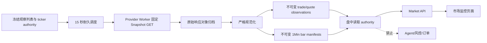

# NEXUS 分钟级盘中市场监控设计规格

**日期：** 2026-08-28
**状态：** 设计冻结，可生成实施计划
**范围：** 美股观察列表的只读盘中 Snapshot、1 分钟波动指标、证据展示与默认关闭的生产采集门禁
**明确排除：** 高频交易、浏览器直连数据商、由盘中指标生成订单、Agent 读取盘中流、复星写操作、实盘、部署、真实凭据和付费订阅激活

## 1. 背景与问题

当前 NEXUS 已有来源感知的市场页面、`LatestQuote`、`PriceSeriesManifest(interval=1Min|1Day)`、原始对象归档、耐久 Job 和前端 15 秒轮询，但运行闭环仍缺三部分：

1. 生产采集只执行收盘后的 `1Day` 历史 bars，没有盘中 Snapshot 调度；
2. `latest_quotes` 对 `(instrument_id, source, feed)` 的唯一约束只能保存一行，无法同时满足不可变审计和持续更新；
3. Market API 的历史 series loader 只在测试中注入，生产组合根不会从数据库读取已准入的 bar authority。

因此页面可以展示测试 fixture，却不能在不破坏权限边界的前提下持续展示真实盘中变化。本规格补齐分钟级只读监控，但不把它升级为交易权威。

## 2. 产品目标

首个版本面向单一用户的美股观察列表：

- 美股正常交易时段内，每 15 秒最多执行一次批量 Snapshot 读取；
- 单批最多 30 个观察标的，严格绑定冻结的内部 instrument ID 与当日 ticker；
- 保存最新成交、买卖盘和最新 1 分钟 bar 的来源、feed、交付口径、观察/可用/接收时间、内容哈希与原始对象证据；
- 为选中标的展示最近完整 1 分钟 bars、5 分钟收益、30 分钟收益、30 分钟高低区间、买卖价差和证据新鲜度；
- 明确区分 `IEX real_time`、`SIP real_time`、`delayed_sip`、Fosun 只读和 fixture，不把 IEX 描述为全市场行情；
- 数据缺失、过期、部分、越界、来源冲突或契约漂移时显示原因并保持只读；
- 盘中指标不进入 Agent 工具、硬风控、订单数量、模拟成交、策略晋级或实盘审批。

成功标准不是“产生交易信号”，而是用户能看见一组时点正确、来源清楚、延迟口径明确的盘中观测事实。

## 3. 方案比较与选择

### 3.1 方案 A：批量 Snapshot 定时采集（采用）

服务端 Provider Worker 每 15 秒对固定 `https://data.alpaca.markets/v2/stocks/snapshots` 发起一个批量 GET。官方 Snapshot 契约一次返回每个 ticker 的 latest trade、latest quote、minute bar、daily bar 和 previous daily bar；NEXUS v1 只准入前三类。

优点：

- 一次请求覆盖最多 30 个观察标的，远低于基础套餐公开的历史 API 调用上限；
- 复用现有固定 HTTPS origin、禁止重定向、响应上限、绝对超时和对象归档；
- 失败是有边界的离散 Job，不需要维护长连接状态；
- 15 秒页面刷新与 15 秒服务端采集口径一致，适合“中长期＋波段”，不制造毫秒级假象。

缺点：相对 WebSocket 多出最多一个采集周期延迟，也不是逐笔 tick 流。

### 3.2 方案 B：Alpaca WebSocket

官方建议在需要最新定价时使用 WebSocket，基础权限可提供 IEX 实时流。它适合逐笔 trades/quotes 和更低延迟，但需要长连接租约、动态订阅、断线补洞、消息重放、背压、流式原始证据切片和单独健康模型。

本阶段不采用。NEXUS 不是高频系统；在没有真实运行数据证明 15 秒 Snapshot 不足前，引入长连接会增加远高于产品收益的运维复杂度。

### 3.3 方案 C：浏览器或 API 请求时直连 Provider

不采用。它会让页面刷新频率决定外部成本，模糊 Provider 密钥域，让慢请求占用用户 API，并使浏览器读取动作产生不可控外部副作用。

## 4. 稳定边界

盘中监控是新的只读数据域：



权限规则：

- 只有 `provider` 运行域持有 Alpaca 数据凭据；Web、BFF、Engine API、Agent Worker 和 Broker Worker 均不可见；
- 普通 `app` profile 不包含盘中采集配置，也不产生外部请求；
- `NEXUS_INTRADAY_MONITOR_MODE` 默认 `disabled`；只有显式 `production` 且完整配置时才调度；
- fixture 测试通过依赖注入运行，不允许 production 配置失败后回退 fixture；
- 盘中响应只能由 Market 页面读取，不能被 Agent 工具注册表或交易模块导入。

## 5. Provider 契约

### 5.1 固定请求

生产 transport 只允许：

```text
GET https://data.alpaca.markets/v2/stocks/snapshots
```

查询键严格等于：

- `symbols`：按 ticker ASCII 升序、逗号连接，1–30 个；
- `feed`：`iex | sip | delayed_sip`；
- `currency=USD`。

不得接受调用方 URL、path、method、headers、任意 query、通配符或 symbol 字符串。ticker 必须由数据库 instrument alias authority 在调度时解析。HTTP 层继续拒绝重定向、动态 origin、超过 8 MiB 的响应和超出绝对截止的重试。

### 5.2 feed 与费用口径

- 推荐低成本配置：`feed=iex`、`delivery_mode=real_time`；界面必须显示“实时 IEX，仅覆盖 IEX”；
- `feed=sip` 只有在用户另行确认订阅权限与费用后才能配置；代码不能根据成功响应推断已购买权限；
- `feed=delayed_sip` 必须配置 `delivery_mode=delayed`，界面显示“延迟 SIP”；
- feed 与 delivery mode 不一致时启动失败，不发请求。

### 5.3 严格响应

JSON 使用 duplicate-key rejecting parser，并以 `Decimal` 直接解析 JSON 数字，禁止先转二进制 float。顶层只接受请求 ticker 的键；每个 ticker 对象只允许冻结的 `latestTrade/latestQuote/minuteBar/dailyBar/prevDailyBar` 键，其中后两项只保留在原始证据、不进入业务表。未知 ticker、未知字段、重复键、非对象、超限字段、非有限或非正价格、负成交量、无时区时间戳、high/low 关系错误会拒绝整批业务落库，但原始失败证据只保留在受控对象域，不进入 API 错误。

每个 ticker 只准入：

- `latestTrade`: price、timestamp 和稳定 provider trade ID（存在时）；
- `latestQuote`: bid price、ask price、timestamp；
- `minuteBar`: OHLCV 和 bar 起始时间。

`dailyBar`、`prevDailyBar` 和任何新增字段不自动进入业务模型。缺少其中一类允许保存其余类别，但批次结果为 `INTRADAY_SNAPSHOT_PARTIAL`。

## 6. 调度与 Job

新增 `collect.intraday_snapshot`：

- queue：`general`；优先级低于日终质量冻结和交易相关任务；
- schema：`intraday_snapshot_job_v1`；
- retry：`AUTOMATIC_SAFE`，最多 3 次；
- handler timeout：10 秒；
- 业务有效期：bucket 结束后 45 秒，超时后 `skipped/INTRADAY_BUCKET_EXPIRED`，不读取旧 bucket；
- Job key：`(job_type, XNYS session, 15-second UTC bucket, symbol_set_hash)`；
- 每个 bucket 最多一项，数据库唯一键负责并发幂等。

调度只在数据库冻结且已发布的 XNYS session authority 满足 `open_at <= now < close_at` 时运行。它读取 default private watchlist，按 ticker、instrument ID 排序，要求 1–30 个有效美股 USD instrument。空观察列表不入队；超过 30、ticker authority 冲突或日历 authority 缺失时不调用 Provider，并记录稳定的调度结果码。

Job payload 冻结：

- calendar authority ID 和 session；
- bucket start/end；
- 每个 instrument ID 与 ticker；
- ordered symbol-set SHA-256；
- feed、delivery mode 和 transport contract hash。

Handler 在网络前重算 payload；配置、calendar、bucket、symbol hash 或 contract hash 不匹配立即 dead-letter。请求成功后，原始响应、规范化记录和 Job terminal state 在同一业务事务边界完成；对象存储的临时/已归档对象按现有 raw-first 补偿规则处理。

## 7. 数据模型与迁移

新增迁移 `0025_intraday_market_monitor`，不修改任何历史迁移。

### 7.1 `latest_quotes` 变为追加式 observation

保留表名和主键以兼容现有 FK，但更正语义：每行是一个不可变 trade、quote、snapshot 或 fixture observation，而非可更新投影。

变更：

- 删除 `uq_latest_quotes_instrument_source_feed`；
- 新增 `event_kind = trade | quote | snapshot | fixture`；
- 新增 `content_hash CHAR(64)`；
- 新增可空 `data_artifact_id -> data_artifacts.id`，非 fixture 必须非空；
- 新唯一键 `(instrument_id, source, feed, event_kind, observed_at, content_hash)`；
- 索引 `(instrument_id, source, feed, event_kind, observed_at DESC, available_at DESC)`；
- 约束 `available_at >= observed_at`、`received_at >= available_at`；
- 所有非空价格必须大于 0，bid/ask 同时存在时 `bid <= ask`；
- `trade` 必须只有 `last`，`quote` 必须有 bid/ask，`snapshot`/`fixture` 至少有一个价格。

历史行按字段形态回填 `fixture` 或 `snapshot`，使用 PostgreSQL `pgcrypto` 对规范化旧字段生成 content hash。迁移前后引用这些行的 paper execution FK 保持不变；之后禁止 UPDATE/DELETE 已存在 observation 的业务字段。

### 7.2 `intraday_bar_set_authorities`

1 分钟 bars 复用 `data_artifacts`、`price_series_manifests` 和 `price_bar_records`，但不能使用 Agent/回测的 `PriceBarSetAuthority`。新增独立 authority：

- `price_series_manifest_id`、`evidence_ref_id` 唯一；
- `source_policy_id` 固定为 `intraday_monitor_policy_v1`；
- source/provider object/revision/content hash/byte length/bar count/first observed/last observed/available_at；
- policy version 固定 `intraday_monitor_authority_v1`；
- 只接受 manifest `interval=1Min`；
- 数据库触发器重算 bar 内容哈希、数量、时间边界和 evidence owner，禁止伪造或事后修改。

现有 `PriceBarSetAuthority` 继续只代表研究、回测和订单所使用的冻结价格证据。两个 authority 表不会互相引用或自动晋级。

### 7.3 盘中 source policy

新增不可变 `source_policies` 记录：

```json
{
  "priority": ["fosun", "alpaca", "fixture"],
  "fosun": {"mode": "read_only", "operation": "fosun_get_bars", "market_scope": "US"},
  "alpaca": {
    "feeds": ["iex", "sip", "delayed_sip"],
    "delivery_modes": ["real_time", "delayed"]
  },
  "fixture": {"delivery_mode": "fixture"},
  "purpose": "display_only_intraday_monitor"
}
```

Fosun 只有在对应 read-only admission 有效时才可选中。不同来源的 bar/quote 不做字段级拼接；选中的 trade、quote 和 minute bars 来源不一致时整体质量为 `PARTIAL/INTRADAY_SOURCE_MISMATCH`。

## 8. 采集落库

一个 Snapshot 原始响应只归档一次，并建立 `DataArtifact(schema_version=alpaca_stock_snapshots_v1)`。同批所有非 fixture quote observations 引用该 artifact。

- latest trade 生成一行 `event_kind=trade`；
- latest quote 生成一行 `event_kind=quote`；
- minute bar 为每个 instrument 生成或复用一个 `1Min` manifest，并由 `intraday_bar_set_authorities` 冻结；
- 重复 Snapshot 通过 observation 唯一键和规范化 Parquet SHA-256 幂等；
- 同一分钟的上游修订产生新的 immutable manifest，读取端按 `available_at` 和 authority ID 选择在 decision time 可见的最后修订；
- 任一 DB 约束、artifact owner 或 authority 重算失败，整批数据库事务回滚，不留下部分可读状态。

原始响应不得包含账户或交易数据；错误日志只记录 provider、operation、bucket、symbol count、attempt、safe result code 和耗时，不记录 ticker 列表、headers、URL query、response body、凭据或原始错误文本。

## 9. 盘中读取与确定性指标

Market API 对选中 instrument 同时返回日线历史和独立 `intraday_monitor`。生产组合根默认从数据库加载已准入 authority；测试仍可注入 loader。

读取流程：

1. 以 decision time 查询每个 source/feed 最新、可见、不可变的 trade 和 quote observation；
2. 加载最近 90 分钟的 `intraday_bar_set_authorities`，对同一 bar timestamp 选择当时可见的最新 revision；
3. 只保留已完整结束的 1 分钟 bar，即 `observed_at + 1 minute <= decision_time`；
4. 按盘中 source policy 整组选择，不跨来源拼 bars；
5. 最多返回最近 60 根完整 bar。

服务端使用 `Decimal` 计算并返回字符串：

- `return_5m = last_complete_close / close_at_or_before_5m - 1`；要求覆盖连续 6 根；
- `return_30m`；要求覆盖连续 31 根；
- `range_30m = max(high) / min(low) - 1`；要求连续 30 根；
- `spread_bps = (ask - bid) / ((ask + bid) / 2) * 10000`；要求同一来源最新 quote 且不陈旧；
- `quote_age_seconds` 和 `bar_age_seconds`；由服务端 decision time 计算为整数。

一分钟序列存在缺口、时间重复、未来数据、负 volume、source mismatch 或 quality flag 时，对应指标为 `null`，原因明确。不得插值、前向填充、用最新 trade 合成 bar、用日线替代分钟线或从客户端补算。

质量状态：

- `ready`：交易时段内，trade/quote 不超过 45 秒，最后完整 bar 不超过 90 秒，指标窗口完整且来源一致；
- `partial`：至少有一种可展示事实，但窗口不完整、来源不一致、存在可解释 quality flag 或 cross-source divergence；
- `stale`：交易时段内 trade/quote 超过 45 秒或 bar 超过 90 秒；
- `outside_session`：当前不在冻结 XNYS 正常交易时段；保留最后事实但不计算 age 告警；
- `unavailable`：没有可准入事实或 authority 无效。

这些状态只解释数据质量，不表达看涨、看跌、买入、卖出或风险承受能力。

## 10. API 契约

`GET /internal/v1/market` 保持原查询面，不增加外部调用。`MarketPageResponse` 新增可空：

```text
intraday_monitor: IntradayMonitorResponse | null
```

`IntradayMonitorResponse` 严格字段：

- instrument ID；
- `status`；
- source、feed、delivery mode；
- last/bid/ask；
- trade/quote/bar 各自 as-of；
- `return_5m`、`return_30m`、`range_30m`、`spread_bps`；
- quote/bar age；
- sample count；
- quality reasons；
- 最多 60 根 `IntradayBarResponse(observed_at, OHLCV, available_at, quality_flags)`。

所有 Decimal 仍是字符串。响应不含 Provider request ID、artifact URI、ticker 查询串、原始 payload、凭据存在性或任何账户字段。BFF 继续只代理同一 GET，浏览器不会获得新写入口。

## 11. 页面设计

现有 `/market` 双栏结构保留。选中标的的“报价证据”下增加一个独立的“盘中波动观察”区域：

- 顶部明确显示 `实时 IEX（仅 IEX）`、`实时 SIP`、`延迟 SIP`、`Fosun 只读` 或 `Fixture`；
- 四个紧凑事实块：5 分钟收益、30 分钟收益、30 分钟区间、买卖价差；缺失显示“证据不足”而不是 0；
- 一个只展示最近 60 根完整 1 分钟 close 的折线/面积图，横轴使用 UTC 时间并在辅助文案注明美股正常交易时段；
- 可访问的语义数据表作为图表等价物，包含时间、OHLCV、可用时间与质量；
- 数据状态、来源和截止时间始终在图表附近，不依赖颜色；
- `partial/stale/outside_session` 展示稳定原因和最后已知事实；
- 不显示“强烈波动”“买入机会”“止损”等投资判断，也不添加通知、订单或 Agent 按钮。

页面仍按可见 15 秒、后台 60 秒轮询 NEXUS API。轮询只是读取数据库，不直接触发采集或业务写入。移动端按单列排列，数据表允许带标签的横向滚动；200% reflow、键盘、焦点和 reduced-motion 必须通过。

## 12. Agent、风控和交易隔离

以下边界由导入测试和路由测试固定：

- Agent tool registry 不新增盘中工具；
- `nexus.agents`、`nexus.risk`、`nexus.paper`、`nexus.providers.broker` 不得导入 intraday monitor service、response 或 scheduler；
- `LatestQuote` 的 append-only 变更不能改变任何已有 paper execution window 已引用的行；
- intraday bar authority 不满足研究 `PriceBarSetAuthority`，不能用于回测、策略晋级、诊断价格、订单 sizing 或模拟成交；
- 页面读取、质量状态和指标永远不能自动创建 proposal、job、order、approval 或 broker command。

未来若要让某个盘中指标进入决策，必须另行形成 point-in-time 特征规格、回测、前向验证和人工启用，不属于本阶段。

## 13. 配置与 Compose

新增非敏感配置名：

```text
NEXUS_INTRADAY_MONITOR_MODE=disabled|production
NEXUS_INTRADAY_POLL_SECONDS=15
NEXUS_INTRADAY_MAX_SYMBOLS=30
ALPACA_INTRADAY_FEED=iex|sip|delayed_sip
ALPACA_INTRADAY_DELIVERY_MODE=real_time|delayed
```

固定约束：poll seconds 必须为 15，max symbols 必须为 30；它们显式出现在配置只是为了部署审计，不能由环境放宽。production 使用现有 Alpaca key ID/secret，但只有 provider-worker 可见。

- `app` profile 不注入上述变量；
- `provider` profile 默认 monitor mode 仍为 disabled；
- 启用 production 是外部 Provider 请求和凭据操作，必须另行获批；
- Compose 静态测试确认 broker/Fosun/OpenAI 配置不进入 provider-worker，intraday 配置不进入 API/Web/Broker 服务。

## 14. 失败、停止和恢复

稳定结果码至少覆盖：

- `INTRADAY_DISABLED`
- `INTRADAY_OUTSIDE_SESSION`
- `INTRADAY_WATCHLIST_EMPTY`
- `INTRADAY_WATCHLIST_TOO_LARGE`
- `INTRADAY_SYMBOL_AUTHORITY_INVALID`
- `INTRADAY_BUCKET_EXPIRED`
- `INTRADAY_CONTRACT_MISMATCH`
- `INTRADAY_SNAPSHOT_COLLECTED`
- `INTRADAY_SNAPSHOT_REPLAYED`
- `INTRADAY_SNAPSHOT_PARTIAL`
- `INTRADAY_SOURCE_CONFLICT`

Provider 401/403、未知 feed、429 异常、重定向、TLS、响应漂移、对象归档失败或数据库 authority 失败都停止当前 bucket。不得通过放宽 JSON、切换 feed、扩大 symbols、关闭 TLS 或回退 fixture 恢复。

恢复方式是停止新调度、保留最后只读事实和审计、修复配置/契约后等待新 bucket。回滚代码使用 `git revert` 或前向修复；迁移 downgrade 只有在不存在 0025 盘中事实时允许，否则拒绝破坏性降级。

## 15. 测试策略

### 15.1 单元与属性测试

- Snapshot 请求 canonicalization、symbols 上限、feed/delivery 配对；
- duplicate key、unknown ticker、额外字段、float/NaN/Infinity、时间戳、价格与 OHLCV 约束；
- 15 秒 bucket、XNYS session、DST、half-day、空/超限观察列表；
- 指标连续窗口、边界、缺口、重复、未来数据和 Decimal 精度；
- source policy、stale/outside-session 和不跨源合并。

### 15.2 PostgreSQL

- `0024 -> 0025 -> 0024 -> 0025` 空库往返；
- 有盘中事实时 downgrade 拒绝；
- append-only quote observation、幂等重放和并发同 bucket；
- raw artifact owner、intraday bar authority 重算、伪造 hash/evidence/policy 拒绝；
- 生产数据库 loader 不需要测试注入即可读取日线和盘中 authority；
- 旧 paper quote FK 在后续 observation 插入后仍指向原行且内容不变。

### 15.3 API/Web

- Strict OpenAPI/BFF runtime schema、collection bounds、Decimal 字符串和字段脱敏；
- ready/partial/stale/outside-session/unavailable 页面；
- IEX/SIP/delayed 文案、证据不足不是 0、分钟图表与语义表一致；
- 15/60 秒读取轮询不产生外部请求或业务写；
- 375/390/768/1024/1440、200% reflow、键盘、焦点、reduced motion 和 Axe serious/critical=0。

### 15.4 安全与边界

- app/fixture 模式外部 socket attempt 0；
- disabled 模式不会构造 Provider HTTP client；
- 固定 origin/path/query、无重定向、响应上限和截止测试；
- Agent/risk/paper/broker import 命中 0；
- tracked credential-shaped finding 0，日志/错误不含 headers、body、ticker set 或 endpoint query。

## 16. 验收与阶段结论

本地完成时只能报告：

```text
Intraday Monitor offline_ready / external_data_activation_blocked
```

本地验收要求：

- fixture Snapshot 可重复采集、重放和读取；
- 一次有意失败不会留下部分 authority；
- Market API 在没有 test-only loader 时读取数据库日线和盘中证据；
- 页面准确展示分钟指标、来源和延迟口径；
- 所有测试、迁移、静态、构建、浏览器与 socket guard 门禁通过；
- 普通 app、Agent、Broker 和实盘能力不变。

真实激活不属于本实施计划。未来启用前必须单独确认 Alpaca 账号权限、feed entitlement、费用、密钥注入、目标环境、UTC 窗口和停止条件，并先做有界只读 probe。启用 IEX 不代表 SIP，启用 Snapshot 不代表 WebSocket，也不改变复星 Phase 1/3B/4 门禁。

## 17. 外部契约参考

- [Alpaca Stocks Snapshots](https://docs.alpaca.markets/us/reference/stocksnapshots-1)：固定批量 Snapshot endpoint 与 feed 枚举；
- [Alpaca Real-time Stock Data](https://docs.alpaca.markets/us/docs/real-time-stock-pricing-data)：WebSocket 能力和 IEX/SIP/delayed SIP feed 语义；
- [Alpaca Market Data FAQ](https://docs.alpaca.markets/us/docs/market-data-faq)：基础权限 IEX、SIP entitlement 和 latest endpoint 约束；
- [Alpaca Market Data API](https://docs.alpaca.markets/us/v1.1/docs/about-market-data-api)：基础套餐公开的覆盖、调用上限与认证头。

这些页面是设计输入，不是激活证据。真正启用前仍需在批准窗口重新冻结页面版本/内容哈希和账户 entitlement。

## 18. 设计自审记录

- **占位符：** 无 TODO、TBD、待定阈值或隐式用户选择；外部未知均转为激活门禁。
- **时点：** 所有读取绑定服务端 decision time；未来、未完成分钟和迟到修订不会倒灌旧决策。
- **审计：** quote/trade 追加写，1Min bars 使用独立 monitor authority；不修改研究/订单 authority。
- **成本：** 采用每 15 秒单批 Snapshot，最多 30 symbols；不实现 WebSocket、通知和高频指标。
- **安全：** 默认 disabled、固定源、无浏览器 Provider、无 Agent/交易消费、无真实请求。
- **范围：** 本规格是单一可交付工作包；真实 Agent 激活和复星外部门禁保留为后续独立工作。
