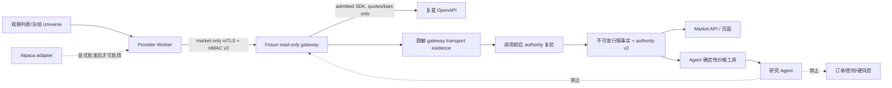

# NEXUS 复星美股行情主源运行时设计规格

**日期：** 2026-08-29

**状态：** 已冻结，允许直接实施

**范围：** 复星美股 L1 行情通过隔离网关进入 Provider Worker、不可变证据、PIT/质量门禁、Agent 日线价格 authority v2、盘中监控和市场页面
**明确排除：** 真实凭据注入、真实 Provider/账户探测、复星或 Alpaca 外部调用、付费订阅、部署、券商写操作、模拟券商写入和实盘订单

## 1. 结论

NEXUS 的产品决策保持不变：美股价格数据优先使用复星，Alpaca 仅作为默认关闭的可选补充；SEC 与 FRED/ALFRED 是独立研究数据域，不随 Alpaca 市场数据开关变化。

本次不是把系统从 Alpaca 架构改成复星架构，而是修复实现与已发布来源政策不一致的问题。当前数据库政策已经声明 `fosun -> alpaca -> fixture`，但生产组合、盘中 Snapshot、Agent 日线 authority 和网关调用身份仍硬编码或仅接受 Alpaca。仅删除 Alpaca 配置会使系统进入 `unavailable/abstain`，不会自动获得复星数据。

冻结后的运行拓扑为：



复星真实激活仍由现有 SDK admission 和 read-only activation runbook 单独控制。本地实现完成不等于真实接口已可用。

## 2. 复星与 Alpaca 的职责差异

| 维度 | 复星 | Alpaca | NEXUS 决策 |
| --- | --- | --- | --- |
| 账户关系 | 同时提供券商账户、持仓、订单及行情域 | 独立市场数据/交易平台 | 账户事实只来自复星；绝不回退 Alpaca |
| 美股行情 | 已公开 US L1、quote、K 线、分时、逐笔、盘口和推送能力 | Snapshot 可一次返回 trade、bid/ask、minute bar；IEX/SIP 权限清楚 | 首期复星主源；Alpaca adapter 保留但关闭 |
| 覆盖/费用 | 以实际 admission/probe 证据为准，不从文档宣传推断实时性或历史深度 | Basic 通常是 IEX；SIP/更高额度涉及相应权限或付费 | 未证明的复星延迟一律 `unknown`；不为补全字段自动购买 Alpaca |
| 安全边界 | SDK、API key、客户端私钥、服务端公钥和出站白名单集中在 gateway | Provider Worker 固定 HTTPS client | 两者都不能进入 Web/Agent；复星额外经过独立 gateway |
| 典型补充价值 | 同账户行情、券商事实一致性 | 独立交叉验证、SIP、已知历史深度、批量 Snapshot | 只在第 12 节触发条件成立并另行批准后启用 Alpaca |

已核对的公开来源：

- 复星官方 `fw-trading`：<https://github.com/fosunwealth/fw-trading>
- 复星 Market OpenAPI：<https://openapi-docs.fosunxcz.com/specs/public/market/market/openapi.yaml>
- 复星 Push OpenAPI：<https://openapi-docs.fosunxcz.com/specs/public/market/push/openapi.yaml>
- Alpaca Market Data 权限说明：<https://docs.alpaca.markets/us/docs/about-market-data-api>
- Alpaca IEX/SIP FAQ：<https://docs.alpaca.markets/us/docs/market-data-faq>

公开文档只能确定接口能力，不能替代 NEXUS 的 license、SDK、TLS、entitlement、延迟、请求预算或真实覆盖 probe。

## 3. 数据域政策

| 数据域 | 首选 | 次选 | 首选不可用时 |
| --- | --- | --- | --- |
| 复星账户、现金、持仓、订单、流水 | 复星 broker read-only | 无 | `BROKER_STALE`，不回退 |
| 美股日线、回测、Agent 价格、paper 参考价 | 复星 bars authority v2 | 经批准的 Alpaca | 无合格源时 abstain |
| 盘中显示 | 复星 quote + 完整 minute bars | 经批准的 Alpaca Snapshot | 显示 unavailable/partial，不生成信号 |
| 公司行动 | 独立 capability；现有 Alpaca adapter 不随价格开关自动启用 | 待单独设计 | unavailable |
| 财报 | SEC | 无自动回退 | unavailable/abstain |
| 宏观 | FRED/ALFRED | 无自动回退 | unavailable/abstain |

系统只选择完整来源序列或同一来源的事实集合，不跨来源拼接 bid/ask、last 或 bars。来源冲突阻断需要完整价格权威的后续动作；盘中显示只告警。

## 4. 信任域与最小权限

### 4.1 进程权限

- `fosun-gateway` 是唯一持有 `FSOPENAPI_*`、SDK admission、Provider base URL 和出站网络能力的进程。
- `provider-worker` 只持有 market-only 网关 mTLS 客户端证书、HMAC 身份、Provider 数据库角色，
  以及独立的 market-prefix 对象存储 principal；不持有账户 ID 加密密钥。对象键被运行时固定在
  `provider/market`，永久证据只 Put/Get，Delete 仅限 `temporary/market` 子树。
- Provider 数据库角色对 status/capability/已有 artifact/manifest 只有读取权；authority 校验与这些输入的变更使用同名事务级 advisory lock 串行，不以 `SELECT FOR SHARE` 换取隐含 `UPDATE` 权限。
- Provider 数据库凭据必须直接认证为独立 login role；`SET ROLE`、出入两个方向的 membership、任意非系统 schema 权限、Provider 或 `PUBLIC` 的 column/sequence ACL，以及 allowlist 外 table/partition/view/materialized-view/foreign-table 权限或 grant option 均使启动失败。RLS helper 固定 `search_path=pg_catalog, public, pg_temp`，bypass policy 还核对其绑定的 catalog `pg_has_role` OID。
- `broker-worker` 使用另一组 mTLS/HMAC 身份，只能调用组合、订单列表和现金流水读取；它不拥有行情采集队列。
- Web、BFF、API、general worker、Agent 和 Strategy R&D 均不持有任一网关客户端身份。
- 复星 gateway profile 可由 `provider` 或 `broker` 显式启动；普通 `app` profile 不启动它。

既有回测审计要求 authority/corporate-action INSERT 同事务写入 publication mark，而受限
Provider 不能直接写该标记表，也不得因 bar INSERT 获得回测成员表读权。迁移因此保留
两个 owner-controlled、trigger-only `SECURITY DEFINER` bridge，都固定
`search_path=pg_catalog, public, pg_temp`：publication bridge 只接受两张允许表的无条件、
非约束、非延迟、无参数 `AFTER INSERT FOR EACH ROW` trigger 并只追加 public-qualified
mark；price-bar guard 只接受 `price_bar_records` 的无条件 `BEFORE INSERT FOR EACH ROW`
trigger，并仅判断对应 manifest 是否已被回测冻结。Provider、`PUBLIC` 和其他非 owner 均无直接
`EXECUTE`；startup probe 对全部非系统 schema 的 definer 精确集合、精确源码/owner/ACL、三个
owner-rights trigger，以及 Provider 可写表上 60 个非内部应用 trigger 的启用状态、时机、函数归属、
配置与函数体摘要 fail closed。

### 4.2 HMAC v2

现有 HMAC v1 未把 `actor_id` 与 `request_id` 纳入签名，不能作为 principal 授权依据。由于真实 SDK 尚未激活，本次直接关闭 v1 并使用 v2：

nonce 保留期以签名时间戳的最晚有效时点计算，而不是首次到达时点。
服务端不接受未来时间戳。生产 nonce 写入持久 SQLite journal，正常重启继续拒绝
已用 nonce；同一持久卷的排他 lease 使第二个 Gateway 进程在启动时失败。每次生产
进程启动都进入新的 61 秒认证拒绝窗口，覆盖旧 snapshot 无法由卷内状态自证的问题；
持久化 clock high-water mark 使墙钟回拨期间持续拒绝认证。readiness/Compose health
还要求 lifespan owner PID 存活且 TCP listener 已建立。支持的部署固定一副本；任何
外部编排也必须让所有候选进程挂载同一个支持 POSIX lock 的 journal 卷，不得使用
独立 replay state 重叠运行。

```text
hmac-v2\n
POST\n
canonical_path_and_query\n
unix_timestamp\n
nonce_uuid7\n
actor_id\n
request_id_uuid7\n
sha256(body)
```

请求必须包含固定版本头、key ID、timestamp、nonce、actor ID、request ID、body hash 和 signature。服务端由 key ID 注册表派生 principal，并要求请求 actor ID 与注册 principal 完全相等；不能由调用方自报角色。

固定授权矩阵：

| principal | 允许 operation |
| --- | --- |
| `nexus-broker-worker` | `fosun_sync_portfolio`、`fosun_list_orders`、`fosun_list_cash_flows` |
| `nexus-provider-worker` | `fosun_get_quotes`、`fosun_get_bars` |

`fosun_capabilities` 与 `fosun_sync_accounts` 不授予常驻 worker；未来若需要，使用独立 bootstrap 身份。越权统一返回 404，transport 调用计数为零。broker/provider 的 current/previous key ID、secret 和客户端证书必须独立；所有配置 key ID/secret 跨角色唯一。

### 4.3 数据真实性 TCB 与非目标

`provider-worker` 是受信任的数据接入根（normalization/writer TCB），不是需要由
`fosun-gateway` 防御的敌对租户。它负责校验 gateway 合同、保存收到的字节、规范化事实并以
Provider 数据库角色发布 authority；因此其进程完整性、已审查镜像和运行身份是行情真实性的
前提。`fosun-gateway` 的隔离目标是把 Provider 凭据、出站网络与固定只读 operation 面从
Web、Agent、general worker 和 broker 域中剥离，不是对已攻陷的 `provider-worker` 提供
gateway-origin 的密码学证明。

本阶段的 `immutable` 只表示事实提交后不能更新或删除，血缘哈希可检测已提交数据的漂移；它
不表示能够阻止一个已获得 Provider 数据库写权限和 market-prefix 对象存储权限的恶意 worker
自造一套内部自洽的行情事实。该进程一旦完整性未知，运维必须进入人工 incident stop：停止
provider profile、禁用集成，并禁止平台继续作出依赖这些事实的新决策。现版本不能自动检测
worker compromise，也不能自动撤销此前冻结的事实；恢复前必须单独处置并重建信任。若未来把“抵御被攻陷的 Provider
Worker”纳入威胁模型，必须先单独设计 gateway-only 响应签名、独立验证/authority writer、
重放约束和新的密钥域；不能把现有 HMAC 请求签名或 create-only 存储宣称为 origin attestation。

### 4.4 TLS

- `read_only` transport 只允许 `NEXUS_ENV=production` 且 server mTLS 配置完整；development/test 只能 fixture。
- Gateway client 固定 HTTPS origin、证书/私钥/CA、`trust_env=False`、禁重定向、10 秒绝对 deadline 和响应字节上限。
- mTLS 负责连接认证，HMAC principal 负责 operation 授权；任一成功都不能替代另一项。

## 5. Provider 运行配置

新增显式市场模式：

```text
NEXUS_MARKET_PROVIDER=fosun|alpaca
NEXUS_ALPACA_MARKET_MODE=disabled|enabled
PROVIDER_OBJECT_STORE_PREFIX=provider/market
```

默认 `fosun + disabled`。规则：

- fixture 模式不构造任何生产 client，也不读取 secret value；
- production + Fosun 只要求复星 market gateway、SEC 和 FRED 配置，不要求 Alpaca key；
- production + Alpaca 必须同时显式 `ALPACA_MARKET_MODE=enabled` 并满足现有 feed/delivery/credential 门禁；
- Provider 的 `PROVIDER_OBJECT_STORE_*` principal 必须与 app/general worker 的
  `OBJECT_STORE_*` 不同；bucket/versioning/prefix/IAM 由激活流程预置，Provider profile
  不运行通用 `object-store-init`；
- 禁止配置错误时回退 fixture 或另一 Provider；
- SEC/FRED 配置与 Alpaca 市场模式独立；
- `repr`、验证错误和日志不能包含 secret、证书路径内容、URL query 或原始 body。

Fosun 首期固定：

- `feed=l1`；
- `delivery_mode=unknown`，除非 activation capability 明确证明 `real_time` 或 `delayed`；
- ticker 由 PIT instrument alias 解析成唯一 `us{SYMBOL}`，调用方不能传任意 Provider code；
- 每批 quote 1–10 个 symbol；不得超过 admission 记录的请求预算。

## 6. Gateway market 合同

### 6.1 请求

`fosun_get_quotes`：1–50 个唯一、规范排序且匹配 `^us[A-Z][A-Z0-9.-]{0,14}$` 的 code。

`fosun_get_bars`：一个合格 code、`day|minute`、成对出现且有时区的 start/end、`start <= end`、limit 1–500。不能传 URL、HTTP method、SDK method、headers 或未注册参数。

### 6.2 响应

Gateway 只返回脱敏、严格、gateway-owned JSON；Provider 原始账户或 transport 对象永不跨边界。Provider Worker 保存收到的精确 gateway HTTP JSON 字节，名称固定为 **gateway transport evidence**，不能误称为 Provider raw body。这里的 `gateway-owned` 描述响应合同的生产责任，不构成对敌对 Provider Worker 的独立密码学来源证明。

quotes 必须与请求 code 集合完全一致；缺价以 `price=null` 和 `PARTIAL` 表达，额外 code 拒绝整批。由于当前冻结 SDK 合同未提供可靠 Provider quote timestamp：

- `QuoteItem.as_of` 是 gateway receipt time；
- Engine 写入 `FOSUN_PROVIDER_TIMESTAMP_UNAVAILABLE`；
- 它不能被描述为 Provider observed time，也不能产生 `ready` 质量。

bars 必须匹配请求 code/window/limit，严格按 timestamp 升序且无重复；价格必须为有限正 Decimal、volume 非负、OHLC 关系有效。未来时间、窗口外行、数量超限或乱序拒绝整页业务事实。

Gateway 在 SDK 调用前与返回后都检查 activation expiry；调用跨过 expiry 时返回失败，不发布响应事实。

## 7. 冻结 Provider authority

每次复星外部读取必须在调用前和完整收包后，按**实际 UTC 时钟**调用 `load_fosun_market_admission`。该函数必须验证：

- `ProviderCapability.created_at <= check_time < expires_at`；
- provider=`fosun`、capability=`READ_ONLY`、schema=`1`；
- operation 与 market_scope=`US` 精确匹配；
- `IntegrationStatus.status=read_only`；
- status admitted hash 与 capability contract hash 相同；
- capability 未被当前 invalidation 边界覆盖。

Job payload 冻结 capability ID、created_at、expires_at、contract hash、status ID/version、source、operation、feed、delivery mode 和 source-policy version。调用前/后任一字段漂移时：

1. 精确 gateway transport bytes 仍以 create-only 方式归档；
2. 不写 LatestQuote、PriceSeriesManifest、bar authority 或 Agent evidence；
3. Job 以稳定的 authority-changed 结果结束；
4. 不重试到另一 Provider。

## 8. 数据库 authority v2

新增迁移，不修改历史迁移和 v1 事实。

### 8.1 事实绑定字段

`price_series_manifests` 与 `latest_quotes` 增加可空的：

- `provider_capability_id`；
- `provider_status_id`；
- `provider_status_version`；
- `provider_contract_hash`；
- `provider_authorized_at`。

Fosun 新事实必须全部非空，非 Fosun 必须全部为空。数据库 INSERT trigger 读取 capability/status 并验证 operation、market scope、版本、hash、时间和 read-only 状态。字段被现有不可变边界覆盖，旧事实不能被后来的新授权重新合法化。

### 8.2 不可变政策 v2

新增而非修改以下记录：

- `source_policy_v2`：日线/Agent；
- `quote_source_policy_v2`：last/quote；
- `intraday_monitor_policy_v2`：盘中 bars + observations；
- `agent_price_authority_v2` 与对应 PostgreSQL canonical hash v2；
- `intraday_monitor_authority_v2` 与对应 canonical hash v2。

v2 canonical 文档把 Provider binding 五字段纳入摘要。v1 Alpaca/fixture authority 继续按原函数重放；v2 Fosun authority 只能由新的 v2 prepare/validate 函数创建。policy/version/hash-version 必须是受允许的完整元组，不能混搭。

Agent price v2 只接受：

- interval=`1Day`、source=`fosun`、feed=`l1`；
- delivery mode 已由 capability 证明为 `real_time|delayed`，不能是 `unknown`；
- adjustment=`raw`；
- 完整 PIT Provider binding；
- 所有 bars `quality_flags=[]`；
- 一个 session 恰好一条 bar，时间顺序、instrument、行数与 manifest 一致。

Gateway bars 顶层 `quality=PARTIAL` 是因为网关不持有决策时点的 XNYS 日历 authority，
因而使用的保守 transport marker，不是对每根 bar 的质量通过证明。Engine 只有在重新校验
精确 instrument/区间/顺序，且实际 session 与冻结日历集合完全一致后，才为日线生成空
`quality_flags`；缺任一 session 稳定返回 `FOSUN_MARKET_PAGE_INCOMPLETE`、仅保留原始证据且不创建
manifest/bar/authority。因此这一转换是 Engine 基于独立冻结 authority 的确定性重评估，
不是将 Gateway 的 `PARTIAL` 盲目提升为 `PASS`。

因此首期以 `delivery_mode=unknown` 激活时可以安全展示/归档，但 Agent、回测、paper 与订单价格 authority 继续 abstain，直到真实 activation 证据证明交付口径。这是预期的 fail-closed 行为。

### 8.3 PIT 读取

读取端只使用事实自身冻结的 capability/status 版本和 `provider_authorized_at`，capability 生效/过期窗口也对该冻结时点校验，不以查询时刻或未来新授权补签旧事实。当前 Provider 被禁用后不再产生新事实；历史事实仍可审计，但超过 stale/数据窗口后不能支持当前决策。所有 `timestamptz` 到交易日的转换显式使用 UTC，不依赖数据库 session `TimeZone`。

## 9. 盘中采集

Job schema 升为 `intraday_snapshot_job_v2`，保留 job type。每 15 秒最多一个 bucket：

- 每个 bucket 一次批量 quote；
- 仅 `bucket_start.second == 0` 时读取每个 symbol 的最近两根 minute bars，并只发布已完整结束的 bar；
- Fosun 最多 10 个 symbol，确保在 gateway 的 2 QPS / 30 RPM 保守预算内；
- handler deadline 30 秒，bucket 结束后 45 秒失效；
- Alpaca 显式启用时保留既有最多 30 symbol 的单 Snapshot 请求。

Fosun last 使用 `event_kind=snapshot`，bid/ask 保持 null；绝不能设置 `bid=ask=last`。缺盘口时 `spread_bps=null`，质量原因包含 `INTRADAY_BID_ASK_UNAVAILABLE`。quote timestamp 缺失、delivery unknown、minute window 不完整或任何 quality flag 都使状态至少为 `partial`。

批次原始证据 schema 按来源区分：`fosun_gateway_market_snapshot_v1` 或 `alpaca_stock_snapshots_v1`。同一批多次 gateway 响应以有界、确定性的 envelope 保存每个 operation、request ID、body digest 和精确 body bytes。

## 10. 日线采集

`collect.market` 根据显式市场模式构造单一 Provider：

- Fosun 使用 `adjustment=raw`、limit 500、最多 400 天窗口；
- Alpaca 保持现有显式 feed/delivery；
- 复星 bars 请求前后冻结并比较 authority；
- 每页 raw-first 归档，严格规范化后才创建 manifest/authority；
- 响应为空、部分、窗口外、contract mismatch 或 authority 漂移时不发布序列；
- 不自动调用 Alpaca 补洞。

## 11. API 与页面

现有 Market API 字段足以表达 `source/feed/delivery_mode/quality/quality_reasons`，不新增交易含义。页面必须：

- 复星显示“复星 L1（只读）”，不再显示泛化英文标签；
- `delivery_mode=unknown` 显示“实时性未获证明”；
- 无 bid/ask 时显示“盘口未提供”，而不是笼统的数值错误；
- 质量 reason 映射为可读中文，同时保留机器码用于审计；
- 显示 gateway evidence 的接收时点，不把它标成 Provider 成交时点；
- 无合格主源且 Alpaca disabled 时显示 unavailable，不显示 fixture 或陈旧数据作为替代。

页面和 API 只读；盘中事实仍不进入硬风控或订单创建。Agent 只能消费通过 authority v2 冻结的日线集合。

## 12. Alpaca 客观触发矩阵

触发条件只生成 `ALPACA_ELIGIBLE` 运维建议，不能自动改配置、读取 secret、发请求或购买订阅。

| 场景 | 客观条件 | 允许动作 |
| --- | --- | --- |
| 复星 bars 能力不足 | 未准入、过期、权限缺失、历史深度不足或合同无效 | 评估显式启用 Alpaca 日线 |
| 复星盘中不可用 | 正常交易时段连续超出质量/SLA 窗口，且复星 capability/health 失败 | 评估有界 Alpaca Snapshot |
| 独立验证 | 复星 contract hash 变化、恢复或出现数据争议 | 开启有时限双源验证，不自动切主 |
| SIP 需求 | 用户明确需要全市场 SIP，IEX/复星 L1 不满足 | 先确认 entitlement、费用和预算 |
| 双源冲突 | 日线超过 `max(tick,20bps)` 或盘中超过 50bps | 阻断/告警，不以冲突本身自动切源 |
| 券商事实故障 | 任意账户/持仓/订单错误 | Alpaca 永不作为 fallback |
| SEC/FRED | 独立来源健康 | 与 Alpaca 市场开关无关 |

Alpaca 首次真实启用继续遵循既有有界 probe：1 symbol、最多 2 GET、最长 10 分钟，并要求 entitlement、费用、保留、RLS、停止与回滚证据。

## 13. 失败语义

- 配置缺失：启动失败，零外部请求；
- Fosun admission 缺失/过期：不调度或安全跳过；
- pre/post authority 漂移：仅归档 transport evidence，零业务事实；
- unknown delivery：可展示 partial，不进入 Agent/订单 authority；
- quote 无 Provider timestamp：标记 gateway receipt-only，不计算 ready；
- bars/quote payload 无效：保留受控 evidence，整页业务事实拒绝；
- 复星失败且 Alpaca disabled：unavailable/abstain；
- 任何 Agent 输出：不能改变 source policy、capability、风控或订单状态。

## 14. 验收条件

### 14.1 安全与组合

- broker/provider current/previous key × operation 授权矩阵测试通过；越权 404 且 transport 零调用；
- actor/request ID 篡改导致 HMAC v2 失败；v1 请求拒绝；
- 未来时间戳、每次生产启动后 61 秒内请求、墙钟回拨、重放 nonce、第二个持锁进程和非单副本配置均失败；
- 非 production read_only gateway 拒绝启动；
- Provider Worker 不含 broker external-ID key，broker 不含 market-only key，app/general worker 两者都没有；
- Provider 角色无需 authority 输入的 `UPDATE` 权限，不能直接写 publication mark 或执行其最小 definer；startup probe 对 advisory-lock、`PUBLIC`/column/sequence ACL、definer 与全部 Provider 写入 trigger 边界的任何漂移 fail closed；
- Fosun production 配置不要求或构造 Alpaca client；Alpaca disabled 零访问 secret。
- Provider Worker 被明确纳入行情真实性 TCB；它的凭据域不能访问 broker/order 写面，疑似 compromise 时按运行手册人工停机，且不声称现版能自动检测或撤销已冻结事实。

### 14.2 合同与证据

- symbol、集合、bars 窗口/排序/数量/OHLC/volume 的正反例通过；
- gateway 精确响应字节被 content-addressed 保存，schema/source 正确；
- authority 在调用前创建时间、调用中失效、响应后 version/hash 漂移都 fail closed；
- 漂移路径只增加 raw artifact，LatestQuote/manifest/authority 为零；
- Fosun fact/manifest 缺任一 binding 或 hash 不符时，应用和直接 SQL 都失败；
- v1 authority 可重放，v2 Fosun authority 摘要覆盖完整 binding，迁移 upgrade/downgrade 测试通过。

### 14.3 数据与产品

- Fosun quote 仅产生 snapshot-last，bid/ask/spread 保持 null；
- receipt-only timestamp 与 unknown delivery 必须 partial；
- minute bar 只有完整结束后可见；无前视、无跨源字段拼接；
- 有效复星是第一来源；Alpaca disabled 时不出现自动 fallback；
- Agent 仅接受满足 v2 且 delivery 已证明的干净日线；否则 abstain；
- API、页面、OpenAPI、类型生成、可访问性和窄屏 E2E 通过。

### 14.4 完成证据

- Python offline suite、PostgreSQL integration suite、gateway suite、Web unit、lint、typecheck、build 和 E2E 全部通过；
- 独立代码审查与安全审查无未处理的 Critical/Important；
- secret scan 不含真实 key、凭据内容或认证文件；
- 工作树只含目标改动并完成本地提交；
- 不执行真实 Provider 调用、部署或任何订单。

## 15. 回滚

- 运行回滚：保持 `NEXUS_INTRADAY_MONITOR_MODE=disabled`，停止 provider profile；普通 app 不受影响。
- 来源回滚：把 production market mode 置为 disabled/fixture 需要显式运维变更；不能自动切到 Alpaca。
- 数据库回滚：只允许按 `0029 -> 0028 -> 0027` 逆序执行；0029 在存在 transport lineage/freshness 引用时、0028 在存在 Fosun v2 事实或受限 Provider writer 时、0027 在存在 v2 Fosun 事实/authority/引用时分别 fail closed。历史不可变证据不删除，也不能跳过中间 guard。
- 代码回滚：revert 本次提交；不修改历史迁移或 Git 历史。

## 16. 实施裁决

1. **Gateway transport evidence 而非 Provider raw。** Provider raw 不跨隔离边界，代价是无法在 Engine 内独立重放 SDK 私有原始对象；gateway contract 和 fixture 承担反腐层验证。
2. **HMAC v2 直接替换未激活的 v1。** 代价是所有内部 client/fixture 必须同步升级；收益是 principal 与 request correlation 真正受签名保护。
3. **unknown 先展示、Agent 继续 abstain。** 代价是首次本地接线后不会立刻产生 Agent 可用价格；收益是不把未证明实时性误当作交易权威。
4. **不自动 fallback。** 代价是主源故障时页面可能 unavailable；收益是不会在未批准 entitlement、费用或数据合同下悄悄切换 Provider。
5. **Provider Worker 是数据真实性 TCB。** 当前隔离防止行情进程接触账户/订单能力，但不声称抵御已攻陷的行情写入进程；扩大到该威胁需要新的响应 attestation 与独立 writer 设计，不在本阶段暗中引入新密钥域。
